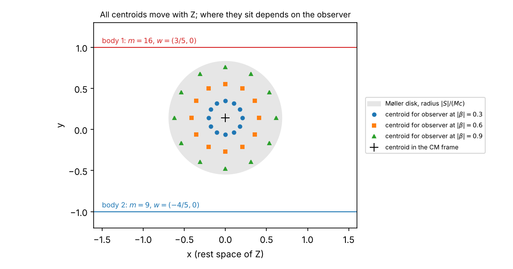

# The many-body mass centre: Oziewicz's last statement, read against standard relativity

> Oziewicz's last word on the centre of inertia is chapter 2 of *Many-body mass-centre* (short version *J. Phys.: Conf. Ser.* 532 (2014) 012021; long version revised 11 April 2017), with corrections he sent by email up to September 2020. **Definition MC0** translates his symbols (`g`, `det g = -c^2`, body `X` with `(gX)X = det g`, clock, groupoid factor `gamma`, binary velocity `v_XY = Y/gamma - X`, Schrödinger energy `E_iG`) into standard covariant relativity. **Proposition MC1**: the binary velocity is the ordinary relative velocity of `Y` in the rest space of `X`; equations (1.7.15) and (1.7.19) to (1.7.23) hold exactly, and the boost that carries `X` to `Y` carries `v_XY` to `-v_YX`, so Einstein's reciprocity holds once the two vectors are compared in one rest space. **Proposition MC2**: the velocity groupoid is the pair groupoid of the set of bodies, so its associativity is automatic and is not a physical difference from the Lorentz group, whose isometries are fixed by Oziewicz's own postulates (1.6.1) to (1.6.5). **Theorem MC3**: the mass centre `Z` of Definition 2.1.3 is the 4-velocity of the total 4-momentum (the centre-of-momentum frame) and `M` is the invariant mass; (2.1.5), (2.1.6), (2.1.7) and (2.1.14) hold exactly for null radiation. **Corollary MC4**: the radicand of (2.1.15) is misprinted (`gamma_ZX - 1` for `gamma_ZX^2 - 1`), and it vanishes without radiation. **Proposition MC5**: the reduced momenta (2.2.4), (2.2.5), (2.2.8), (2.2.10) and (2.2.11) hold exactly without radiation, and (2.2.4) as printed is `c^2` times Planck's momentum, the factor Oziewicz reported missing on 5 September 2020. **Theorem MC6**: in the algebra of observers the mass centre is the idempotent `c = P/M^2`, the only trace-1 idempotent with `cP = P = Pc`; this settles the uniqueness question Oziewicz left open on 16 November 2012 and is the idempotent he described in November 2018. **Proposition MC7**: `Z` fixes the direction of the centre's worldline but not its position; each observer's energy centroid moves with `Z`, displaced by `(S x beta)/(Mc)` (Møller's disk), so the problem of Pryce (1948), which concerns the position, is not addressed. All of it is standard special relativity in another notation; what is not standard is the claim that it is impossible with the Lorentz group. Checked exactly with SymPy; the figure is numerical.

*Ladder abstract — see the [full list](README.md#the-ladder).*

**Status.** Analysis note, step 1 of the ladder. Theorem prefix **MC**.
Companion script: [`src/verify_mass_centre.py`](../src/verify_mass_centre.py)
(Parts A to F and W; §11). Prompted by Bill Page, 1 November 2026: begin where
Oziewicz ended, with the centre of inertia, using his last paper on it, an
earlier project summary of that paper, and the correspondence of his last years.
Derivation and checks were drafted with Claude (Anthropic) and are subject to
review; every claim about what Oziewicz wrote is a reading of the cited page.

---

## 0. What this note asks, inherits and retracts

**Question.** Oziewicz's abstract says that an intrinsic centre of mass of an
interacting many-body system is impossible "within the Albert Einstein theory of
relativity postulating the Lorentz group" and well defined in his group-free
approach (long version, §1.1). What exactly does his chapter 2 define, does it
hold, and does it do what the abstract says?

**Inherits.** Nothing from the ladder: this is step 1. Two earlier pieces of
work in the Project chats (not in this repository) are re-derived here rather
than cited:

- the observer-algebra review of 30 October 2026, whose centre-of-mass section
  found `c = P/M^2` and its uniqueness (now Theorem MC6, re-proved and
  re-checked);
- its comparison of Oziewicz's manuscript *Rival theories of relativity* (eq.
  10.7) with Bill Page's 2012 Maple worksheet (summarised in §1).

**Retracts.** The project-chat summaries of June 2025 ("Relativity Theory:
Centre-of-Mass Analysis" and two related chats) took the paper's claims at face
value. Their statements below are withdrawn; the reason is the section given.

| June 2025 statement | Reason it is withdrawn |
|---|---|
| An intrinsic mass centre exists in groupoid relativity but not with the Lorentz group | `Z` is the textbook centre-of-momentum 4-velocity, Lorentz covariant (§4); the open problem is position (§8) |
| Binary velocities compose associatively, unlike Einstein's | The groupoid is a pair groupoid; associativity is automatic (§3) |
| The groupoid gamma is a different quantity from the Lorentz gamma | It is the same scalar `-g(X,Y)/c^2` (§2) |
| The `gamma`-dependent reduced mass predicts deviations from Kepler for wide binaries, pulsars or cosmic rays | The paper has no dynamics (§6); for wide binaries `gamma - 1` is about `1e-12` (§9) |
| The two-body total mass (2.1.15) as quoted | Misprinted radicand (§5) |
| The Python, Maple and FriCAS sketches of that month (`centerOfMass()` and others) | Not run against any exact check; superseded by `src/verify_mass_centre.py` |

---

## 1. Sources and their history

The paper exists in three versions.

- **Short version (2014).** [Oziewicz 2014](../references/bibliography.md) in *J. Phys.: Conf. Ser.*, 15 pages.
- **Public long version (2015).** *Many-body mass-centre for finite radiation-speed: Homological Algebra approach to relativity theory of position-space and simultaneity*, dated 7 December 2013 with "improved notation" of 31 March 2015, 45 pages, [on Academia.edu](https://www.academia.edu/12338867/Many_body_mass_centre_for_finite_radiation_speed_Homological_Algebra_approach_to_relativity_theory_of_position_space_and_simultaneity). The mass centre is its §8 and the reduced momenta its §9.
- **Last long version (2017).** *Many-body mass-centre: Homological Algebra for relativity of position-spaces*, 62 pages, "Revised April 11, 2017". Oziewicz emailed it to Bill Page on 13 April 2017 as a draft needing serious revision, not ready for ResearchGate. It is not known to be public.

Section and equation numbers below are those of the 2017 version, which is
Oziewicz's last statement. Its chapter 2 is the 2015 §§8-9 with the same
content, renumbered, with the factors of `det g` written in and with the
relative accelerations of §1.8 added. A reader with only the public version can
translate with this table.

| 2017 (this note) | 2015 (Academia.edu) | Difference |
|---|---|---|
| (1.6.6), (2.1.1) `gamma` | (6.3), (8.1) | none |
| (1.7.14), (1.7.15) | (7.13), (7.14) | none |
| (1.7.19)-(1.7.23) | (7.15)-(7.19) | (7.19) is written `2 det g (1 + gamma)(1 - 1/gamma)^2`, equal to (1.7.23) |
| Def. 2.1.3, (2.1.4) | Def. 8.3, (8.3) | 2015 also gives the clock, `gZ = (sum E_ii gX_i - gG)/E_ZZ` |
| Lemma 2.1.5, (2.1.6) | Lemma 8.5, (8.5) | (8.5) omits the `1/det g`: correct only with `c = 1` |
| Lemma 2.1.6, (2.1.7) | Lemma 8.7, (8.6) | (8.6) gives `E_ZG` itself, again with `c = 1` |
| (2.1.11), (2.1.12) | (8.10), (8.11) | (8.11) with `c = 1` |
| (2.1.13)-(2.1.15) | (8.12)-(8.14) | same misprint in (8.14) |
| Speculation 2.1.7 | Speculation 8.8 | none |
| (2.1.18)-(2.1.20) | (8.16)-(8.18) | none |
| (2.2.1)-(2.2.5) | (9.1)-(9.5) | none; the factor `c^2` of Proposition MC5 is missing in both |
| Clarification 2.2.3 | Clarification 9.3 | the radiation relations are written differently; neither is checked (MC-SP5) |
| (2.2.8)-(2.2.14) | (9.8)-(9.14) | none |
| §1.8.3-1.8.4, relative acceleration as a Lie bracket (1.8.9)-(1.8.19) | absent | 2015 discusses acceleration only in words (§1) |

So the units were repaired between 2015 and 2017 in §2.1 but not in §2.2,
which is the part Oziewicz said in 2020 still lacked a factor `c^2`. The
2015 forms are checked with `c = 1` in Part B of the script.

The centre of inertia had a longer history in the correspondence between
Oziewicz and Bill Page. The dates are those of the emails; the quotations are
short and the paraphrases are this note's.

| Date | Source | Content relevant here |
|---|---|---|
| 8-16 Nov 2012 | IARD draft "Center-of-inertia" (unpublished) and emails | Def. 3.4: `(id - c)(sum m_S S + I) = 0`. Bill Page found that `(p + q)^2` is not idempotent and proposed `c = P / tr P` (14 Nov). Oziewicz: "Center-of-inertia must be unique ... Let left this as open problem" (16 Nov). |
| 15 Nov 2012 | Page and Oziewicz, Maple worksheet "The algebra of observers is Frobenius" (unpublished) | The two-body idempotent (5.27) and the family (5.23) of all trace-1 idempotents. Allows `gamma_pq != gamma_qp`. |
| c. 2012-2013 | Oziewicz, *Rival theories of relativity* (manuscript, unpublished) | Ch. 9: total mass (9.6) with an interaction field; Ch. 10, Thm 10.0.11: `c = (1/M^2) sum p_i p_j / gamma_ij`. |
| July 2012 / 2014 | Tallinn talk, published as the short version | Def. 2.1.3 and Lemmas 2.1.5, 2.1.6 as below. |
| 31 Mar 2015 | Long version posted on Academia.edu (dated 7 Dec 2013) | Same mass-centre content as 2017, with `c = 1` in §8. |
| 11-13 Apr 2017 | Long version emailed | "Acceleration for FINITE light speed" added; still a draft. |
| 3 Sep 2018 | Email | Revisits a non-symmetric Minkowski factor (symmetric metric plus a bivector). |
| 28-30 Nov 2018 | Emails | Retracts it: a non-symmetric metric, Minkowski factor and observer idempotent were "total stupidity". A body is its energy-momentum one-form `P` with `P^2 = (det g) m^2`; dividing `P` by its internal energy gives an idempotent of trace 1. Proposes `dP` as the carrier of intrinsic spin. |
| 3 Feb 2019, 4 Nov 2019 | Emails | Absolute rotation with absolute mass; spin in the two-form `dP`, split by the clock `u` parallel to `P`. |
| Aug 2020 | Emails | "Here the center of a mass enters"; Bill Page asks whether dynamics can be written as binary accelerations relative to the mass centre. |
| 5-8 Sep 2020 | Emails | In ch. 2, pp. 35-43, "factor (-det g = c^2) was missing" in the definition of momenta; a revision was promised. None was sent; Oziewicz died later in 2020. |

Two points from this history bear on the reading. The symmetric `gamma` of the
long version ((1.4.13), (1.6.6)) is Oziewicz's settled view: the
non-symmetric variant was explored in 2012 and in 2018 and withdrawn by him in
November 2018. And the factor he flagged in 2020 can be identified exactly
(§6).

---

## 2. Dictionary

**Definition MC0 (dictionary).** Oziewicz works with a symmetric metric `g` on
the module of derivations (1.6.1)-(1.6.2), with `det g = -c^2` in vacuum
(§1.7.4). In what follows `g(X, Y)` means his `(gX)Y`.

| Oziewicz (long version) | Meaning here | Standard name |
|---|---|---|
| material body `X`, time-like derivation, `(gX)X = det g` (1.6.5) | `X = c u_X` with `g(u_X, u_X) = -1` | `c` times the 4-velocity |
| clock `gX / det g` (1.6.6) | the one-form that is 1 on `X` and vanishes on its rest space | simultaneity of `X` |
| `gamma_XY = (gX)Y / det g` (1.6.6), (2.1.1) | `-g(u_X, u_Y)` | Lorentz factor of the relative motion |
| `v_XY = Y/gamma - X` (1.4.7), (1.7.14) | `Y = gamma (X + v_XY)`, `g(X, v_XY) = 0` | velocity of `Y` in the rest space of `X` |
| `Pi_X = ev_{gX} ∘ (X ∧) / det g` (1.7.9) | `Pi_X Y = Y - gamma_XY X` | projection onto the rest space of `X` |
| `E_kk = m_k c^2`, `E_lk = gamma_lk E_kk` (Notation 2.1.1) | rest energy, energy of `k` seen by `l` | |
| radiation `G`, `(gG)G = 0` | a null vector | radiated 4-momentum, times `c` |
| `E_XG = (gX)G / det g` (Def. 2.1.2) | energy of `G` seen by `X` | |
| mass centre `Z`, total mass `M` (Def. 2.1.3) | | §4 |

Symbols used below and not in the table: `m_i > 0` masses; `S = sum_i m_i gamma_iZ`;
`P` the total 4-momentum; `beta` the velocity of an observer, as a fraction of
`c`; `S` in §7 the intrinsic angular momentum (spin) of the system.

The same `gamma` appears whether it is called a groupoid factor or a Lorentz
factor: with `X = c u_X`, `Y = c u_Y`,

```math
\gamma_{XY}=\frac{(gX)Y}{\det g}=\frac{c^{2}\,g(u_X,u_Y)}{-c^{2}}=-g(u_X,u_Y)=\frac{1}{\sqrt{1-v^{2}/c^{2}}} .
```

Warning 1.6.4 says the groupoid factor "conceptually is completely different" from the Fitzgerald-Lorentz factor. They are
the same number; the difference is only in what is taken as primitive.

---

## 3. The binary velocity

**Proposition MC1.** With Definition MC0:

1. `v_XY` lies in the rest space of `X`, and `v_XY^2 = c^2 (1 - 1/gamma^2) = v_YX^2` (1.7.15).
2. Equations (1.7.19), (1.7.20), (1.7.22) and (1.7.23) hold as printed.
3. Let `B` be the boost in the plane of `X` and `Y` with `B X = Y` (so `B Y = 2 gamma Y - X`, and `B` is the identity on the orthogonal complement). Then `B v_XY = -v_YX`.

*Proof.* (1) and (2) are direct: substitute `Y = gamma (X + v_XY)` and use
`g(X, X) = g(Y, Y) = -c^2`, `g(X, Y) = -c^2 gamma`. For (3),

```math
B\,v_{XY}=\frac{B Y}{\gamma}-B X=\frac{2\gamma Y-X}{\gamma}-Y=Y-\frac{X}{\gamma}=-v_{YX},
```

and `B` preserves `g` on the plane (`g(BX, BY) = g(Y, 2 gamma Y - X) = g(X, Y)`,
and similarly for the other pairs). ∎ Checked exactly in SymPy, Part A.

So Conclusion 1.7.9 and §1.7.10 are right that `v_YX` is not `-v_XY` as
vectors: they lie in different rest spaces, the rest space of `X` and that of
`Y`. That is the standard covariant account of relative velocity (for example
Matolcsi 1994). Einstein's reciprocity compares the two
velocities after carrying one rest space to the other, and part 3 shows it holds
then. The "formal contradiction" of §1.7.10 is a comparison of vectors from two
different spaces.

**Proposition MC2 (the velocity groupoid).** Let `H` be the set of bodies
(time-like `X` with `g(X, X) = -c^2`). Since `Y = gamma(v)(X + v)` with
`gamma(v) = (1 - v^2/c^2)^(-1/2)`, the pair `(X, v_XY)` determines `Y`. The
arrows `X -> Y` labelled by `v_XY`, with composition `v_YZ ∘ v_XY = v_XZ`, form
the pair groupoid `H x H`. Its composition is associative and its identities
are the zero vectors `0_X`, one per body, because every arrow is just a pair of
bodies.

This is what the paper's associativity amounts to (§1.4 and §1.7.10:
"associative because they are unique by very definition"). Einstein's addition of
velocities is non-associative (Ungar) because it identifies every rest space
with one fixed rest space, and the identification introduces the Thomas-Wigner
rotation. Both descriptions use the same `g`, and Oziewicz's postulates
(1.6.1)-(1.6.5) (a symmetric metric with `det g < 0` on time-like bodies) fix its
isometry group, which is the Lorentz group. The construction does not avoid the
Lorentz group; every quantity in chapter 2 is built from `g` and the bodies and
is invariant under it. It does not need to name it.

*Analogy.* Two passengers in two trains each measure the other's velocity on
their own map. The two arrows sit on different maps and cannot be added head to
tail until one map is laid on the other. Laying the maps is the boost `B`.
Oziewicz's groupoid keeps the maps separate; Einstein's addition lays them all on
one map.

---

## 4. The mass centre is the centre-of-momentum frame

Definition 2.1.3 defines the mass centre `Z` (a body, `g(Z, Z) = det g`) and
the total mass `M` (`E_ZZ = M c^2`) of bodies `X_i` with radiation `G` by

```math
G+E_{ZZ}\,Z=\sum_i E_{ii}\,X_i .
```

On the right is the free system, on the left the bound system and the
radiation. With 4-momenta `p_i = m_i X_i` this is the conservation law
`sum_i p_i = P_Z + G/c^2`.

**Theorem MC3.** Let `G` be null. Then

```math
M^{2}=\sum_{i,j}m_i m_j\gamma_{ij}-\frac{2}{c^{2}}\sum_i m_i E_{iG},\qquad
Z=\frac{1}{M}\Big(\sum_i m_i X_i-\frac{G}{c^{2}}\Big),
```

and the following hold exactly, with `gamma_i = gamma_iZ` and `E_Zi = gamma_i E_ii`:

- (2.1.5) `E_ZZ = sum_i E_Zi - E_ZG`;
- (2.1.6) `M^2 = sum m_i m_j gamma_ij + 2 sum m_i E_iG / det g`;
- (2.1.13), second line: `M E_ZG = sum_i m_i E_iG`;
- (2.1.7) `(E_ZG / det g)^2 = sum m_i m_j (gamma_i gamma_j - gamma_ij)`;
- (2.1.14), for two bodies: `M^2 - 2M(m_x gamma_ZX + m_y gamma_ZY) + m_x^2 + 2 m_x m_y gamma_XY + m_y^2 = 0`.

Without radiation `Z` is the unit vector along the total 4-momentum and `M` the
invariant mass. With radiation `Z` is the unit vector along `sum_i p_i - G/c^2`.

*Proof.* Contract the definition with `g(Z, ·)`, with `g(G, ·)` and with itself,
using `g(G, G) = 0`. For (2.1.7), let `e = E_ZG / c^2`. Then (2.1.5) reads
`M = S - e` with `S = sum m_i gamma_i`, and (2.1.6) with (2.1.13) reads
`M^2 + 2 M e = sum m_i m_j gamma_ij`. Hence
`e^2 = (M + e)^2 - (M^2 + 2Me) = S^2 - sum m_i m_j gamma_ij`. (2.1.14) is the same
two equations with `e` eliminated. ∎ Checked exactly in SymPy for two and three
bodies with symbolic `gamma_ij`, `m_i` and `E_iG` (Part B).

In the rest frame of `Z`, `e` is the energy of the radiation in mass units,
and (2.1.12) says `e^2 = |sum_i m_i gamma_i v_Zi|^2 / c^2`: the constituents'
total momentum is carried off by the radiation. Lemma 2.1.6 is this momentum
balance.

The relation (2.1.11), `gamma_ij = gamma_i gamma_j (1 - v_Zi · v_Zj / c^2)`, is
the standard composition of Lorentz factors when both velocities are measured
in the same rest space, that of `Z`. The plus sign of Sommerfeld's formula,
which the paper contrasts with it, appears when one of the two velocities is
replaced by its reciprocal, which by Proposition MC1 is legitimate once both are
in one rest space. The two are the same formula.

---

## 5. The two-body total mass

**Corollary MC4.** As a quadratic in `M`, (2.1.14) has the roots
`M = S ± sqrt(S^2 - m_x^2 - 2 m_x m_y gamma_XY - m_y^2)`, and

```math
S^{2}-m_x^{2}-2m_xm_y\gamma_{XY}-m_y^{2}=m_x^{2}(\gamma_{ZX}^{2}-1)+2m_xm_y(\gamma_{ZX}\gamma_{ZY}-\gamma_{XY})+m_y^{2}(\gamma_{ZY}^{2}-1).
```

The radicand printed in (2.1.15) has `gamma_ZX - 1` and `gamma_ZY - 1` in place
of the squares; the difference is
`m_x^2 gamma_ZX (1 - gamma_ZX) + m_y^2 gamma_ZY (1 - gamma_ZY)`, which is zero
only when both factors are 1. The root with the minus sign is the physical one,
since `e = S - M >= 0`. Without radiation the radicand is zero and
`M = m_x gamma_ZX + m_y gamma_ZY`. (SymPy, Part B.)

The radicand is `e^2`. That settles Speculation 2.1.7: the three factors
`gamma_XY`, `gamma_ZX`, `gamma_ZY` are not independent, because `Z` is
determined by the bodies and `G`, so setting `∂M/∂gamma_ZX = 0` with the
others held fixed has no meaning. §2.1.1 on the maximal binding energy is a
bound on `e` from `|sum_i m_i gamma_i v_Zi| <= sum_i m_i |gamma_i v_Zi|`, which
is correct with the corrected radicand.

---

## 6. Reduced momentum and reduced mass

Definition 2.2.2 defines the reduced momentum of body `k` as its momentum in the
rest space of `Z`, `p_Zk = E_kk Pi_Z X_k = E_kk (X_k - gamma_kZ Z)` (2.2.4), and
(2.2.9) defines `mu_kl = gamma_kl E_kk E_ll / E_ZZ`.

**Proposition MC5.**

1. `p_Zk` lies in the rest space of `Z`, and `sum_k p_Zk = p_ZG` with `p_ZG = Pi_Z G` (2.2.5), for any number of bodies and null `G` (checked for three).
2. As printed, `p_Zk = c^2 gamma_kZ m_k v_Zk`, which is `c^2 = -det g` times Planck's momentum `gamma m v` used in Theorem 1.7.8. This is the factor Oziewicz reported missing on 5 September 2020. It is a common factor, so (2.2.5) and every ratio are unaffected.
3. Without radiation, (2.2.8), the two-body (2.2.10) and the three-body (2.2.11) hold exactly as printed.

(SymPy, Part C.) Part 3 was the least expected outcome of the checks: the
three-body formula (2.2.11), with eleven terms, is right. Its radiation terms in
(2.2.8) were not checked (open item MC-SP5).

These are identities for the momentum of each body in the rest space of `Z`,
written in terms of the binary velocities between the bodies. In the
Newtonian limit they become `p_Zi = sum_k mu_ki v_ki` (2.2.14), the usual
reduced-mass decomposition. The `gamma` in `mu_kl` is a definition chosen to make
(2.2.10) hold; it is not a dynamical result, and the paper contains no
equations of motion. The suggestion at the end of §2.2 that a `gamma`-dependent
reduced mass could explain wide-binary data is therefore a suggestion, not a
prediction; §9 gives its size.

---

## 7. The mass centre as an idempotent

The algebra of observers (Oziewicz since 2003; Cruz Guzmán and Oziewicz)
represents a body `X_i` by the idempotent `p_i = X_i ⊗ (clock of X_i)`, with
`p_i p_j p_i = gamma_ij^2 p_i` and `tr p_i = 1`. Write `e_ij = X_i ⊗ clock_j`,
so `e_ij e_kl = gamma_jk e_il`, `p_i = e_ii`, and `p_i p_j = gamma_ij e_ij`.

**Theorem MC6.** Let `P = sum_{i,j} m_i m_j p_i p_j / gamma_ij` and
`M^2 = sum_{i,j} m_i m_j gamma_ij`. Then

1. `P^2 = M^2 P` and `tr P = M^2`, so `c = P / M^2` is an idempotent of trace 1;
2. `c = Z ⊗ (clock of Z)` with `Z = sum_i m_i X_i / M`, and `c p_i c = gamma_iZ^2 c`;
3. `c` is not central (for `n >= 2`);
4. `c` is the only idempotent of trace 1 with `cP = P = Pc`.

*Proof.* `P = sum m_i m_j e_ij = (sum_i m_i X_i) ⊗ (sum_j m_j clock_j)`, a rank-one
operator, which gives 1 and 2. For 4: an idempotent of trace 1 has rank 1;
`cP = P` fixes its image (the image of `P`) and `Pc = P` fixes its kernel (the
kernel of `P`); a projector is determined by its image and kernel. ∎ Checked
exactly in SymPy for two and three bodies with symbolic `gamma_ij` and `m_i`;
for two bodies the uniqueness was also solved directly (Part D).

This is the same `Z` as Theorem MC3 without radiation, and the same `c` as
*Rival theories* (10.6)-(10.7) and the Maple worksheet (5.27). Two answers
follow for the 2012 correspondence:

- **"Center-of-inertia must be unique"** (16 Nov 2012). It is, given Oziewicz's
  own Def. 3.4 read inside the algebra: `(id - c) P = 0` and `P (id - c) = 0`.
  Bill Page's conclusion that the Frobenius structure alone does not fix `c` was
  also right: the masses enter only through `P`.
- **November 2018.** Oziewicz's later description, that a body is its
  energy-momentum one-form and that dividing it by its internal energy gives an
  idempotent of trace 1, is Theorem MC6 with `P` read as the body. The composite
  body is to its constituents what `c` is to the `p_i`.

Without radiation no unit is needed, so the construction also works for five or
more observers in four dimensions, where the algebra has no unit (shown in the
30 October 2026 review; not re-checked here).

---

## 8. What the mass centre leaves open: position

`Z` is a direction, a 4-velocity. A centre of mass in the sense of Pryce (1948)
and Møller (1949) is a worldline: an energy-weighted mean position at one
instant. "One instant" needs a simultaneity, so it depends on the observer.

**Proposition MC7 (Møller).** Let free bodies have total 4-momentum along `Z`,
invariant mass `M` and intrinsic angular momentum `S` (in the rest frame of `Z`).
For an observer moving with velocity `c beta` relative to `Z`, the
energy-weighted centroid of the bodies taken on that observer's hyperplanes of
simultaneity

1. moves with 4-velocity `Z` (it is at rest in the rest frame of `Z`);
2. is displaced from the rest-frame centroid by `Delta = (S x beta) / (M c)`, so all such centroids fill a disk of radius `|S| / (M c)` orthogonal to `S`.

Part 1 holds because each observer's centroid moves with velocity
`P_spatial / E` in that observer's frame, which is the velocity of `Z`. Part 2
is Møller's result (Møller 1949). It was checked exactly in SymPy for one two-body system in 2+1
dimensions (masses 16 and 9, velocities 3/5 and -4/5, `M = 35`, `S = -24`, in
units `c = 1`) and eight observer velocities with rational components, including
`|beta| = 12/13` and `63/65` (Part E). That checks the formula on these cases; the
general statement is Møller's.



*Figure (numerical, Part F).* The rest space of `Z` for the example of Part E.
Body 1 moves right along the top line, body 2 left along the bottom line. Each
marker is the centroid seen by one observer; all are at rest here, and all lie
within the disk.

*Analogy.* Photograph a spinning wheel from a passing train. Seen from the
train, the side of the rim moving against the train carries more energy than
the side moving with it, so the energy-weighted centre is pulled toward that
side, at right angles to both the train's motion and the axle. Every
passenger agrees which way the wheel drifts (that is `Z`); they disagree, by up
to `S/(Mc)`, about where its centre is.

So the paper settles the part of the mass-centre problem that was never in
dispute (the frame) and does not touch the part that is (the worldline). In
Oziewicz's ontology a body is a congruence, a whole position space ("Keres
z-space", §1.2.1, §2.1), and `Z` is a vector field; which integral curve of `Z`
is the centre is not asked (open item MC-SP1). His abstract and §2.1 say the
intrinsic mass centre "does not exist" with the Lorentz group "for finite
radiation-speed", citing Pryce, Møller and Landau-Lifshitz. Those authors meant
the worldline; with the Lorentz group the frame `Z` is standard and unique. The
claim and the construction use the word for two different things. *Corrected by step 4,
CS3* ([`clock_centre.md`](clock_centre.md)): those authors do not say the worldline is
impossible. Pryce's (d) and Møller's centre of gravity are a covariant worldline, and the
paragraph above should not be read as saying it is in dispute.

The disk has a second meaning for the correspondence. Its radius is set by the
spin `S`. Oziewicz's last proposals (November 2018 to November 2019) put intrinsic
spin in the two-form `dP`. If that is right, the object he was looking for in his
last years is exactly what decides the size of the indeterminacy that chapter 2
does not address (open item MC-SP3).

---

## 9. Assessment

| Claim in the long version | Standing after this note |
|---|---|
| Binary velocities are non-reciprocal (Conclusion 1.7.9) | True as vectors in different rest spaces; reciprocal after transport (MC1) |
| Their composition is associative, Einstein's is not (§1.4, §1.7.10) | True, and automatic for a pair groupoid (MC2) |
| The groupoid gamma differs from the Lorentz gamma (Warning 1.6.4) | Same scalar (§2) |
| The Lorentz group is useless | Not used by name, but fixed by postulates (1.6.1)-(1.6.5) (MC2) |
| Def. 2.1.3, Lemmas 2.1.5, 2.1.6, (2.1.14) | Correct for null `G`; standard 4-momentum conservation (MC3) |
| (2.1.15) | Misprinted radicand (MC4) |
| Speculation 2.1.7 | Unsupported: the gammas are not independent (MC4) |
| Reduced momenta (2.2.4)-(2.2.11) | Correct without radiation, up to the factor `c^2` Oziewicz flagged in 2020 (MC5) |
| An intrinsic mass centre is impossible with the Lorentz group and possible here | The frame `Z` exists in both. *Corrected by step 4, CS3:* the worldline is defined by Pryce and Møller with the metric, and the paper gives none |
| A `gamma`-dependent reduced mass may explain wide binaries | No dynamics given; for `v` of 0.5 to 2 km/s, `gamma - 1` is `1.4e-12` to `2.2e-11` (Part W), against claimed anomalies of tens of per cent |

What remains of Oziewicz's own is the presentation: no coordinates, bodies as
derivations, each body owning its rest space, and the mass centre as one more
body defined by conservation. As a way of writing standard relativity it is
consistent and, on the evidence of §§3 to 8, correct once misprints are fixed.
It is not a different theory.

---

## 10. Open items

- **MC-SP1.** *Answered by step 4, CS3: the centre of the clock of `Z`.* Which integral curve of `Z` is the mass centre? In the paper's language: is there an intrinsic point of Keres's z-space, or only the frame?
- **MC-SP2.** The radiation `G` (gravitational or electromagnetic) enters only as a null vector in a balance. The paper gives no law for it, so Def. 2.1.3 is kinematics. *Rival theories* (9.6) admits a non-null interaction field; this note checks only the null case.
- **MC-SP3.** Relate Oziewicz's proposal that intrinsic spin lies in `dP` (emails of 30 November 2018 and 4 November 2019) to the spin `S` that sets the radius of Møller's disk. Step 3 restates this as MF-SP1 ([`metric_free_body.md`](metric_free_body.md#12-open-items)).
- **MC-SP4.** Bill Page's question of 17 August 2020: can relative dynamics be written with binary accelerations `L_Z v_Zi` relative to the mass centre, as in §1.8 of the long version, and is that enough?
- **MC-SP5.** Check the radiation terms of Proposition 2.2.4, (2.2.8), and the radiation relations of Clarification 2.2.3.
- **MC-SP6.** *Answered* (1 November 2026): the public long version is the 2015 one on Academia.edu, and §1 maps its numbering to the 2017 version. The 2017 revision is not known to be public; whether to publish a summary of it is left to Bill Page.

---

## 11. Verification

`PYTHONPATH=src python3 -u src/verify_mass_centre.py` runs every check below and
ends with `ALL CHECKS PASSED`. Parts A to E and W are exact (SymPy); Part F
draws the figure (NumPy, numerical).

| Part | What is checked | How |
|---|---|---|
| A | MC1: (1.7.15), (1.7.19) both forms, (1.7.20), (1.7.22), (1.7.23); `B` an isometry; `B v_XY = -v_YX`; the 2015 form of (7.19) | Gram model, symbolic `gamma` |
| B | MC3, MC4: (2.1.5), (2.1.6), (2.1.13), (2.1.7) for 2 and 3 bodies; (2.1.14); the (2.1.15) misprint; zero radicand without radiation; the 2015 forms (8.5), (8.6) hold with `c = 1` only | Gram model, symbolic `gamma_ij`, `m_i`, `E_iG`; identities reduced modulo `M^2 = Q` |
| C | MC5: (2.2.4), (2.2.5) for 3 bodies with radiation; the factor `c^4` in `g(p_Zk, p_Zk)`; (2.2.8) for 2 and 3 bodies, (2.2.10), (2.2.11) without radiation | as B |
| D | MC6 for 2 and 3 bodies; uniqueness solved for 2 | matrix model `X ∗ Y = X G Y`, `tr X = tr(XG)` |
| E | MC7 on 8 observers | exact rationals in 2+1 dimensions, `c = 1` |
| F | figure | NumPy |
| W | `gamma - 1` for 0.5, 1, 2 km/s | exact, printed to 3 digits |

A Gram model represents every vector by its coefficients on the bodies `X_i`
and `G`, with `g` given by the matrix of inner products (`-c^2 gamma_ij`,
`-c^2 E_iG`, 0). It needs no coordinates and leaves every `gamma` symbolic, so a
passing check is an identity, not a numerical coincidence.

---

## References

- Z. Oziewicz, "Many-body mass-centre: Homological Algebra for relativity of position-spaces", *J. Phys.: Conf. Ser.* 532 (2014) 012021, [doi:10.1088/1742-6596/532/1/012021](https://doi.org/10.1088/1742-6596/532/1/012021). Long version of 7 December 2013 / 31 March 2015, [Academia.edu](https://www.academia.edu/12338867/Many_body_mass_centre_for_finite_radiation_speed_Homological_Algebra_approach_to_relativity_theory_of_position_space_and_simultaneity); last long version revised 11 April 2017 (not public).
- Z. Oziewicz, "Relativity groupoid, instead of relativity group", [arXiv:math/0608770](https://arxiv.org/abs/math/0608770).
- Z. Oziewicz and W. S. Page, "Concepts of relative velocity", [arXiv:1104.0684](https://arxiv.org/abs/1104.0684).
- M. H. L. Pryce, "The mass-centre in the restricted theory of relativity and its connexion with the quantum theory of elementary particles", *Proc. R. Soc. Lond. A* 195 (1948) 62-81.
- C. Møller, "Sur la dynamique des systèmes ayant un moment angulaire interne", *Ann. Inst. Henri Poincaré* 11 (1949) 251-278, [Numdam](https://www.numdam.org/item/AIHP_1949__11_5_251_0/).
- T. Matolcsi, *Space-time without reference frames* (Akadémiai Kiadó, Budapest 1994).
- Unpublished and not linked: Oziewicz, IARD draft "Center-of-inertia" (2012); Oziewicz, *Rival theories of relativity* (manuscript, c. 2012-2013); Oziewicz and Page, Maple worksheet "The algebra of observers is Frobenius" (15 Nov 2012); correspondence between Oziewicz and Page, 2012-2020.
