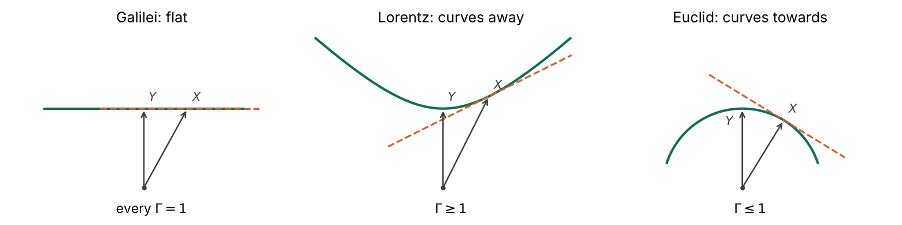

# A body with a clock: how far the pair goes without a metric

> *Many-body mass-centre* gives each body a time-like derivation and a clock. This note drops "time-like", keeps only a pair `(X, alpha)` with `alpha X = 1`, and asks how far that goes with no metric and no signature, whether the creation and evaluation operators can carry the weight put on them, and whether the paper's algebraic position space and time are adequate. **Definition MF0** fixes the setting and the factor `Gamma_XY = alpha_X(Y)`, which need not be symmetric. **Proposition MF1**: `{ev_X, ∧_alpha} = alpha X` gives the split with no metric; the image of `Pi` depends on the process alone and its kernel on the clock alone, and the clock is a contracting homotopy, so the Koszul complex has no homology. The operators are pointwise. **Proposition MF2**: the non-reciprocity (1.7.19), (1.7.20), (1.7.22) needs no metric; the direction of a relative velocity needs no clock, and its size does. **Proposition MF3**: the mass centre `(P/M, theta/M)`, `M^2 = theta(P)`, needs neither metric nor symmetry, and radiation is a square-zero pair with no split. **Theorem MF4**: if the bodies span and `Gamma` is symmetric, there is exactly one symmetric bilinear form `b` with `alpha_i = b(X_i, .)`. Postulate 1.6.3 is therefore the metric, not an addition to it: Oziewicz rejects Einstein's reciprocity of velocities and postulates a reciprocity of clocks, and that gives the metric and its isometry group. **Corollary MF5**: clocks can be chosen reciprocal for up to 10 bodies in dimension 4, so only the 11th tests the claim, and scale changes leave only cycle ratios. **Proposition MF6**: the signature is an output: `Gamma >= 1` near every body gives one positive direction, `Gamma <= 1` gives a definite form, and `Gamma = 1` gives `b = alpha ⊗ alpha`. **Proposition MF7**: unit processes form a surface `L = 1` whose tangent plane is the natural clock, the only one with no first-order clock effect; reciprocity holds exactly when the surface is a central quadric, its centro-affine curvature decides whether `c` is finite, and `Gamma >= 1` is the reverse triangle inequality. **Proposition MF8**: requiring the mass centre to be a body whose vector and clock are both sums forces the quadric by a second route; on a non-quadric the two means differ. **Proposition MF9**: the paper's position space is not adequate: it gives two inequivalent definitions, and (3.1.18) names the factor algebra of the instant, which depends only on the clock. The basic algebra `ev_X b = 0 = ev_X db` is the position space: it needs no clock and `d` closes on it, also on a rotating disk, where the paper's factor differential does not exist. **Proposition MF10**: the clock is a connection on the worldline fibration: `Pi d alpha` is its curvature, `L_X alpha` is Einstein's one-body acceleration without Christoffel symbols, and its holonomy on the disk is the Sagnac term. **Proposition MF11**: the clock is not a time: time scalars exist only where `alpha ∧ d alpha = 0`, and on a rotating body the reciprocal clock and a time function exclude each other. Checked exactly with SymPy except where the note says numerical; MF4 to MF8 and MF11 also rest on short proofs given here. Nothing here departs from standard relativity. Step 4 takes up the link between this vorticity and Møller's spin.

*Ladder abstract — see the [full list](README.md#the-ladder).*

**Status.** Analysis note, step 3 of the ladder. Theorem prefix **MF**. Companion
script: [`src/verify_metric_free.py`](../src/verify_metric_free.py) (Parts A to I;
§13). Prompted by Bill Page, 3 November 2026: if a body is a process with its own
clock, how far can we get without a metric, can we rely on the creation and
evaluation operators, and is Oziewicz's characterisation of position space and
time adequate? He placed the work in the ladder and set MC-SP3 as what follows it.
Derivation and checks were drafted with Claude (Anthropic) and are subject to
review, and no separate reader has checked the proofs; every claim about what
Oziewicz wrote is a reading of the cited page.
[PDF](https://github.com/billpage/oziewicz/releases/latest/download/metric_free_body.pdf)

---

## 0. What this note asks, inherits and retracts

**Question.** Which of Oziewicz's constructions survive with a body taken as a
pair (process, clock), before any metric or signature is assumed? Where exactly
does the metric enter?

**Inherits.** From step 1: the dictionary MC0, the binary velocity MC1, the pair
groupoid MC2, the mass centre MC3, the idempotent MC6, the position problem MC7.
From step 2: the Frobenius determinant TV8, which is the rank statement after
Theorem MF4 for dependent bodies. From `supplement/bodies_first.md`: the two-layer
reading of §2, corrected below.

**Retracts or corrects.**

| Earlier statement | What happens to it |
|---|---|
| `bodies_first.md` §2, table: symmetric `gamma` is something "the metric adds" to the pair | Corrected. For spanning bodies, symmetry is the metric (MF4) |
| `bodies_first.md` §2: position space is "scalars with `Xf = 0`; forms in `ker ev_X`" | Corrected. Those are two different objects; the second is not a position space (MF9) |
| `bodies_first.md` §2: "time-like" is needed in the second layer, and the first cannot supply `c` | Refined. "Time-like" can be defined from the clocks (MF6), and finite `c` from the surface of unit processes (MF7) |
| `bodies_first.md` RV-SP1 | Answered in part (§7): the number `c` still needs a ruler |
| `bodies_first.md` §1, point 4, as a statement of fact: there is no acceleration of one body | It stands as a reading of Oziewicz. As mathematics it fails for a pair: `L_X alpha` is the one-body acceleration (MF10) |
| `mass_centre.md` MC2: the postulates (1.6.1)-(1.6.5) fix the Lorentz group | Stands, and sharpened: linear clocks with (1.4.13) already give `b` (MF4); the signature follows from `Gamma >= 1` (MF6) |
| `GLOSSARY.md`, "Position space" and "Clock" | Changed to agree with MF9 and MF10 |

A chat reply of 3 November 2026 said that `c` is the curvature of the surface of
unit processes. That is too strong: the curvature decides only whether `c` is finite
(MF7, part 5).

---

## 1. Sources

Section and equation numbers are those of the 62-page long version of *Many-body
mass-centre*, as in step 1. Also used are §§1.3, 1.4, 1.6, 1.8 and chapter 3 of that
text, and eq. (16) and Figure 2 of *Relativity groupoid, instead of relativity
group* (2007).

Two facts about the sources came to light while this note was written.

- Bill Page's files hold two different compiled texts that both print "Revised April 11, 2017". The 62-page one, *Homological Algebra for relativity of position-spaces*, has PDF creation date 8 May 2020. A 49-page one, with the title and "centre-of-inertia" chapter heading of the older version, has PDF creation date 21 April 2020. So neither file is literally the PDF emailed on 13 April 2017, and step 1, §1, needs checking against that attachment (open item MF-SP6).
- Of Keres's papers only the 1976 one has been read directly, and only pp. 351, 352, 357 and the English summary. *Physical interpretation of solutions of the Einstein equations* (1967) was read through a summariser. The two Kiev chapters of 1972 and 1973 have not been found. Elsewhere, what is said about Keres is Oziewicz's account of him (open item MF-SP5).

On those pages Oziewicz's citations hold: p. 351 defines a congruence as a three-dimensional space and calls it `x`-space, and the velocity `u^i` of `x`-space relative to `xi`-space stands just before formula (10), as (1.7.8) cites. Two qualifications apply. In the 1976 paper the `x`-space is a freely falling congruence, the `xi`-space is arbitrary, neither is called a material body, and the setting is Newtonian, with common time `t`. Only one direction of the velocity appears there.

---

## 2. Setting

**Definition MF0 (setting).** `F` is a commutative unital `R`-algebra, `der F` its
module of derivations and `(der F)*` the dual module. Everything below assumes
`F = C^∞(U)`, or that `der F` is finitely generated and projective, and "pointwise"
means linear algebra in `V = der F` at one point. A **body** is a pair `(X, alpha)`
with `X` in `der F`, `alpha` in `(der F)*` and `alpha X = 1`. `X` is its **process**
and `alpha` its **clock**. For two bodies,

```math
\Gamma_{XY}=\alpha_X(Y),\qquad \Gamma_{XX}=1 ,
```

and `Gamma_XY` need not equal `Gamma_YX`. The **gauge** `(X, alpha) -> (fX, alpha/f)`,
with `f` invertible, leaves the observer idempotent `p = X ⊗ alpha` unchanged and
sends `Gamma_XY` to `(f_Y / f_X) Gamma_XY`.

Other symbols: `Λ` is the Grassmann algebra of forms; `ev_X` is contraction and
`∧_alpha` left multiplication, as in (1.3.2)-(1.3.4); `(alpha)` is the principal ideal
of `alpha`; `L_X = ev_X d + d ev_X` is the Lie derivation; `F^X` is the set of
`f` with `Xf = 0`; `b` is a bilinear form on `V`; `c` is the speed of light. Where a metric
appears, `g` has signature `(-,+,+,+)`, and the dictionary with Oziewicz is
`g = (det g) b` on his normalisation `(gX)X = det g`. So `b` is his metric with the unit
`det g = -c^2` removed, and `b` is positive on bodies.

A clock with `Gamma_XY` in this sense is Oziewicz's clock of Definition 1.4.1, which
is chosen freely, not his metric clock (1.6.6). Note that (1.4.13) and (1.6.6) as printed
read `clock_X Y = (det g) gamma`. Taking `Y = X` with (1.4.12) shows this to be a
misprint for `(gX)Y = (det g) gamma`, which is (1.7.12). (Part B.)

---

## 3. Creation, evaluation and the split

**Proposition MF1 (the split).** For any `X`, `alpha` with `alpha X = 1`:

1. `{ev_X, ∧_alpha} = alpha X`. With `Pi = ev_X ∧_alpha` and `D = ∧_alpha ev_X`, these are complementary idempotents on `Λ`. `Pi` is the algebra map induced by `P = id - X ⊗ alpha`, and `D` is a grade-0 derivation. On a space of dimension `n` each has rank `2^(n-1)`.
2. `im Pi = ker D = ker ev_X` depends only on the process, and `ker Pi = im D = (alpha)` only on the clock. So `Λ = (alpha) ⊕ ker ev_X`, and each summand belongs to one half of the body.
3. `ker ev_X = im ev_X`: the Koszul complex of `X` is exact, with `∧_alpha` as contracting homotopy.
4. A clock for `X` exists exactly when `F X` is a free direct summand of `der F`. For `F = C^∞(M)` that says `X` vanishes nowhere.
5. `p = X ⊗ alpha` forgets the scale of `X`, and it forgets the arrow, because `(X, alpha)` and `(-X, -alpha)` give the same `p`.

*Proof.* Part 1: the fermion relations `{a_i, c_j} = delta_ij` give the anticommutator
by bilinearity. Then `Pi + D = id`, `D^2 = ∧_alpha (ev_X ∧_alpha) ev_X = D`, using
`ev_X^2 = 0`. On one-forms `Pi beta = beta - (beta X) alpha = P* beta`, and a direct
computation on products gives multiplicativity. Part 2: `ev_X Pi = ev_X ev_X ∧_alpha = 0`,
and `ev_X beta = 0` gives `Pi beta = beta`. `im D` lies in `(alpha)`, and
`D(alpha ∧ beta) = alpha ∧ ev_X(alpha ∧ beta) = alpha ∧ beta`, since
`alpha ∧ alpha = 0`. Part 3: if `ev_X beta = 0` then `beta = ev_X (alpha ∧ beta)`. Part 4: `alpha` is a retraction of
`F -> der F`, `1 -> X`, and on a paracompact manifold a nowhere-zero `X` has one. ∎
Part A checks parts 1 to 3 exactly: the fermion relations on 16 by 16 integer matrices,
multiplicativity and the derivation property on all basis pairs with symbolic `X`,
`alpha` for `n = 3`, and the rest on one rational case in `n = 4`.

**Remarks.**

- The relation is the Clifford relation of the canonical pairing on `V ⊕ V*`, which has signature `(n, n)`. The operators are free of any chosen metric, but they are not free of a signature; that one is always there. Choosing `g` picks out the operators `ev_X + ∧_{gX}`, which generate the Clifford algebra of `g`.
- Part 3 is the whole homological content of "the Grassmann complex". There is no homology, so no homological invariant, until `d` enters (§§8 to 10).
- `Pi` is `F`-linear and fixes `F`. The operators know nothing of position as a space, and everything they say is pointwise. This is the limit of what they can carry.
- The paper says to "consider only non-zero derivations" (§1.1). Part 4 needs more: non-zero at every point.

So the answer to "can we rely on them?" is yes for the algebra of §§3 to 7, and no for
anything that needs `d`.

---

## 4. Velocity

**Proposition MF2 (velocity without a metric).** Let `(X, alpha)`, `(Y, beta)` be
bodies with `A = alpha Y` and `B = beta X` invertible, and let `v_XY = Y/A - X`,
`v_YX = X/B - Y`, as in (1.4.7). Then

1. `alpha(v_XY) = 0`, and `v_YX = -A v_XY - (A - 1/B) X`, the general form of (1.7.19);
2. `v_XY + v_YX = (1/A - 1) Y + (1/B - 1) X`, the general form of (1.7.22), so for independent `X`, `Y` reciprocity holds exactly when `A = B = 1`;
3. `v_YX ∧ v_XY = (1 - 1/(AB)) Y ∧ X`, the general form of (1.7.20), and `AB = tr(pq)` is the only gauge-invariant number of the pair;
4. the class of `Y` in `der F / F X`, which is the direction of motion, uses no clock, and `f -> Yf` on `F^X` is Keres's velocity per unit of `Y`'s own process, which uses no clock of `X`;
5. under a change of clock `alpha -> alpha + beta'` with `beta' X = 0`, the components `v x = Yx / alpha(Y)` of the velocity on conserved `x` all change by one common factor.

(Part B.) Part 5 is the one-way speed problem in this language: direction belongs
to the process, size to the synchronisation (Reichenbach; see Rizzi et al. 2004). Note
that (1.4.11), line 1, reads `v_XY x = Y x`, whereas (1.4.7) gives `v_XY x = Yx / gamma`,
so that line holds only for `gamma = 1`, as in Keres's Galilean setting. Line 2 of
(1.4.11) is exact. (Part B, on one case.)

So non-reciprocity is not a consequence of the metric. It comes from having two
clocks with `Gamma != 1`. What needs more than the pair is the size of `v`, which
enters through (1.7.15), and hence (1.7.21), (1.7.23) and (2.1.11).

---

## 5. The mass centre and radiation

**Proposition MF3 (mass centre without a metric).** Let bodies `(X_i, alpha_i)` have
masses `m_i > 0`, and put `P = sum m_i X_i`, `theta = sum m_i alpha_i`, with
`theta(P) > 0`.

1. `M^2 = theta(P) = sum m_i m_j Gamma_ij`, and `(Z, zeta) = (P/M, theta/M)` is a body. `c = Z ⊗ zeta` is an idempotent of trace 1. Symmetry of `Gamma` is not used.
2. For one common clock, every `Gamma = 1`, `M = sum m_i`, and `Z` is the barycentric velocity. For the metric case this is Theorem MC6.
3. `M^2 - (sum m_i)^2 = sum m_i m_j (Gamma_ij - 1)`. So `Gamma >= 1` for all pairs gives `M >= sum m_i`, positive kinetic energy, and `Gamma <= 1` gives the opposite.
4. With radiation, take a pair `(G, gamma_G)`, `gamma_G G = 0`, and `Z`, `zeta` along `P - G`, `theta - gamma_G`. Then `M^2 = theta(P) - theta(G) - gamma_G(P)`, which for `gamma_G = b(G, ·)` and `c = 1` is (2.1.6). Schrödinger's energy (2.1.3) is `alpha_X(G)`.
5. For such a pair, `G ⊗ gamma_G` has square zero, and `ev_G`, `∧_{gamma_G}` anticommute, so radiation has no idempotent, no split and no rest space.

(Part C.) Part 5 says less than it seems to: `(v_XY, alpha_X)` is also a square-zero
pair. The pair alone does not tell radiation from a velocity; §7 does, as the boundary
of the cone of bodies.

---

## 6. Reciprocity of clocks is the metric

**Theorem MF4 (reciprocity of clocks).** Let `(X_i, alpha_i)` be bodies whose
processes generate `der F`, with `Gamma_ij = Gamma_ji` for all `i`, `j`. Then there is
exactly one symmetric `F`-bilinear form `b` on `der F` with `alpha_i = b(X_i, ·)`, and
every `b(X_i, X_i) = 1`. Its radical is the intersection of the `ker alpha_i`.
Conversely, a symmetric `b` with `b(X_i, X_i) = 1` gives such a family.

*Proof.* Put `b(sum a_i X_i, Y) = sum a_i alpha_i(Y)`. If `sum a_i X_i = 0`, then for
each `j`,

```math
\sum_i a_i\,\alpha_i(X_j)=\sum_i a_i\,\alpha_j(X_i)=\alpha_j\Big(\sum_i a_i X_i\Big)=0 ,
```

so the form `sum a_i alpha_i` vanishes on generators and is zero: `b` is well
defined. It is symmetric on generators, hence everywhere, and uniqueness is
linearity. ∎ (Part D: `n = 3` symbolically, with a further body `Y` whose clock is
forced to be `b(Y, ·)`.)

**What this says about the paper.** Clarification 1.4.5 postulates, before the metric
is introduced in §1.5, that the gamma factor "must be symmetric", and Postulate 1.6.3
repeats it. With clocks
linear on derivations, that is already `b`, so `g = (det g) b`, and the Lorentz group
is the isometry group of a form the postulate has already fixed. The separate
Postulates (1.6.1)-(1.6.5) add the unit and the signature, not the form.

Oziewicz rejects Einstein's reciprocity of velocities (§1.7.10) and postulates a
reciprocity of clocks, and the second is what gives him the metric. He came close to
saying so: *Relativity groupoid* (16) and the sentence after it call `p* g = g p` a
compatibility that "could be tested experimentally rather than postulated a priori".
With `p = P ⊗ alpha`, one has `p* g - g p = alpha ⊗ gP - gP ⊗ alpha`, zero exactly when
`alpha` is parallel to `gP` (Part D). MF4 is that test applied to all bodies at once:
reciprocity for a spanning family gives a `g` compatible with every one of them.

`det g` in (1.6.5) is a scalar only relative to a chosen volume, since the determinant
of a bilinear form is a density. Here it appears only as the unit in `g = (det g) b`, and
`Gamma` needs no such unit.

**Corollary MF5 (what can be tested).**

1. *Counting.* For `N` bodies in dimension `n`, the reciprocal clocks are the symmetric `b` with `b(X_i, X_i) = 1`. These are `N` linear conditions on `n(n+1)/2` unknowns. So in dimension 4, clocks can be chosen reciprocal for up to 10 bodies in general position, whatever their rates, and an 11th tests the claim.
2. *Scale.* Two bodies can always be made reciprocal by a gauge, when `Gamma_XY / Gamma_YX > 0`. For any family with all `Gamma_ij` non-zero and those ratios positive, a gauge makes `Gamma` symmetric exactly when `Gamma_ij Gamma_jk Gamma_ki = Gamma_ik Gamma_kj Gamma_ji` for all triples. This is Kolmogorov's criterion for reversibility of a Markov chain.

*Proof.* Part 1 is MF4 and linear algebra. Part 2: `Gamma_ij lambda_j / lambda_i` is
symmetric exactly when `(lambda_j / lambda_i)^2 = Gamma_ji / Gamma_ij`, which can be
solved exactly when the ratios multiply to 1 round every triangle; set
`lambda_j^2 = Gamma_j1 / Gamma_1j`. ∎ (Part D: one set of bodies with `N` = 4, 5, 8, 10, 11;
one gauge and one symmetrisation.)

If `Gamma` comes with the physical rates of the processes, then symmetry is a property
of those rates. If only the idempotents are given, it is the cycle condition, which is
a statement about `tr(p_i p_j p_k)` and its reverse.

**Proposition MF6 (the signature is an output).** Let `b` be as in MF4, and let the
bodies through each `X` fill a neighbourhood of `X` in `{b = 1}`.

1. If `b` is nondegenerate and `Gamma >= 1` on such neighbourhoods, then `b` is negative definite on every `ker alpha_X`, so `b` has one positive direction. This is the Lorentz signature.
2. If `Gamma <= 1` there, then `b` is positive definite.
3. If `Gamma = 1` there, then `b = alpha ⊗ alpha`, and all clocks are one clock. This is Galilei, and `b` has rank 1.

*Proof.* Take `w` in `ker alpha_X`, so `b(X, w) = 0`, and
`Y = (X + e w) / sqrt(1 + e^2 b(w, w))`. Then `b(Y, Y) = 1` and

```math
\Gamma_{XY}=\frac{1}{\sqrt{1+e^{2}\,b(w,w)}}=1-\tfrac12 e^{2}\,b(w,w)+\dots
```

Parts 1 and 2 follow from the sign of `b(w, w)`, with nondegeneracy turning
semi-definite into definite. In part 3, `b(w, w) = 0` on `ker alpha_X`, so by
polarisation `b` vanishes there, and `b(X, ·) = alpha` then gives `b = alpha ⊗ alpha`. ∎
(Part E.)

So "time-like" need not be assumed. Given a family of clocks, a vector is space-like
if some clock kills it and time-like if none does. "Moving clocks run slow", `Gamma >= 1`,
is the Lorentz signature; the reverse is the Euclidean one, and no effect is Galilei.
In the Euclidean case `Gamma` vanishes between bodies a right angle apart, so the split
of (1.4.7) is partial and the velocity groupoid is not defined on all pairs. That is
the counterpart of the causality hypothesis in Lévy-Leblond's derivation (1976), which
rejects his case `alpha < 0`, the one with this sign.

The neighbourhood hypothesis matters. For three bodies with `Gamma_12 = Gamma_13 = 11/10`,
`Gamma_23 = 3`, the matrix has eigenvalues about `-2, 0.34, 4.66`, two of them positive,
though every `Gamma >= 1`: the triangle inequality for rapidities fails. (Part E.) A
finite family can break the signature; a family closed under small relative motion cannot.

---

## 7. The surface of unit processes

MF4 takes clocks as given. Where do they come from? Only the process has a physical
rate, so consider the set of unit processes.

**Proposition MF7 (the surface of unit processes).** Let `C` in `V` be an open cone,
`L : C -> (0, ∞)` smooth and homogeneous of degree 1, `H = {L = 1}`, and
`alpha_X = dL_X` for `X` in `H`.

1. `alpha_X X = 1` and `ker alpha_X` is the tangent space of `H` at `X`. This is the only clock of `X` for which `Gamma_XY(e) = 1 + O(e^2)` along every curve `Y(e)` in `H` through `X`: no first-order clock effect.
2. For `w` in `ker alpha_X` and `Y(e) = (X + e w)/L(X + e w)`, `Gamma_XY(e) = 1 - (e^2/2) Hess L_X(w, w) + ...`. So `kappa_X = -Hess L_X` on `ker alpha_X` is a form on the rest space of `X` defined with no metric.
3. If `C` is convex, `Gamma_XY >= 1` for all `X`, `Y` in `H` exactly when `L` is concave, and this is the reverse triangle inequality `L(X + Y) >= L(X) + L(Y)`.
4. `Gamma` is symmetric on `H` exactly when `L^2 = b` on `C` for a symmetric bilinear `b`, that is when `H` is part of a central quadric. Rank 1 is the hyperplane `tau = 1`.
5. `kappa = 0` is Galilei and `kappa != 0` is finite `c`. With a separate ruler `h_X` on the rest space, `kappa = h/c^2`. In particular `c` is a conversion between clocks and rulers. The surface decides whether it is finite; its value needs the ruler.

*Proof.* Part 1: Euler's relation, and `d/de alpha(Y(e)) = alpha(Y'(0))`. Part 2: Taylor
expansion of `L` at `X`, where the first-order term vanishes. Part 3: concavity is
`L(Y) <= dL_X(Y)`, the tangent plane above the graph, and for a homogeneous function it
is superadditivity. Part 4: if `Gamma` is symmetric, MF4 gives `b` with `dL_X = b(X, ·)`
on `H`, and `H` spans `V`; the converse is differentiation. Part 5: for a quadric,
`kappa = -b` on the rest space, which is (1.7.15) with `c = 1`. ∎ (Part F, exactly
at one point of `L^4 = t^4 - x^4`, and for the quadric symbolically.)



*Figure (numerical, Part I).* The surface `H` (solid) and the clock of `X` (dashed),
its tangent. If `Y` lies on the far side of the tangent from the origin, `Gamma_XY > 1`.
In the Galilei panel the two lines coincide.

`kappa_X` is, as far as I know, the centro-affine fundamental form of `H` in affine
differential geometry (Nomizu and Sasaki 1994, from memory). It needs no metric on `V`.

*Analogy.* Lay a ruler along a curve at the point `X`, and read a nearby point against
it. On a straight line the reading does not change; on a bowl curving away from you,
every nearby point lies beyond the ruler; on a dome, every point lies short of it.
Time dilation is that second-order reading, and Minkowski's tangent to the hyperbola
is the ruler. The clock is not an extra datum: it is how the surface looks to first
order at `X`, and the metric is the statement that the surface is a quadric.

So bodies need not carry an independent clock. Between the pair and the metric lies a
consistent layer in which `L` is concave but not quadratic. This is a Lorentz-Finsler
structure. There `L^4 = t^4 - x^4` has, at `X = (1, 0)` and `Y = (2, 1)/15^(1/4)`,

```math
\Gamma_{XY}=\frac{2}{15^{1/4}}\approx 1.0163,\qquad \Gamma_{YX}=\frac{8}{15^{3/4}}\approx 1.0496 .
```

(Part F, exact.) The boundary of `C`, where `L = 0`, is where radiation lies, and this
is what tells a radiation pair from a velocity pair in MF3. On a quadric, `b(G, G) = 0`.

**Proposition MF8 (the two mass centres).** Let bodies be as in MF7, and give mass `m`
at `X` in `H` the momentum vector `mX` and momentum form `m alpha_X`, so that the
momentum form is `pi = L dL = d(L^2/2)` on `C`.

1. If a sum of bodies is a body whose vector and clock are the sums, that is if `pi(P_1 + P_2) = pi(P_1) + pi(P_2)` on `C`, then `pi` is linear, and `L^2` is quadratic.
2. Otherwise the mean of the vectors and the mean of the forms give different mass centres.

*Proof.* Part 1: additive and homogeneous on an open cone gives a linear map, and
`L^2 = pi(X)(X)` by Euler. It is symmetric because it is a Hessian. Part 2 is the contrapositive.
∎ On `L^4 = t^4 - x^4`, the clock of the vector mean of `(1, 0)` and `(2, 1)` is not
parallel to the sum of the forms, exactly. Numerically, for velocities 0.3 and 0.7 and masses
1 and 2, the vector mean has velocity 0.5725 and the form mean 0.6310. (Part G.)

This is a second route to the quadric, and it is Oziewicz's own: "2-body problem is in
fact always 3-body" requires that `Z` be a body with its own clock. Definition 2.1.3
writes conservation for vectors. In a Lagrangian theory the conserved quantity is the
form, and the velocity is related to it by the Legendre map, so the vector equation
(2.1.4) assumes that map is linear. With a metric it is, and the two statements are one
(MC3). Below the metric they are two different claims.

---

## 8. Position space

The paper offers two descriptions of the position space of `X`. In §1.1 and §1.4 it
is the conserved subalgebra `F^X` of scalars. In §3.1 it is the Grassmann factor-algebra
(3.1.2), (3.1.18), which is `ker ev_X` over all of `F`: §3.1.1 insists on no change of
scalars and lists `t` among them, and (3.1.7) lists `t` and `t'`. Chapter 3 also says
that position space is a quotient manifold, not a submanifold (§3.1.1, first lesson).

**Proposition MF9 (position space).**

1. `ker ev_X` is a subalgebra of `Λ`, not a factor algebra, contains every scalar, and is not stable under `d`.
2. `Λ/(alpha)` depends only on the clock, and `Pi` gives an `F`-algebra isomorphism `Λ/(alpha) -> ker ev_X`. `d` descends to `Λ/(alpha)` exactly when `alpha ∧ d alpha = 0`, and then `Λ/(alpha)` is the algebra of forms restricted to the leaves of `ker alpha`, which are the instants.
3. The **basic algebra** `B_X = {beta : ev_X beta = 0, ev_X d beta = 0}` is a differential graded subalgebra of `Λ` over `F^X`. It needs no clock, `B_{fX} = B_X`, and it needs no integrability. In a flow box it is the de Rham algebra of the local quotient by the worldlines.
4. On a disk in rotation, `X = ∂_t + w ∂_phi` in Minkowski space, the metric clock has `alpha ∧ d alpha != 0`, so the factor differential of (3.1.12) does not exist. The position space, generated by `r`, `z`, `phi - w t`, is untouched.

*Proof.* Parts 1 and 2: (3.1.5) and MF1; `d(alpha) ⊂ (alpha)` is (3.1.12). Part 3: `d beta`
is basic since `dd = 0`, and products by the derivation property; `ev_{fX} = f ev_X`
fixes both conditions. Part 4: Part H. ∎

The duality between spaces and algebras is contravariant: a quotient of a space is a
subalgebra of its functions, and a subspace is a factor algebra. (3.1.18) writes the
position space as a factor algebra by the simultaneity ideal, which is the algebra of
the instant `t = const`, the object §3.1.1 rejects. Warning 3.1.3 sees the consequence:
a factor differential does not always exist. It is a warning about the wrong object.
`Pi` hides this, since it identifies the two pointwise; but it is not compatible with `d`.

Warning 3.1.3 also ties (3.1.12) to "inertial or non-inertial" bodies. (3.1.12) tests
vorticity, not acceleration. A unit Rindler body has `alpha ∧ d alpha = 0` and is not
inertial (MF10).

This leaves `ker ev_X` with a real use, which should not be lost. It is the home of fields on the position space that may vary with time: §3.1.2 says it contains the relative electric and magnetic fields, and Keres's form (10) is an example. There, `gamma_rs (dxi^r - u^r dt)(dxi^s - u^s dt)` vanishes on the process, and in the coordinates `x` it is `g_pq(t, x) dx^p dx^q`, which is not basic unless `g_pq` is independent of `t`. So the position space is `B_X`, and `ker ev_X` over `F` holds what happens on it. The defect in (3.1.18) is the identification of the two.

The body's three attributes in (1.1.1) sort as follows: the line `F X` gives the position
space, the clock gives the simultaneity, and the scale of `X` gives the rate.

`F^X` can also be too small. For an irrational flow on a torus it is the constants, and
position space has no algebra of scalars at all (open item MF-SP4). This does not
affect a local statement, or a body whose worldlines form a manifold.

---

## 9. The clock is a connection

**Proposition MF10 (the clock as a connection).** For a body `(X, alpha)`:

1. `L_X alpha = ev_X d alpha` lies in `ker ev_X`, and `d alpha = Pi d alpha + alpha ∧ L_X alpha`.
2. `(Pi d)^2 f = -(Xf) Pi d alpha`. So `Pi d alpha` is the curvature of the horizontal derivative `f -> Pi df`, of which the factor differential of (3.1.16) is the integrable case.
3. For `g` a metric, `u` a unit vector and `alpha = -g(u, ·)` (`c = 1`), `L_u alpha = -g(a, ·)` with `a = ∇_u u`. Einstein's one-body acceleration needs no connection once the body has a clock.
4. For `v` in `ker alpha`, `alpha(L_X v) = -d alpha(X, v) = -(L_X alpha)(v)`. So relative acceleration leaves the rest space of `X` when `X` accelerates. This settles the guess at the end of §1.8.4: accelerations are not space-like in general.
5. Under the gauge, `L_{fX}(alpha/f) = L_X alpha + Pi d ln f` and `Pi d(alpha/f) = (1/f) Pi d alpha`. So acceleration depends on the rate of `X`, and vorticity only scales, and `alpha ∧ d alpha = 0` is gauge invariant.
6. On the disk, `alpha = dt - (w r^2 / (1 - w^2 r^2)) dpsi`, with `psi = phi - w t`, and the holonomy round a circle in position space is `2 pi w r^2 / (1 - w^2 r^2)` in `t`. Twice the holonomy in proper time is `4 pi r^2 w gamma`, the Sagnac difference.

(Part H: parts 1 and 2 with a generic `f` on the disk, part 3 against Christoffel symbols,
part 4 on Rindler, part 5 with generic `alpha`, `f`, part 6 on the disk.) The value
in part 6 agrees with the formula quoted by Rizzi et al. (2004).

This is the threading point of view (Landau and Lifshitz, *Classical Theory of Fields*
§84, and Jantzen et al. 1992, cited here without re-reading): the quotient by the
worldlines is a fibration, and `alpha` is a connection on it. Parts 3 and 4 show what the metric-free
language gains and loses. Oziewicz's slogan that acceleration needs a second body
(§1.2.2) holds for `L_X v_XY`, but a body with a clock has an absolute acceleration
`L_X alpha`, and his relative acceleration contains it through part 4. His objection to
`∇_X X` is to the connection, and with a clock the connection is not needed. The
absoluteness is not removed.

Part 5 shows a Killing `X`, as on the disk, can absorb the acceleration: the rate
`X = ∂_t + w ∂_phi` has `L_X alpha = 0`, while the unit `u = gamma X` has
`L_u alpha_u = Pi d ln gamma`.

---

## 10. Time

**Proposition MF11 (the clock is not a time).**

1. Every process has, locally, a closed clock: in a flow box `X = ∂_t`, `alpha = dt`.
2. Where `alpha ∧ d alpha != 0`, only locally constant `f` have `df ∧ alpha = 0`. A clock of that kind has no time scalars near that point.
3. On the disk the metric clock is the only one reciprocal with all bodies (MF4), and it has `alpha ∧ d alpha != 0`. The disk does have clocks with a time function, for example `(u, dt/gamma)`, integrable, but then `Gamma_uT = 1/gamma` and `Gamma_Tu = gamma` for the inertial body `T = ∂_t`. So on a rotating body the reciprocal clock and a time function exclude each other.

*Proof.* Part 2: `df ∧ alpha = 0` with `df != 0` gives `alpha = h df`, and then
`alpha ∧ d alpha = 0`. So `df = 0` wherever `alpha ∧ d alpha != 0`. Part 3: Part H. ∎

The position scalars of §8 always exist locally, for any nowhere-zero `X`, because a
line field is always integrable. Time scalars do not, because a hyperplane field is
not. Space and time are not symmetric here, whatever the notation suggests.

Is the characterisation of time adequate? Not as it stands.

- The exact sequence (3.1.1) contains the simultaneity ideal, an ideal with no unit, which (3.1.1) calls the "zero `F`-algebra". There is no algebra of times in it. MF11 says what such an algebra would be, and when it would be empty.
- A physical clock fixes a rate along its own worldline. Extending it to a form on `der F` is a synchronisation, so `Gamma_XY` is not read from one clock (open item MF-SP2).
- The arrow is in `X`, not in `p` (MF1, part 5).
- Ages are line integrals. §3.2 calls the approach event-free, but the curve `c*` of (1.8.1) is used, and for `F = C^∞(M)` the characters of `F` are the events (a standard fact, not checked here). "Manifold-free" renames the block universe unless `F` is something else.

**What this sets up.** (2.1.17) is `zeta ∧ d zeta = 0` for the clock `zeta` of the mass
centre. Bill Page's annotation of the paper, of September 2020, reads this as the
spin of the centre of mass. Vorticity is the part of `d alpha` that survives the gauge
(MF10), so it is the right kind of object, and `theta = M zeta` gives

```math
d\theta=\sum_i m_i\,d\alpha_i,\qquad \zeta\wedge d\zeta=\frac{1}{M^{2}}\,\theta\wedge d\theta ,
```

so the vorticity of `Z` is assembled from the constituents. (The second equation is MF10,
part 5, with `f = 1/M`.) But there is an obstacle. Step 1's example of Møller's disk has
two free bodies, with constant `X_i`. There `d alpha_i = 0`, `Z` is constant and (2.1.17) is
empty, yet `S != 0`, because `S` depends on which worldlines of the congruences carry the
masses, which is the position problem MC-SP1. A body as a congruence with one mass
cannot see that. Vorticity can reach `S` only once mass becomes a density, `P = rho alpha`,
for then `dP = d rho ∧ alpha + rho d alpha` is non-zero even when `d alpha = 0`
(open item MF-SP1).

---

## 11. Assessment

| Question or claim | Standing after this note |
|---|---|
| Split, idempotents, Koszul complex need no metric | True, and pointwise (MF1); signature `(n, n)` is canonical |
| "Homological algebra" | One exact complex with an explicit homotopy; no homology (MF1) |
| Non-reciprocity needs a metric | No (MF2) |
| Size of a velocity | Needs a clock (MF2), and a form on the rest space (MF7) |
| Mass centre | Needs neither metric nor symmetry (MF3), but the Legendre map decides which one (MF8) |
| Symmetric gamma is a postulate within a group-free theory | It is the metric (MF4) |
| Signature must be assumed | No: it is the sign of `Gamma - 1` (MF6) |
| Bodies must carry independent clocks | No: a surface of unit processes supplies them (MF7) |
| Position space as factor algebra (3.1.18) | Not adequate. Basic algebra instead (MF9) |
| Factor differential (3.1.12) concerns inertial bodies | It concerns vorticity (MF9, MF10) |
| Acceleration needs two bodies | Not for a body with a clock (MF10) |
| Clock form as time | Not adequate. A connection; time scalars need integrability (MF10, MF11) |
| Equivalent to standard relativity | Yes once `b` exists. The layer below it is Lorentz-Finsler, which is known, and which Oziewicz did not use |

Nothing here gives a prediction different from standard relativity. What is gained is
a map of the assumptions. In order: pair, linear clocks, tangent clock, reciprocity (or
closure of composition), sign of `Gamma - 1`.

---

## 12. Open items

- **MF-SP1.** *Answered in part by step 4, CS5 and CS6.* Relate the vorticity of MF10 to Møller's spin, which is MC-SP3 in the setting of this note, with mass as a density (§10). A pointer: for rapidly decaying momentum density `p` in the plane, integration by parts gives `S = -(1/2) ∫ r^2 curl p`, checked on a Gaussian rotor (Part H). So `S` is a second moment of the curl of the momentum form. Whether that survives relativistically, and whether Møller's radius `|S|/(Mc)` can be read from it, is the question. Keres's non-Newtonian "vortex" fields are a lead that has not been followed up: the 1976 paper, (29)-(32), and his 1965 and 1967 papers, where the 1967 paper applies the method to the Kerr solution. Whether his curl of the relative velocity is `alpha ∧ d alpha` for some clock is to be checked; his freely falling `x`-space has the closed clock `dt`, so it would be the clock of the reference space.
- **MF-SP2.** How is `Gamma` measured without presupposing a synchronisation? Radiation as the boundary of `C` is the natural tool. Compare Ehlers, Pirani and Schild (1972), who build the conformal structure from light; that paper has not been read for this note.
- **MF-SP3.** Linear but non-symmetric clocks: `alpha_X = b(X, ·)` with `b` having an antisymmetric part. MF5 gives the cycle ratio as its gauge-invariant trace. Oziewicz explored this and withdrew it in November 2018 (step 1, §1). Is there a reason beyond the failure of MF7?
- **MF-SP4.** When `F^X` is trivial (an irrational flow), what replaces the position space? The paper mentions non-commutative geometry in §3.2 without using it.
- **MF-SP5.** Keres's papers were read only in part (§1). The Kiev chapters of 1972 and 1973 are not located, and the statements cited to them, including the relative acceleration of 1972 §2.8 and the quotation of 1973 p. 142, are unchecked.
- **MF-SP6.** Which text was emailed on 13 April 2017: the 62-page text, the 49-page text, or a third? Both files held print the same revision date and were compiled in 2020. Step 1, §1, depends on the answer.

---

## 13. Verification

`PYTHONPATH=src python3 -u src/verify_metric_free.py` runs every check below and ends
with `ALL CHECKS PASSED`. Parts A to H are exact (SymPy) except for one numerical block
in Part G; Part I draws the figure.

| Part | What is checked | How |
|---|---|---|
| A | MF1 | Integer fermion matrices in `n = 4`; symbolic `X`, `alpha` on all basis pairs in `n = 3`; one rational case in `n = 4` |
| B | MF2; misprints in (1.4.11), (1.4.13), (1.6.6) | SymPy, symbolic; exact cases |
| C | MF3 | SymPy, symbolic |
| D | MF4, MF5, (16) of the 2007 paper | `n = 3` symbolic; exact rank counts on one set of 11 integer vectors; exact gauge examples |
| E | MF6; the three-body example | SymPy; eigenvalues printed numerically |
| F | MF7 | Symbolic quadric; exact at one point of `L^4 = t^4 - x^4`; `f'' < 0` in closed form |
| G | MF8 | Exact cross product; velocities and the grid numerical |
| H | MF9 to MF11; the pointer in MF-SP1 | SymPy on the disk, on Rindler and on a generic pair in adopted coordinates |
| I | figure | NumPy |

The proofs of MF4 to MF8 and MF11 are by hand; the script checks instances, not the general
statements. MF7, part 3, and MF8, part 1, have no machine check beyond the example.

---

## References

- Z. Oziewicz, "Many-body mass-centre: Homological Algebra for relativity of position-spaces", *J. Phys.: Conf. Ser.* 532 (2014) 012021, [doi:10.1088/1742-6596/532/1/012021](https://doi.org/10.1088/1742-6596/532/1/012021); long version as in step 1 (§1 here).
- Z. Oziewicz, "Relativity groupoid, instead of relativity group", [arXiv:math/0608770](https://arxiv.org/abs/math/0608770).
- H. Keres, "Tensor gravitational potential and E. Cartan's four-dimensional representation of Newtonian theory" (in Russian; our rendering of the title), *Izv. Akad. Nauk Eston. SSR, Fiz. Mat.* 25 (1976) 349-358, [PDF](https://kirj.ee/wp-content/plugins/kirj/pub/phys.math-4-1976-349-358_20230428170004.pdf), [doi:10.3176/phys.math.1976.4.03](https://doi.org/10.3176/phys.math.1976.4.03).
- H. Keres, "Physical interpretation of solutions of the Einstein equations", *Sov. Phys. JETP* 25 (1967) 504, [PDF](https://ns.jetp.ras.ru/cgi-bin/dn/e_025_03_0504.pdf). Read through a summariser.
- H. Keres, "Non-Newtonian gravitational fields", *Sov. Phys. JETP* 21 (1965) 882, [PDF](https://www.jetp.ras.ru/cgi-bin/dn/e_021_05_0882.pdf). Located, not read.
- J.-M. Lévy-Leblond, "One more derivation of the Lorentz transformation", *Am. J. Phys.* 44 (1976) 271 (page from memory), [copy](https://sciences-physiques.neocities.org/pdf/One_more_derivation.pdf).
- R. T. Jantzen, P. Carini and D. Bini, "The many faces of gravitoelectromagnetism", [arXiv:gr-qc/0106043](https://arxiv.org/abs/gr-qc/0106043). Abstract only.
- G. Rizzi, M. L. Ruggiero and A. Serafini, "Synchronization gauges and the principles of special relativity", [arXiv:gr-qc/0409105](https://arxiv.org/abs/gr-qc/0409105).
- G. S. Rinehart, "Differential forms on general commutative algebras", *Trans. Amer. Math. Soc.* 108 (1963) 195-222, [AMS](https://www.ams.org/tran/1963-108-02/S0002-9947-1963-0154906-3/), for the setting of MF0 when `der F` is not free. Not read in full.
- J. K. Beem, "Indefinite Finsler spaces and timelike spaces", *Canad. J. Math.* 22 (1970) 1035-1039, [Cambridge](https://www.cambridge.org/core/services/aop-cambridge-core/content/view/03DA7BCFEF4768E13226AB9F11042B8F/S0008414X00047799a.pdf/indefinite-finsler-spaces-and-timelike-spaces.pdf). Located, not read; volume and pages from memory.
- J. Ehlers, F. A. E. Pirani and A. Schild, "The geometry of free fall and light propagation", in L. O'Raifeartaigh (ed.), *General Relativity* (Oxford 1972) 63-84. From memory; not read.
- L. D. Landau and E. M. Lifshitz, *The Classical Theory of Fields*, §84. From memory.
- A. Kolmogorov, "Zur Theorie der Markoffschen Ketten", *Math. Ann.* 112 (1936) 155-160. From memory.
- K. Nomizu and T. Sasaki, *Affine Differential Geometry* (Cambridge 1994). From memory.
