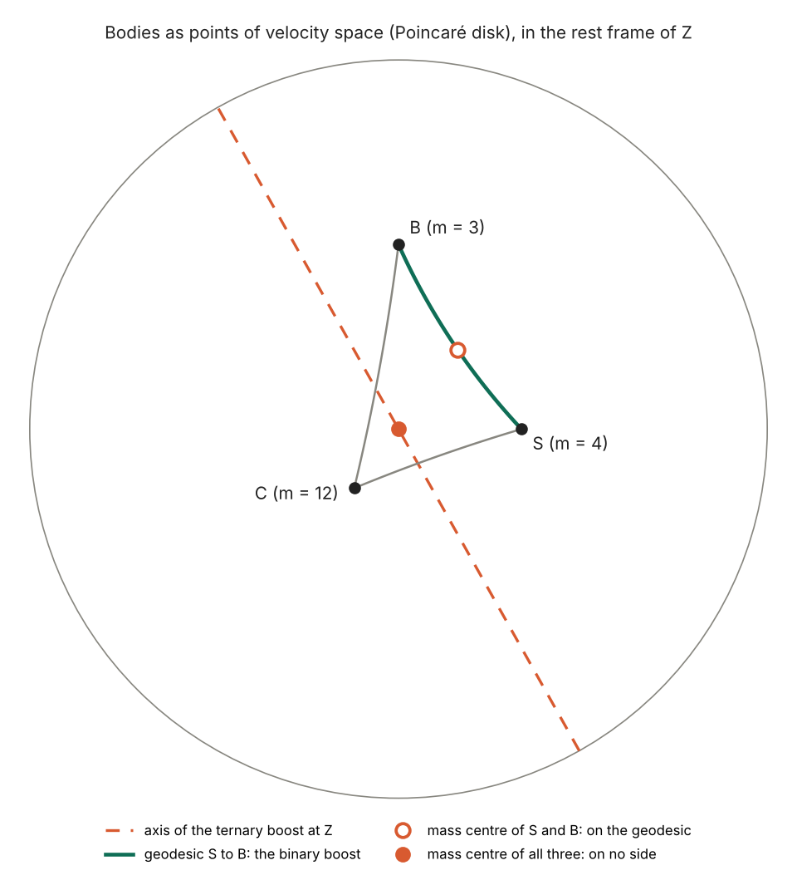

# Ternary velocity at the mass centre: what is left of the astonishing conflict

> Step 1 read the mass centre `Z` as the centre-of-momentum frame, and `supplement/bodies_first.md` read the ternary velocity `w(P, A, B)` as a family labelled by a third observer `P`. This note puts `Z` in the place of `P`, which Oziewicz's papers and the part of his correspondence that was read do not do; the question is his, the answers here go beyond what he published. **Definition TV0** fixes the notation. **Proposition TV1**: for `P` in the plane of `A` and `B`, `P ∧ w = A ∧ B`, so every coplanar eagle reads one bivector. **Theorem TV2**: for two bodies `p_ZB = -p_ZA = (m_A m_B / M) w(Z, A, B)` and `v(Z, A, B) = (m_A v_AB - m_B v_BA) / M`, so the fraction in Oziewicz's (2.2.10) is a ternary velocity. **Corollary TV3**: a pair has one velocity, a Lorentz link and vector reciprocity in one rest space, with nothing exterior, so the conflict needs one `P` for all pairs; this corrects `bodies_first.md` §6. **Proposition TV4**: for three or more bodies `Z ∧ X_i ∧ X_j` is the sum of the other momenta wedged with `X_i ∧ X_j`, so `Z` leaves the plane of every pair; the eagle of RV3 is the mass centre of masses 4, 3, 12. **Proposition TV5**: `gamma_AB - 1 = cosh^2 r (gamma_ternary - 1)` with `r` the distance from `A` to the boost axis; this gives both halves of Oziewicz's Theorem 2.5 and answers RV-SP3. **Theorem TV6 (no-go)**: no Lorentz link depends covariantly on the pair alone, carries `A` to `B` and composes, because the Lorentz group is simple; the Galilei group has one. **Proposition TV7**: of the three properties the binary boost gives up composition (31.16° round the example triangle), ternary boosts at one eagle give up two (32.75°), and a lift based at `Z` gives up dependence on the pair alone. **Proposition TV8**: the Frobenius form of the algebra of observers has determinant `±(det gamma)^(2n)`, so it degenerates exactly when the bodies are linearly dependent; for three bodies that is the coplanar case Oziewicz and Page found in 2004. **Proposition TV9**: Oziewicz's reduced mass `mu_12` is Todorov's effective energy `epsilon_w`, and `v(Z, A, B)` is the velocity of Todorov's effective particle. The conflict therefore keeps one tooth, TV6, which bites the identification of velocity with an isometry; it is not a conflict with the relativity principle, and the rotation it leaves is Thomas precession. Checked exactly with SymPy, except where the note says numerical. No new prediction.

*Ladder abstract — see the [full list](README.md#the-ladder).*

**Status.** Analysis note, step 2 of the ladder. Theorem prefix **TV**. Companion
script: [`src/verify_ternary_mass_centre.py`](../src/verify_ternary_mass_centre.py)
(Parts A to H; §12). Prompted by Bill Page, 2 November 2026: how does the
centre of momentum affect the ternary velocity, and does the "astonishing
conflict" keep any force for three or more bodies? He placed the work in the
ladder because it asks what Oziewicz did not publish. Derivation and checks were
drafted with Claude (Anthropic) and are subject to review; every claim about what
Oziewicz wrote is a reading of the cited page.
[PDF](https://github.com/billpage/oziewicz/releases/latest/download/ternary_mass_centre.pdf)

---

## 0. What this note asks, inherits and retracts

**Question.** *Ternary relative velocity* (Oziewicz 2007) says that a velocity
which parameterizes a Lorentz boost needs a preferred third observer. *Many-body
mass-centre* says that a two-body problem is always a three-body problem, the third
body being the mass centre. Can the mass centre be that third observer, and what
does that do to the conflict?

**Inherits.** From step 1: the dictionary MC0, the binary velocity MC1, the pair
groupoid MC2, the mass centre MC3, the reduced momenta MC5, the idempotent MC6.
From `supplement/bodies_first.md`: the boost formula of §3, the coplanar reduction
RV2, the case RV3, and the formulas (2.2) to (2.5) as checked in RV5.

**Retracts or corrects.**

| Earlier statement | What happens to it |
|---|---|
| `bodies_first.md` §6, reason 2: the conflict lies in reading reciprocity as an equality of vectors in one space | Corrected. That reading can be satisfied pair by pair (TV3); what forces a preferred system is one `P` for all pairs, or composition (TV6) |
| `bodies_first.md` §6, table: "Einstein velocity needs a preferred system (2.6)", not from (i) and (ii) | Stands for (i) and (ii). With composition added the conclusion holds in a precise form (TV6, §7) |
| `bodies_first.md` RV5: the "only if" half of Theorem 2.5 is not checked | Now proved (TV5) |
| `bodies_first.md` RV-SP3 | Answered (§5) |
| `mass_centre.md` §6: the `gamma` in `mu_kl` is "a definition chosen to make (2.2.10) hold" | Refined: `gamma` turns the binary `v` into the boost parameter `w`, and `mu_kl` is Todorov's `epsilon_w` (TV2, TV9). That the paper has no equations of motion stands |

---

## 1. Sources: what was and was not said

Nothing below identifies `Z` with the eagle. The search was of Bill Page's mail for
Oziewicz's addresses with the words ternary, mass centre and its variants, three-body,
Thomas, Ungar, coplanar and Frobenius. Each search returned about 160 to 220 threads,
of which 13 were read in full, with the December 2012 draft. Attachments were not
opened (open item TV-SP5). Short quotations follow.

| Date | Source | What it says |
|---|---|---|
| 16 to 17 Nov 2004 | Page, Oziewicz | Page's Maple determinants for Fr_2 to Fr_4. Fr_3 also vanishes on `-1+pq^2+pr^2-2*pr*qr*pq+qr^2 = 0`. Oziewicz: this is his Theorem 10.5 in `velocity.pdf`; the conditions "ensure that the ternary velocity (as observed by extra observer) is reciprocal"; "Theorem 10.5 gives the Lorentz group". Page: the form is "degenerate precisely in the case of reciprocal observers" |
| 13 to 14 Oct 2005 | Page, Oziewicz | Oziewicz: a 2-body system read with the Lorentz transformation brings in a third body, a "ghost". He gives `alpha(gamma_RS, gamma_RP, gamma_PS)` on his slides: `alpha = 0` is "exactly the condition you found", the system then "looks like in Einstein theory", and it "is not Frobenius algebra". He asks for which `y, z` the deviation of ternary from binary is maximal, and whether `y = z` is a maximum or a minimum |
| 9 Nov 2012 | Page | Of a hypothetical extra central observer: "Does it mean that from the (privileged?) point of view of this observer that all velocities are in the isometry group (Lorentz)?" |
| 23 Dec 2012 | Oziewicz, draft *On center-of-mass* (unpublished) | Warning 1.3 sets aside how much `w(P, S, B)` can differ from the binary velocity. Warning 2.2: reading the total mass through a reciprocal `P`-velocity "is impossible in general". Remark 3.3: a non-coplanar three-body system "needs" separate study. (3.10) has the magnitude of the fraction of (3.14), not its identity |
| 6 Aug 2014 | Oziewicz | "I believe more important is not velocity of p relative to q, but velocity of p relative to mass-center." |
| 23 Jun 2015 | Page | Third-observer-free velocities allow "a good definition of the center-of-inertia of a many body relativistic system". The link runs from the binary velocity to the mass centre, not the other way |

So the question was open and was asked by both of them. Page's question of 2012 was
about a central element, which `Z` is not (MC6), but its physical part is the question
of this note: the answer is yes for a pair (TV2) and no for three or more (TV4).

---

## 2. Notation

**Definition TV0.** Signature `(-,+,+,+)`, `c = 1`. Bodies `A`, `B`, `X_i` are unit
time-like vectors with masses `m_A`, `m_B`, `m_i > 0`. As in MC0, `gamma_AB = -A.B` and
`v_AB = B/gamma_AB - A`. For a unit time-like eagle `P`:

- `w(P, A, B)` is the unique vector with `P.w = 0` and `L_{P∧w} A = B` (*Concepts* §3; *Ternary* Theorem 2.3);
- `gamma_t(P, A, B) = sqrt(1 + w.w)`, which is (2.4) of *Ternary*;
- `v(P, A, B) = w / gamma_t`, which is (2.2).

Without radiation `M Z = sum_i m_i X_i` (MC3). `p_Zk = m_k (X_k - gamma_kZ Z)` is the
momentum of body `k` in the rest space of `Z`, which is (2.2.4) without its factor
`c^2` (MC5). `mu_AB = gamma_AB m_A m_B / M` is (2.2.9). Oziewicz's `(gX)Y / det g`
is `gamma_XY` here.

Geometrically, the unit time-like vectors form hyperbolic space (velocity space), with
distance `d(A, B) = arccosh gamma_AB`. A body is a point, the plane of `A` and `B` is
the geodesic through them, and `L_{P∧w}` is a translation along an axis through `P`.

---

## 3. Two bodies: the eagle lies in the plane

**Proposition TV1.** Let `P` lie in the plane of `A` and `B`. Then

```math
w(P,A,B)=(P\cdot B)\,A-(P\cdot A)\,B,\qquad P\wedge w=A\wedge B,\qquad w\cdot w=\gamma_{AB}^{2}-1 .
```

So `L_{P∧w}` is the same boost for every such `P`, and `w` is the contraction of `P` with
one bivector.

*Proof.* Put `P = aA + bB` and `w` as above. Then `P.w = 0` by antisymmetry, and
`P ∧ w = -(a P.A + b P.B) A ∧ B = -(P.P) A ∧ B = A ∧ B`. For `P = A` this is
`A ∧ (B - gamma A)`, the binary boost of MC1. A boost is fixed by its bivector, and
uniqueness (Theorem 2.3) identifies `w`. ∎ (SymPy, Part A: basis `A, B` with symbolic
`gamma`, and symbolic rapidities.)

**Theorem TV2 (the ternary velocity at the mass centre).** For two bodies without
radiation,

```math
p_{ZB}=-p_{ZA}=\frac{m_Am_B}{M}\,w(Z,A,B),\qquad
v(Z,A,B)=\frac{m_A v_{AB}-m_B v_{BA}}{M},\qquad
p_{ZB}=\mu_{AB}\,v(Z,A,B).
```

*Proof.* `M Z = m_A A + m_B B` gives `Z ∧ A ∧ B = 0`, so TV1 applies with `P = Z`.
Next, `Z ∧ p_ZB = m_B Z ∧ B = (m_A m_B / M) A ∧ B = (m_A m_B / M) Z ∧ w`, and `p_ZB` and
`w` are both orthogonal to `Z`, which proves the first equation. The second follows
by substituting `A = gamma(B + v_BA)` and `B = gamma(A + v_AB)` in
`w = (Z.B) A - (Z.A) B`, and `gamma_t = gamma_AB` gives the third. ∎ (SymPy, Part B,
symbolic masses and `gamma`; (2.2) itself on an exact case.)

The last equation is (2.2.10): the fraction `(E_11 v_12 - E_22 v_21) / E_ZZ` that
Oziewicz prints is `v(Z, 1, 2)`. Its magnitude is the binary speed, which his 2012 draft
has as (3.10). It moves between the two binary velocities with the mass ratio:
`v_AB` as `m_B -> 0`, and `-v_BA` as `m_A -> 0`, the two ends of RV2. This is
the same long version whose §1.4 says "I do not use Einstein space-like
velocity-vectors"; the words are true of the chapter's definitions, and the object
appears all the same.

**Corollary TV3 (a pair needs nothing exterior).** For a pair, with `P = Z`:

1. there is one velocity, up to the rest space in which the one bivector is read (TV1);
2. a Lorentz boost links `A` to `B` (it is the binary boost);
3. reciprocity holds as an equality of vectors in one rest space, `v(Z, B, A) = -v(Z, A, B)`;
4. neither body of the pair is favoured, which `P = A` does not offer.

So the premises of Main conclusion 2.6 of *Ternary*, with literal reciprocity added,
hold together without an exterior system. The pair needs a third body but not a third
plane: Oziewicz's "ghost" is harmless when it is coplanar. The masses are not essential
here, since `(A + B)/|A + B|` does the same. The conflict therefore needs one `P` for
all pairs, or composition; see §6.

For unequal masses the binary velocities at `Z` are not reciprocal; the momenta are:
`gamma_ZA m_A v_ZA = -gamma_ZB m_B v_ZB`. In the sense of Warning 2.2 of the 2012 draft,
the two-body total mass does have a reciprocal reading, with `P = Z`, since `gamma_t =
gamma_AB` there.

*Analogy.* A stick balances at a point on the stick. Anyone standing on the line of
the stick sees one line; only someone off it sees it slanted.

---

## 4. Three or more bodies: the eagle leaves the plane

**Proposition TV4.** For `n` bodies without radiation,

```math
Z\wedge X_i\wedge X_j=\sum_{k\ne i,j}\frac{m_k}{M}\,X_k\wedge X_i\wedge X_j ,
```

which vanishes only if the momentum of the other bodies lies in the plane of `X_i` and
`X_j`. With radiation, two bodies give `Z ∧ A ∧ B = -G ∧ A ∧ B / M`, so `G` acts as a
massless third body.

*Example.* Take `S = (3/5, 0)`, `B = (0, 4/5)`, `C = (-3/13, -4/13)` with masses
4, 3, 12. The total 4-momentum is `(23, 0, 0)`, so `Z` is at rest and `M = 23`. In
this frame `S` and `B` are the bodies of RV3: **the eagle of RV3 is the mass centre of
this system.** Therefore `gamma_t = 781/444` against `gamma_SB = 25/12`, and the
ternary and binary boosts differ by a rotation with `cos t = 1081/1369`,
`t ≈ 37.85°`. The ternary velocity also depends on a bystander: with the same
velocities, `gamma_t(Z, S, B)` is 2.0658, 1.7590 and 1.5093 for `m_C = 1, 12, 100`,
whereas `gamma_SB` does not change. (SymPy, Part C; the three values printed to
four places.)



*Figure (numerical, Part H).* The example in the rest frame of `Z`. The mass centre
of `S` and `B` lies on their geodesic; the mass centre of all three lies on no side.
The translation that carries `S` to `B` with its axis through `Z` is along the dashed
line, which misses both, so it is not the translation along the side.

*Analogy.* The balance point of a triangle lies on none of its edges.

Nesting is simple, because it adds vectors: `Z(Z(A, B), C) = Z(A, B, C)` with `Z(A, B)`
given the mass `M_AB`. The mass centre is the hyperbolic centroid; Ungar (2004) makes this
identification for three equal masses. It is associative where Einstein addition is
not, but it composes bodies, not velocities.

---

## 5. How far the ternary falls below the binary

**Proposition TV5.** Let `A != B`, `w = w(P, A, B)`, and let `r` be the distance
from `A` to the axis of `L_{P∧w}`, that is, to the plane of `P` and `w`. Then

```math
\gamma_{AB}-1=\cosh^{2}r\;\bigl(\gamma_t(P,A,B)-1\bigr).
```

*Proof.* Split `A = A_par + A_perp` along that plane and its orthogonal complement,
with `A_par^2 = -cosh^2 r` and `A_perp^2 = sinh^2 r`. The boost fixes `A_perp` and
boosts `A_par` by the rapidity `l` with `cosh l = gamma_t`, so
`gamma_AB = -A.(LA) = cosh^2 r cosh l - sinh^2 r`. ∎ (SymPy, Part D: symbolic `r, s, l`;
two exact cases from (2.2) and (2.4).)

Four consequences follow.

1. `gamma_t <= gamma_AB`, with equality exactly when `r = 0`. Then `A`, and so `B = LA`, lies in the plane of `P` and `w`, so `P ∧ A ∧ B = 0`. This is Theorem 2.5 of *Ternary*, both halves. The binary speed is the largest ternary speed over all eagles.
2. In the case of RV3, `sinh^2 r = 144/337`, and `(13/12) / (337/444) = 481/337 = cosh^2 r`.
3. With `x = gamma_AB`, `y = gamma_PA`, `z = gamma_PB`, (2.4) reads `gamma_t - 1 = ((y - z)^2 + 2(x - 1)) / (2yz - x + 1)`. This answers Oziewicz's question of 13 October 2005. At fixed `x` and fixed `y + z` or `yz`, `gamma_t` is smallest at `y = z`, so `y = z` is where the deviation is largest. There is no overall maximum: on the bisector `gamma_t -> 1` as `y -> oo`, so a far eagle off the plane sees an arbitrarily small ternary speed.
4. **RV-SP3 is answered.** `L_{P∧w}` and the binary boost both send `A` to `B`, so the second inverse times the first fixes `A` and is a rotation of the rest space of `A`. It is the identity only if the two boosts coincide, and then they share a plane, so `P` lies in the plane of `A` and `B`.

---

## 6. The no-go theorem

Let `H` be the set of bodies and `G = SO+(3,1)`, or `SO+(2,1)`, which acts on `H`
transitively. Consider a link `g_AB` in `G` for every pair, with three properties:

- **(a)** it depends on the pair alone, covariantly: `g_{ΛA,ΛB} = Λ g_AB Λ^-1` for all `Λ` in `G`;
- **(b)** it is an isometry carrying `A` to `B`;
- **(c)** it composes: `g_BC g_AB = g_AC`.

**Theorem TV6 (no-go).** No such link exists.

*Proof.* Fix a body `o`, with stabiliser `K`, and put `phi(Λ) = g_{Λo,o} Λ`. By (b),
`phi(Λ)` fixes `o`, so it lies in `K`. By (c) and then (a),

```math
\varphi(\Lambda\Sigma)=g_{\Lambda\Sigma o,\,o}\,\Lambda\Sigma
=g_{\Lambda o,\,o}\,g_{\Lambda\Sigma o,\,\Lambda o}\,\Lambda\Sigma
=g_{\Lambda o,\,o}\,\Lambda\,g_{\Sigma o,\,o}\,\Lambda^{-1}\Lambda\Sigma
=\varphi(\Lambda)\,\varphi(\Sigma).
```

By (c), `g_oo = 1`, so `phi(k) = k` for `k` in `K`. So `phi` is a homomorphism from `G`
onto `K` that is the identity on `K`. For `Λ` outside `K`, `Λ phi(Λ)^-1` is a
non-trivial element of `ker phi`, and `K` is not trivial, so `ker phi` is a proper
non-trivial normal subgroup. But `G` is simple. ∎ (By hand; not machine-checked. Part E
checks the contrast and the example.)

*Remarks.* The Galilei group has such a link, `g_AB` = translation by `B - A`, with
`phi(R, a) = R`, because its boosts form a normal subgroup; in the Lorentz group boosts
generate everything. In `SO+(1,1)` the stabiliser is trivial and the link exists:
collinear motion has no obstruction. The three properties are independent: the
binary boost has (a) and (b), a based lift has (b) and (c), and `g_AB = 1` has (a) and
(c). The theorem concerns all pairs at once; for a single pair there is nothing to
compose.

**Proposition TV7 (the three ways out).** For the example of §4, round
`S -> B -> C -> S`:

| Link | Gives up | Product round the triangle |
|---|---|---|
| binary boost `L_{A∧gamma v_AB}` | (c) | rotation with `cos = 25109/29341`, 31.16° |
| ternary boost `L_{Z∧w(Z,A,B)}` | (a) and (c) | rotation with `cos = 34387/40885`, 32.75° |
| based lift `L_{Z->B} L_{Z->A}^-1` | (a) | identity; `g_SB` is neither the binary boost nor the ternary boost at `Z` |

The based lift is covariant when the whole system is carried along, and it changes with
the mass of `C`. For collinear bodies all three coincide and close. The binary
rotation of 31.16° equals the area of the geodesic triangle `S, B, C` (numerical, to
`1e-9` degrees). (SymPy, Part E, exact rationals; the degrees printed to two places.)

Fixing one eagle does not make ternary boosts compose. That is Ungar's non-associativity
stated for boosts. What composes is the based lift, and it is not a boost.

---

## 7. What the tooth bites

**The correct form of the conflict.** If relative velocity is to be an isometry that
composes, then a base point is needed (TV6), and it is a body. In that form Main
conclusion 2.6 of *Ternary* is right, and it is the content of Oziewicz's
complaint that the Lorentz boost has no unique relative velocity: the map from the
pair groupoid to the Lorentz group that one would want does not exist as a covariant
functor.

**Two limits on it.** First, the base point need not be exterior: `Z` serves, at
the cost that the link between two bodies depends on a third (TV4, TV7). A
preferred system supplied by the bodies is not absolute space, nor is it the
"lost frame" of de Abreu and Guerra, which Oziewicz cites in *Ternary*: as read in
their book, that is one global frame of isotropic one-way light speed.

Second, it is not a contradiction with the relativity principle. The principle asks
that laws be covariant. It does not ask for property (c). Standard relativity gives
up (c) and keeps the rotation as physics: Thomas precession, part of the
Bargmann-Michel-Telegdi equation (cited, not derived here).

**The groupoid does not escape.** Its arrows compose because an arrow is a pair of
bodies and records nothing else (MC2). The metric is the same, so a gyroscope taken
through the same boosts turns through the same angle. The pair groupoid is silent on
this, and that is what the composition cost: it answers where a body went, not how
the rest spaces of `A` and `C` are related. The answer to that depends on the path as
soon as there is a triangle. So TV6 supports "velocity is not a boost parameter", and
counts against "the Lorentz group is useless" and against *Ternary* §7.2 on the Thomas
rotation (`bodies_first.md` §6).

*Analogy.* Carry an arrow round a triangle on a curved surface, keeping it straight on
each leg. It returns turned by the area enclosed. A list of towns visited composes
perfectly and says nothing about the arrow. The curvature of velocity space is `-1/c^2`,
which is why the Newtonian world does not show this.

---

## 8. The algebra of observers sees the same line

**Proposition TV8.** Let `G = [gamma_ij]`, with `gamma_ii = 1`, for bodies `X_1, ..., X_n`.
In the matrix model of MC6 (`X ∗ Y = X G Y`, `tr X = tr(XG)`):

1. the form `(X, Y) -> tr(X ∗ Y)` has the matrix `(G ⊗ G) T`, with `T` the swap, so its determinant is `(-1)^(n(n-1)/2) (det G)^(2n)`;
2. `G` is minus the Gram matrix of the `X_i`, so the form degenerates exactly when the bodies are linearly dependent;
3. for `n = 3`, `-det G = (x - yz)^2 - (y^2 - 1)(z^2 - 1)` is the numerator of Oziewicz's `alpha` of 2005 and the polynomial of Page's determinant of 2004, and (2.4) reads `gamma_t = x - alpha`;
4. adjoining the mass centre to its bodies always gives `det G = 0`.

(SymPy, Part F: 3 and the form on exact cases, including `pq = qr = 2, pr = 7`, the
collinear example of November 2004.) The exponents 4, 6, 8 for `n = 2, 3, 4` and the
signs agree with Page's Fr_2, Fr_3, Fr_4. His further factors, in the dimension `d` and in
the `gamma_ij`, come from adjoining a unit and from the basis of products; that was not
checked.

So for three bodies the following are one condition: `alpha != 0`; the bodies are not
coplanar; `gamma_t != gamma` for each choice of eagle among them; the triangle has
non-zero area and the rotation is non-zero; the algebra is Frobenius. Page asked in
November 2004 how to interpret the polynomial, and Oziewicz answered with Theorem 10.5.
Part 2 is the short reason. His word "reciprocal" there must be narrower than in
*Ternary*, where (2.3) holds for every `P`; it is read here as `gamma_t = gamma`, and
`velocity.pdf` was not read.

For part 4, recall that `c = Z ⊗ clock_Z` is already an element of the algebra (MC6), so
`Z` is not a new generator. A pair with its mass centre is the "not Frobenius" case,
which is Oziewicz's "looks like in Einstein theory" in an exact sense.

---

## 9. Dynamics: where two bodies work and three do not

**Proposition TV9 (Todorov).** With `w = M` the centre-of-momentum energy, Todorov's
effective variables are `m_w = m_1 m_2 / w`, `epsilon_w = (w^2 - m_1^2 - m_2^2) / 2w` and
`kappa^2 = epsilon_w^2 - m_w^2` (as given by Sergeenko 2020, citing Todorov 1978). Then

```math
\epsilon_w=\mu_{12},\qquad \kappa^{2}=p_{ZB}^{2},\qquad
\frac{\kappa}{\epsilon_w}=|v_{AB}|,\qquad \frac{\epsilon_w}{m_w}=\gamma_{AB}.
```

So `p_ZB = epsilon_w v(Z, A, B)`: the ternary velocity at the mass centre is the velocity
of Todorov's fictitious particle of relative motion, with rest mass `m_w` and Lorentz
factor `gamma_AB`. (SymPy, Part G, symbolic.)

Oziewicz's `gamma`-dependent reduced mass (2.2.9) is therefore a known quantity. The 2017
long version does not cite Todorov. This takes nothing from the identities of MC5, and
it removes any claim to novelty for the reduced mass. It adds no dynamics: step 1's
remark that the paper contains no equations of motion stands.

For three bodies there is no such reduction in (2.2.11), which is why the question
is open (TV-SP4). Relativistic few-body physics meets a similar boundary. Bakamjian-Thomas
constructions put the interaction into the mass operator at fixed overall velocity, and
Reichelt, Schweiger and Klink trace the failure of cluster separability at 2+1 bodies
to the difference between the overall velocity and the velocity of the interacting pair.
That is `Z` of the system against `Z` of the pair. The parallel is drawn here, not by
them, and they do not discuss Wigner rotations (TV-SP3). Sokolov's packing operators
repair separability and leave on-shell quantities unchanged, as those authors report.

So RV-SP2 stands: no statement was found that holds in the bodies-first reading and
fails in the textbook one.

---

## 10. Assessment

| Claim | Standing after this note |
|---|---|
| A boost-velocity needs a third observer (*Ternary*, 2.6) | For a pair, no exterior one (TV3). For composition among three bodies, yes, a base point (TV6); it can be `Z` |
| Einstein velocity contradicts the relativity principle | No: the principle does not ask for (c); the rotation is Thomas precession (§7) |
| Two-body problem is outside the Lorentz group (email, 13 Oct 2005) | No: TV2 and TV3 |
| "2-body problem is in fact always 3-body" (§2.1) | True, and the third body is coplanar and harmless. The obstruction starts with a real third body |
| Reciprocal reading of the total mass "impossible in general" (2012 draft, Warning 2.2) | False for two bodies with `P = Z`; true for one eagle when `n >= 3` (TV4, TV5) |
| Reduced mass `mu_12` is a new `gamma`-dependent quantity | It is Todorov's `epsilon_w` (TV9) |

What is new here, as far as the reading went, is the reading of (2.2.10) as a ternary
velocity, the use of `Z` as eagle, TV5 as a closed form for the deficit, TV6, and the
explanation of the Frobenius condition by linear dependence. The results are standard
special relativity; TV6 is a short consequence of simplicity and was not found stated
this way, but the literature was not searched for it.

---

## 11. Open items

- **TV-SP1.** The pair groupoid forgets orientation. The groupoid that keeps it has arrows `(A, B, Q)` with `Q` a rotation (the gauge groupoid of `G -> H`), and its isotropy is `K`. Is the rotation `pq - qp` of August 2014 (Page's proposal, which Oziewicz wanted taken "relative to mass-center") a representative of it, and does that bear on spin (MC-SP3)?
- **TV-SP2.** As quoted on 13 October 2005 the slide formula is `Lv^2 = 1 + (v^2 - 1) / (1 + alpha sqrt(1 - v^2))^2`, which gives `gamma_t = gamma + alpha`, whereas (2.4) gives `gamma - alpha` for the `alpha` quoted. Check the sign on the slides, and read Theorem 10.5 of `velocity.pdf`.
- **TV-SP3.** Can the separability failure of Bakamjian-Thomas constructions be written as a Thomas-Wigner rotation between `Z` of the pair and `Z` of the system, or is the parallel only verbal?
- **TV-SP4.** Is there a three-body counterpart of TV2: a reading of (2.2.11) through ternary velocities at `Z` or at the pair mass centres? With TV9, does it give an effective description, or does TV6 forbid one?
- **TV-SP5.** The search of §1 was not exhaustive and opened no attachments, including the 2005 slides and the annotated 2012 PDF. Later mail, for example the threads on *Rival theories*, could still contain the identification.

---

## 12. Verification

`PYTHONPATH=src python3 -u src/verify_ternary_mass_centre.py` runs every check below and
ends with `ALL CHECKS PASSED` (about two minutes). Parts A to G are exact unless noted;
Part H draws the figure.

| Part | What is checked | How |
|---|---|---|
| A | TV1 | SymPy: basis `A, B` with symbolic `gamma`, `a`, `b`; symbolic rapidities |
| B | TV2, TV3, (2.2.10), nesting | SymPy: symbolic masses and `gamma`, identities reduced with `M^2`; (2.2), (2.3), (2.4) on an exact case |
| C | TV4; RV3 as a mass centre; radiation | exact rationals; the bystander values printed numerically |
| D | TV5; closed form; the limit on the bisector | SymPy: symbolic `r, s, l, x, y, z`; two exact cases |
| E | TV7; based lift; collinear case; Galilei | exact rationals in 2+1; Galilei symbolic. The area comparison is numerical |
| F | TV8; `alpha`; the sign of the quoted formula | SymPy: symbolic `x, y, z`; the form on exact cases |
| G | TV9 | SymPy, symbolic |
| H | figure | NumPy, numerical |

TV6 is proved by hand and is not machine-checked.

---

## References

- Z. Oziewicz, "Ternary relative velocity; astonishing conflict of the Lorentz group with relativity", in V. Gladyshev (ed.), *Physical Interpretations of Relativity Theory*, Moscow 2007, pp. 292-303, [arXiv:1104.0682](https://arxiv.org/abs/1104.0682).
- Z. Oziewicz, "Many-body mass-centre: Homological Algebra for relativity of position-spaces", *J. Phys.: Conf. Ser.* 532 (2014) 012021, [doi:10.1088/1742-6596/532/1/012021](https://doi.org/10.1088/1742-6596/532/1/012021); long version revised 11 April 2017 (not public).
- Z. Oziewicz and W. S. Page, "Concepts of relative velocity", [arXiv:1104.0684](https://arxiv.org/abs/1104.0684).
- A. A. Ungar, "The hyperbolic triangle centroid", *Comment. Math. Univ. Carolin.* 45 (2004) 355-369, [DML-CZ](https://www.dml.cz/handle/10338.dmlcz/119464).
- I. T. Todorov, *Ann. Inst. H. Poincaré A* 28 (1978) 207, as cited by M. N. Sergeenko, "Constraint Dynamics and RQM Bound States" (2020), [arXiv:2008.10734](https://arxiv.org/abs/2008.10734). Todorov's paper was not read.
- N. Reichelt, W. Schweiger and W. H. Klink, "Cluster Separability in Relativistic Few Body Problems", [arXiv:1711.04555](https://arxiv.org/abs/1711.04555), citing B. Bakamjian and L. H. Thomas, *Phys. Rev.* 92 (1953) 1300, and S. N. Sokolov, *Theor. Math. Phys.* 36 (1978) 682.
- R. de Abreu and V. Guerra, *Relativity: Einstein's Lost Frame* (Extra]muros[, 2005), [Academia.edu](https://www.academia.edu/102365022/Einstein_s_lost_frame).
- V. Bargmann, L. Michel and V. L. Telegdi, "Precession of the polarization of particles moving in a homogeneous electromagnetic field", *Phys. Rev. Lett.* 2 (1959) 435, [doi:10.1103/PhysRevLett.2.435](https://doi.org/10.1103/PhysRevLett.2.435).
- Unpublished and not linked: Oziewicz, *On center-of-mass* (draft, 23 December 2012); Oziewicz, `velocity.pdf` (2004, not read); Oziewicz's slides of October 2005 (not read); correspondence between Oziewicz and Page, 2004-2015.
