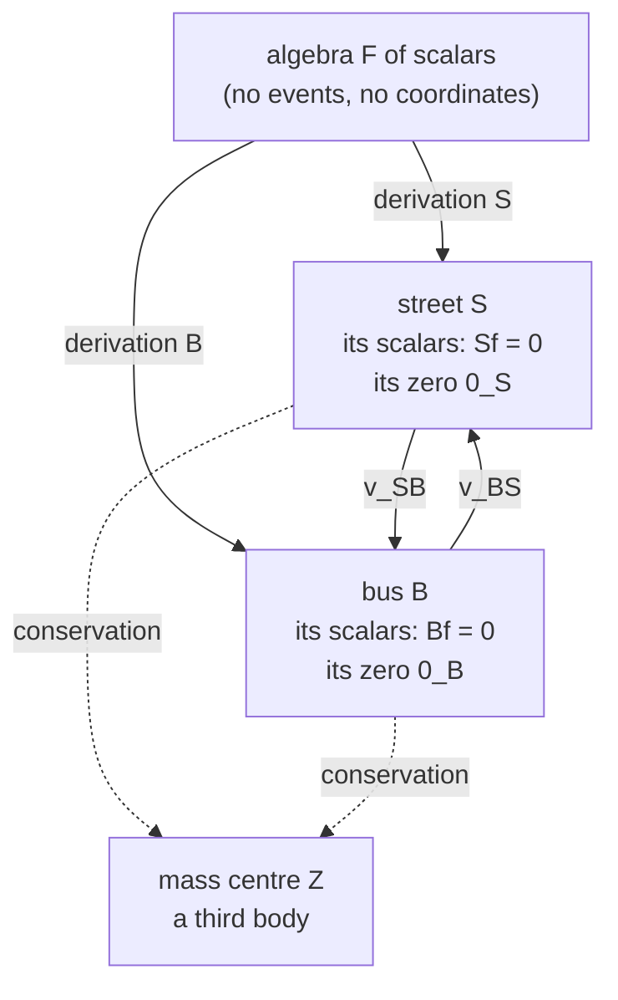

# Bodies first: a reading of *Concepts of relative velocity* and *Many-body mass-centre*

> Oziewicz's reading of relativity takes the material body, not position space, as primitive: a body is a process (a derivation), it owns its position space and its zero velocity, a velocity is a relation between two bodies, and there is no dynamics of one body alone. This supplement states that reading from *Concepts of relative velocity* (Oziewicz and Page 2011) and *Many-body mass-centre* (2014; long version 2017), and asks whether it is a different theory or standard relativity read differently. It separates a metric-free layer (bodies, their position spaces, splits by a chosen clock), which Galilean and Einstein kinematics share, from the layer that needs the metric. **Proposition RV2**: Einstein's ternary velocity of the bus relative to the street seen by an eagle equals Oziewicz's binary velocity whenever the eagle lies in the plane of street and bus (in particular when the eagle is the street). **Proposition RV3**: for an eagle outside that plane it differs in size and direction by a Thomas-Wigner rotation. With the metric the two papers are standard special relativity (ladder step 1 for the mass centre), so the difference rests on the meaning of "relative". **Propositions RV5 and RV6** read *Ternary relative velocity* (2007): its formulas are right, but its "astonishing conflict" of the Lorentz group with the relativity principle needs Einstein's reciprocity read as an equality of vectors in one space, and its proposed test (4.2) compares two different quantities of standard relativity. The applications to Pioneer, galaxy rotation curves, wide binaries and cosmic rays in the Project chats of 2025 are withdrawn. Checked exactly with SymPy; the sizes in §7 are numerical.

**Status.** Supplement (background and reading, not a ladder step). Labels
use the prefix **RV**; the ladder's results are cited by their MC labels from
[`analysis/mass_centre.md`](../analysis/mass_centre.md). Companion script:
[`src/verify_relative_velocity.py`](../src/verify_relative_velocity.py).
Prompted by Bill Page, 1 November 2026, to replace the Project-chat summaries
of June 2025 with a reading that puts Oziewicz's own view first. §6 was added the same day, from the full text of *Ternary relative velocity* (2007) and Oziewicz's NPA talk of December 2009. Step 2 ([`ternary_mass_centre.md`](../analysis/ternary_mass_centre.md), 2 November 2026) corrects §6 and answers RV-SP3; the places are marked. Drafted with
Claude (Anthropic) and subject to review. Every statement of what Oziewicz
meant is a reading of the cited section, not a verified fact about him.
[PDF](https://github.com/billpage/oziewicz/releases/latest/download/bodies_first.pdf)

Section and equation numbers for *Many-body mass-centre* are those of the 2017
long version, as in step 1, whose §1 maps them to the public 2015 version.

---

## 0. What this supplement inherits and retracts

**Inherits** from step 1 (`analysis/mass_centre.md`): the dictionary MC0, the
binary velocity MC1, the pair groupoid MC2, the mass centre as the
centre-of-momentum frame MC3, and the position problem MC7. They are cited, not
re-derived.

**Retracts.** Step 1 withdrew the June 2025 summaries of the mass-centre paper.
The same chats went on to apply the paper to the Pioneer anomaly, galaxy
rotation curves and cosmic rays, with estimated effect sizes. Those estimates
were never computed and §7 shows they cannot be right; they are withdrawn too.
A LaTeX draft and BibTeX file compiled from those chats on 1 November 2026 were
never committed and are superseded by this file.

---

## 1. Oziewicz's reading: the body is primitive

The textbook route starts from a space of positions, puts bodies in it, and
gives each body a velocity. Oziewicz reverses the order. The five points below
are his, read from the cited sections; they are the substance of his
position, and the mathematics of §§2-4 is its formal expression.

1. **No universal position space.** There is no absolute three-dimensional
   position space in nature: "There are many position-spaces and each one
   needs some material body at rest" (*Mass-centre* §1.1). In
   *Concepts* §5 a position space is a quotient, "space-time / material body":
   two events are in the same place for the street if the street says so, and
   not, in general, for the bus.
2. **Each position space belongs to a body.** A body `X` owns its conserved
   scalars, the functions `f` with `Xf = 0` (the coordinates that stay fixed
   along the body), and the Grassmann factor algebra `ker ev_X` of forms
   annihilated by contraction with `X` (§1.1, (1.4.1)-(1.4.3), §3.1). Terminology 3.1.1 goes as far as
   identifying the body with this algebra. Being at rest is owning the zero
   velocity, and every body owns a different zero, `0_X != 0_Y` (Postulate
   1.2.1, Notation 1.2.2). Many zeros make the velocities a groupoid, not a
   group.
3. **The 4-vector is the body, not its velocity.** "Time-like four-velocity is
   wrong concept" (§1.2.2). A single body has an internal energy `mc^2` and no
   velocity at all, because a velocity needs a second body to be relative to.
   The time-like derivation `X` is the body itself, read as a process from its
   own past to its own future (Figure 1.1); "four-velocity" is a misreading of
   it.
4. **There is no dynamics of one body.** Velocity is a pair of bodies;
   acceleration is the Lie bracket of two bodies, `L_X v_XY = [X, Y/gamma]`
   (Definition 1.8.1), not Einstein's `∇_X X` of one body (§1.2.2, §1.8.2); and
   "2-body problem is in fact always 3-body" because the two bodies have a mass
   centre, which is a third body with its own position space (§2.1). Every
   motion is relative and mutual: `v_XY` always comes with `v_YX`
   (Conclusion 1.2.3).
5. **Homological, not geometric.** The primitive is a commutative algebra `F`
   of scalars; bodies are its derivations; position spaces are quotients of
   Grassmann algebras. No manifold of events, no coordinates, no frames
   (§3.2, Clarification 1.7.1). *Concepts* (2011) still treats the spacetime
   of events as the physical arena (§5); by 2017 even events are dropped (§3.2).

The picture, after *Concepts* Figure 1:



*Analogy.* A city has no map of its own; each bus company draws one with its
own depot at the centre. A route is a relation between two maps (where my
stop is on yours), and asking where a lone bus "is" without a map has no
answer.

Bill Page's account of Oziewicz's intent adds one point the papers show only
indirectly: Oziewicz wanted to avoid the metric notion of "time-like". The
papers support this in two places. A body does not fix its clock: "a
process-derivation does not determine uniquely his clock-differential-form"
(Definition 1.4.1). And *Concepts* §4 says the relativity of space is
"metric-independent, and requires no concept of simultaneity". §2 makes this
precise.

---

## 2. Two layers: what needs a metric

Oziewicz's constructions fall into two layers. The first uses only the algebra,
the bodies and a choice of clock; the second adds the metric `g` of Postulate
1.6.2.

| Concept | Metric-free layer | What the metric adds |
|---|---|---|
| body | a derivation `X != 0` | "time-like": `(gX)X = det g < 0` (1.6.5) |
| position space of `X` | scalars with `Xf = 0`; forms in `ker ev_X` (§1.1, §3.1) | nothing |
| clock of `X` | any one-form `alpha` with `alpha X = 1` (Def. 1.4.1) | the canonical clock `gX / (gX)X` (1.6.6) |
| split, relative velocity | `Y = (alpha Y)(X + v_XY)`, `v_XY = Y/(alpha Y) - X` (1.4.4)-(1.4.7) | `gamma_XY = clock_X Y = clock_Y X`, symmetric (1.6.6) |
| speed of light | absent | `det g = -c^2` (1.6.7, §1.7.4) |

**Proposition RV1 (the metric-free layer).**

1. For any body `X`, any clock `alpha` of `X` and any body `Y` with
   `alpha Y != 0`, the split `Y = (alpha Y)(X + v_XY)` holds with
   `alpha(v_XY) = 0`. No metric is used.
2. If all bodies share one clock (`alpha X = alpha Y = alpha Z = 1`), the
   velocities add: `v_XY + v_ZX = v_ZY` ((1.4.8)). This is Galilean
   kinematics.
3. With the metric clocks of (1.6.6), `v_XY + v_YX = 0` only when
   `gamma_XY = 1` (from (1.7.22)).

Parts 1 and 2 are checked exactly in Part D of the script, with symbolic
4-vectors and a symbolic clock; part 3 is Proposition MC1 of step 1.

So the metric-free layer carries the whole of Oziewicz's ontology of §1: bodies,
the position space each one owns, the many zeros, relative velocity as a
relation between two bodies. It does not distinguish Galilean from Einstein
kinematics; the clocks decide that. What it cannot supply is the finite speed
`c`, which enters only through `det g = -c^2`, together with the meaning of
"time-like" and the bound `|v| < c`. So "time-like" can be dropped in the first
layer and is needed in the second, and the second is where the two papers do
their relativistic work: the gamma factors, the non-reciprocity (1.7.19), the
mass centre of chapter 2.

---

## 3. Binary and ternary velocity

*Concepts* §§2-3 introduce three bodies: a street `S`, a bus `B` and an eagle
`E` who observes both. Its Theorem (isometry-link problem) says that, given
unit time-like `E, S, B`, there is exactly one `w` with `E.w = 0` such that the
boost generated by the bivector `E ∧ w` sends `S` to `B`:

```math
L_{E\wedge w}\,S=B,\qquad
L_{E\wedge w}\,x=x-\big((\gamma-1)\,E\cdot x-w\cdot x\big)E-\Big(E\cdot x-\frac{w\cdot x}{\gamma+1}\Big)w,\qquad \gamma=\sqrt{1+w\cdot w},
```

with signature `(-,+,+,+)` and `c = 1`. *Concepts* calls `w = gamma v / c` the
velocity of the bus relative to the street as measured by the eagle, and
concludes that Einstein's relative velocity is **ternary**: it depends on
`E`. The binary velocity of *Mass-centre* (1.4.7) depends on `S` and `B` only.
How are the two related?

**Proposition RV2 (an eagle in the plane).** Let `E` lie in the plane spanned
by `S` and `B`. Then the solution is the boost by the rapidity between `S` and
`B` in that plane, the same boost for every such `E`, and

```math
w(S,S,B)=\gamma_{SB}\,v_{SB},\qquad w(B,S,B)=-\gamma_{SB}\,v_{BS}.
```

So the binary velocity is the ternary velocity with the street as its own
eagle, and the two mutual binary velocities `v_SB`, `v_BS` are the same boost
read in the rest spaces of `S` and of `B`. (Exact, Part B, with symbolic
rapidities; the boost formula is checked to be an isometry in Part A.)

**Proposition RV3 (an eagle outside the plane).** Take, in the eagle's frame,
`u_S = (3/5, 0)` and `u_B = (0, 4/5)`, so `gamma_SB = 25/12`. Then:

1. the isometry-link problem has exactly one solution, `w = (0, -105/148, 140/111)`,
   with `w.w = 412825/197136`, whereas the binary velocity has
   `(gamma_SB v_SB)^2 = 481/144`;
2. the two boosts differ by a rotation `R` of the street's rest space,
   `L_{E∧w} = L_{S∧γv_SB} R`, with `cos t = 1081/1369` (`t ≈ 37.85°`): the
   Thomas-Wigner rotation;
3. `w / gamma_w` is the velocity `v` of Einstein's addition `v ⊕ u_S = u_B` in
   the eagle's frame.

(Exact rationals in 2+1 dimensions, Part C.) This is one case, not a general
proof; parts 2 and 3 are standard facts about Lorentz boosts.

So *Concepts* is right that the boost-link velocity depends on the eagle, and
the dependence is precisely the Thomas-Wigner rotation. Einstein's addition is
non-associative because it compares every velocity in one fixed eagle's rest
space. Oziewicz's binary velocity removes the eagle by making the reference
body its own observer, and its associativity is then automatic (MC2).
Both are inside standard special relativity: the ternary velocity is a family
labelled by the observer, and the binary velocity is the member that needs no
third body.

*Analogy.* Two arrows on two different maps can be compared only after one map
is laid on the other. The eagle lays both on its own map, and a different
eagle lays them at a different angle. Oziewicz lays the bus's arrow on the
street's map, and only there.

---

## 4. The mass centre

Oziewicz's claim (*Mass-centre* §1.1, §2.1) is that an intrinsic centre of mass
of an interacting system is impossible "within the Albert Einstein theory of
relativity postulating the Lorentz group" and well defined when bodies are
primitive. Step 1 found (MC3) that his mass centre `Z` of Definition 2.1.3 is
the direction of the total 4-momentum, the centre-of-momentum frame, which is
standard and Lorentz covariant; and (MC7) that the problem of Pryce and Møller,
which concerns the position of the centre, is not addressed.

In Oziewicz's own terms the result fits his ontology well. `Z` is one more
body, with its own clock and its own position space (Keres's "z-space"); a
two-body system is a three-body system. Which point of that z-space is the
centre is a question about a position, and his ontology declines to make
positions primary. Read that way, he did not solve Pryce's problem but argued
it away: the question presupposes a position space the system does not own.
Whether that is acceptable is a question about interpretation, not
mathematics (open item MC-SP1).

---

## 5. Equivalence, and what remains

Bill Page's question: Oziewicz did not regard his approach as equivalent to
conventional relativity (the Lorentz group is "useless", §1.1; the groupoid
gamma "conceptually is completely different", Warning 1.6.4). Can the
equivalence be proved?

| Oziewicz | Standard covariant relativity | Where shown |
|---|---|---|
| body `X`, `(gX)X = det g` | `c` times a 4-velocity | MC0 |
| groupoid gamma `gamma_XY` | Lorentz factor `-g(u_X, u_Y)` | MC0 |
| binary velocity `v_XY` | velocity of `Y` in the rest space of `X` | MC1 |
| non-reciprocity (1.7.19) | the two velocities lie in different rest spaces; the boost carries one to minus the other | MC1 |
| associative groupoid | pair groupoid; automatic | MC2 |
| ternary velocity (*Concepts*) | boost parameter seen by a third observer; reduces to the binary one in the plane | RV2, RV3 |
| mass centre `Z`, total mass `M` | centre-of-momentum frame, invariant mass | MC3 |
| position space of a body | the space of a reference frame, a quotient of spacetime, as in Matolcsi (1994) | RV1 |

For everything in the two papers, the answer is yes: with Postulates
(1.6.1)-(1.6.5) the metric fixes the Lorentz group (MC2), and every result
checked is a standard result written without coordinates. The
equivalence is mathematical, not only numerical: each row is an identity
between the same objects, not an agreement of predictions.

So the issue rests on the interpretation of "relative", as Bill Page suggests.
The textbook reading takes one position space at a time, chosen by
coordinates, and lets a third body (the eagle, the laboratory) supply it.
Oziewicz's reading gives each body its own space and allows a velocity only as
a relation between two of them. The second reading is not foreign to modern
relativity: it is the reference-frame-free formulation of Matolcsi (1994),
which Oziewicz cited, and of the "relative space" literature cited in
*Concepts* (Ruggiero 2003; Arminjon and Reifler 2010). What is his own is the
insistence that it is the only reading, and the homological language.

A difference of substance would need something these papers do not contain:
dynamics. The relative accelerations of §1.8 (open item MC-SP4), spin in `dP`
(MC-SP3), and the algebra of observers are where the bodies-first reading might
say something the textbook reading does not.

---

## 6. The "astonishing conflict"

*Ternary relative velocity* (Oziewicz 2007, posted to arXiv in 2011) carries
the subtitle "Astonishing conflict of the Lorentz group with relativity". His
talk to the Natural Philosophy Alliance in December 2009 makes the same
argument (PDF pages 26-31 and 38; slide positions 36-53). It can be heard, with
its slides and transcript, [in his own voice](https://billpage.github.io/oziewicz/narrated/npa2009_oziewicz_narrated.html)
or [read by a synthetic voice](https://billpage.github.io/oziewicz/narrated/npa2009_andrew_narrated.html);
sources and notes are in [`talks/npa2009/`](../talks/npa2009/README.md). Notation as in §3, with
the paper's letters: `P`, `A`, `B` are unit time-like (`P` the preferred
observer, the eagle of *Concepts*), `w` satisfies `P.w = 0`, and
`v = w / sqrt(1 + w.w)`; the binary velocity is `v_AB = B/gamma - A` with
`gamma = -A.B`. Section and equation numbers below are the paper's.

**What the paper claims.** Main conclusion 2.6: if (i) there is one and only
one relative velocity between each pair of massive bodies, and (ii) each pair
is related by a Lorentz isometry (Definition 2.1, Minkowski's axiom), then a
preferred reference system must be chosen, so that special relativity with the
Lorentz group "necessarily contradicts" the relativity principle (§2, p. 300).
The final remark (§7.3) ends with the chain: no absolute space, so no
Einstein relative velocities, so no Einstein special relativity, so no
asymmetric biological ageing of twins.

**Proposition RV5 (the ternary formulas).**

1. Eq. (2.2) solves the isometry-link problem of Theorem 2.3: with `w = gamma_v v`, `P.w = 0` and `L_{P∧w} A = B`; and `v(P, B, A) = -v(P, A, B)` (2.3).
2. Eq. (2.4) is `sqrt(1 + w.w)`, the gamma of the boost parameter. For `P` outside the plane of `A` and `B` it differs from `gamma = -A.B`, the factor that gives time dilation between `A` and `B`.
3. For `P` in that plane, (2.2) reduces to the form (2.5) of de Abreu and Guerra and (2.4) to `-A.B` (Corollary 2.4, and the "if" half of Theorem 2.5). In particular, for `P = A` (2.2) is the binary velocity `v_AB`.

(Exact, Part E: parts 1 and 2 on two cases with rational velocities, one of
them the case of RV3, where `gamma_ternary = 781/444` and `-A.B = 25/12`;
part 3 with symbolic rapidities (as `exp` of the rapidity, so that the check is rational), and `P = A` on the general case. The "only
if" half of Theorem 2.5 is not checked here; step 2 proves it, TV5.)

So the mathematics of the paper is right, and it is RV2 and RV3 in closed
form. The conclusion drawn from it does not follow, for four reasons.

1. **Premises (i) and (ii) hold without a preferred system.** Take `P = A`, the
   body that measures. By part 3 each ordered pair `(A, B)` has one velocity,
   `v_AB`, and the boost `L_{A∧gamma v_AB}` links `A` to `B` (MC1). The choice
   of `P` is fixed by the pair; it is what "as measured by `A`" means.
   Definition 2.2 itself reads "as seen/measured by", and in the 2009 talk,
   answering a question about the textbook Lorentz transformation, Oziewicz
   agrees that `v` is the velocity of `B` with respect to `A` "as measured by
   A".
2. **The conflict needs a third premise.** §7.1 names it: Einstein's
   reciprocal-velocity axiom, `v(B -> A) = -v(A -> B)`, read as an equality of
   vectors in one space. Only that reading forces one `P` for both directions;
   with `P = A` for one and `P = B` for the other the two velocities lie in
   different rest spaces, and reciprocity holds after transport by the boost
   (MC1, part 3). So the conflict is between the relativity principle and a
   literal reading of the 1905 reciprocity axiom, not between the relativity
   principle and the Lorentz group. The historical remark of §7.1, that
   Einstein's 1905 derivation uses reciprocity as a tacit axiom, is the part
   that stands (a reading of the paper, not checked against Einstein 1905
   here). *Corrected by step 2:* literal reciprocity can be satisfied pair by
   pair, with `P` the mass centre of the pair or any body in its plane (TV3).
   What forces a preferred system is one `P` for all pairs, or composition of
   the boosts among three bodies (TV6).
3. **The binary velocity does parameterize an isometry.** §4 says it "can not
   parameterize the isometric Lorentz transformation". It does: `L_{A∧gamma u}`
   is an isometry taking `A` to `B = gamma (A + u)` (MC1; used in Part F). What
   fails is compatibility with composition. The boost from `A` to `B` followed
   by the boost from `B` to `C` takes `A` to `C`, but it is the boost from `A`
   to `C` only up to a rotation of the rest space of `A`, the Thomas-Wigner
   rotation of RV3 (open item RV-SP3). The arrows themselves compose
   associatively (MC2).
4. **The twins.** §4 says the groupoid theory "predicts exactly the same
   time-dilation as the relativity-Lorentz-group". The ages of twins who part
   and meet again are proper times `∫ sqrt(-g(dx/ds, dx/ds)) ds` along their
   two worldlines, built from the metric alone, and the groupoid theory has
   the same metric (MC2). So asymmetric ageing holds there too, and the last
   step of the chain in §7.3 contradicts §4.

**Proposition RV6 (the moving-media test, (4.2)).** Let Alice be `A`, Bob
`gamma (A + u)` with `A.u = 0`, and let `F` be an electromagnetic field whose
electric and magnetic fields seen by Alice are `E` and `B_A`, with
`u x B_A = 0`. Write `E_A` and `E_Bob` for the electric fields of `F` seen
by Alice and by Bob, as space-like 4-vectors (each orthogonal to its
observer). Then

1. `E_Bob . E_A - gamma E_A . E_A = 0`, the value (4.2) gives for "groupoid relativity" when its `E'.E` is read as this Minkowski product (a reading: the paper gives no derivation);
2. if `E'` is `E_Bob` carried into Alice's rest space by `L_{A∧gamma u}^{-1}` (the textbook transformed field, read on Alice's axes), then `E'.E - gamma E^2 = -gamma^2 (u.E)^2 / (gamma + 1)`, the value (4.2) gives for "Lorentz-group relativity".

(Exact, Part F, with symbolic `u`, `E` and `B_A`.) Both are statements of
standard special relativity about two different quantities: the first
compares Bob's field with Alice's directly, the second after laying Bob's rest
space onto Alice's with the boost. `E'.E` has no meaning until it is said how
Bob's vector is to be compared with Alice's; once that is said, both
"theories" give the same number. (4.2) is therefore not an experimental test
between them. It is the comparison of vectors from two rest spaces (MC1, and §3 here) again, in electrodynamics.

**Thomas rotation.** §7.2 calls the Thomas-rotation account of
non-associativity and of the Mocanu paradox "not satisfactory", and says the
Dirac equation removed the need for Thomas precession. The Dirac equation
contains the Thomas factor (it reappears in the spin-orbit term of the
equation's non-relativistic reduction), and Thomas precession is part of the
Bargmann-Michel-Telegdi equation used to analyse spin precession in storage
rings. That is standard physics, cited and not checked here. It is the same
rotation as in RV3.

| Claim in *Ternary relative velocity* | Standing |
|---|---|
| (2.2)-(2.5), Theorem 2.3 | Correct; the "if" half of Theorem 2.5 checked (RV5) |
| The boost linking `A` to `B` is not unique | True: unique only once an observer is fixed (RV5) |
| Einstein velocity needs a preferred system (2.6) | Not from (i) and (ii). With composition added, a base point is needed, and it need not be exterior (step 2, TV6) |
| Binary velocity cannot parameterize an isometry (§4) | False; it is not compatible with composition (Thomas-Wigner) |
| (4.2) distinguishes the two theories | No: two quantities of standard relativity (RV6) |
| No asymmetric ageing without absolute space (§7.3) | Contradicts the paper's own §4 |
| No material rod contraction (§4) | Asserted without derivation here (RV-SP4) |

---

## 7. What does not follow: withdrawn applications

The June 2025 chats applied the paper far beyond its content. Every quantity in
chapter 2 depends on velocities only through `gamma`, and every relation there
is standard kinematics (MC3, MC5), so a prediction would need a `gamma` large
enough to matter and a dynamical law, which the paper does not give
(MC-SP2, MC-SP4).

| Application claimed in 2025 | Size or status (Part W, numerical) | Standing |
|---|---|---|
| Wide binaries violate Kepler "for higher `gamma`" (end of §2.2, citing Hernandez et al. 2012) | `gamma - 1 ≈ 6e-12` at 1 km/s; Hernandez et al. place the anomaly at low acceleration, large separation | Oziewicz's reading of Hernandez et al. is not supported by their abstract; withdrawn |
| Pioneer anomaly from collective `gamma` effects | at 20 AU, `v ≈ 12 km/s`, `gamma - 1 ≈ 8e-10`; Newtonian acceleration times `(v/c)^2 ≈ 2e-14 m/s^2`, against `8.7e-10 m/s^2` reported | withdrawn; the anomaly is attributed to anisotropic thermal radiation (Turyshev et al. 2012) |
| Flat galaxy rotation curves without dark matter | `gamma - 1 ≈ 3e-7` at 220 km/s; flat curves need order-one changes in the enclosed mass | withdrawn |
| Cosmic rays above the GZK cutoff | see Remark RV4 | withdrawn |

**Remark RV4 (cosmic rays).** *Mass-centre* §2.2 mentions protons with
`gamma ≈ 1e11` and nothing more. The GZK cutoff is an invariant-mass condition:
a proton `X` absorbing a microwave photon `G` forms a bound system of mass `M`
with `M^2 = m^2 + 2 m E_XG` (in units `c = 1`), which is Theorem MC3 applied to
absorption (exact, Part G). Pion production needs `M >= m_p + m_pi0`, that is
`E_XG >= 144.7 MeV` in the proton's frame; for a head-on photon of the mean
microwave energy, `6.3e-4 eV`, that is `gamma ≈ 1.1e11`, a proton of
`1.1e20 eV` (numerical; the cutoff quoted from the full spectrum is lower,
about `5e19 eV`). So the protons Oziewicz mentions sit at the GZK threshold, and
since his mass formula is the invariant mass, his framework gives the same
threshold as the textbook. It offers no way past it.

---

## 8. Open items

- **RV-SP1.** Can the finite speed `c` be introduced without the metric, for
  example from a cone structure or a conformal class alone? Oziewicz's remark
  that the symmetry group of Maxwell's equations is the conformal group
  (Clarification 1.7.11) suggests he considered it. Without it, "time-like"
  cannot be eliminated from the second layer.
- **RV-SP2.** Is there a statement, kinematic or dynamical, that holds in the
  bodies-first reading and fails in the textbook one? None was found in these
  two papers, nor in step 2. MC-SP4 (relative accelerations) is the first
  candidate.
- **RV-SP3.** *Answered in step 2, §5.* Prove Proposition RV3 in general: for an eagle outside the plane
  of `S` and `B`, `L_{E∧w}` equals the binary boost followed by a rotation of
  the street's rest space, and the rotation is the identity only for eagles in
  the plane.
- **RV-SP4.** *Ternary relative velocity* §4 says groupoid relativity has "no
  material rod contraction", without derivation (it cites Oziewicz 2006,
  2007). With the metric clock of (1.6.6), is the length of a rod moving
  relative to `A`, taken on `A`'s simultaneity, contracted? If it is, the claim
  rests on a different definition of length, which should be stated.

---

## 9. Verification

`PYTHONPATH=src python3 -u src/verify_relative_velocity.py` ends with
`ALL CHECKS PASSED`.

| Part | What is checked | How |
|---|---|---|
| A | The boost formula of *Concepts* is an isometry and sends `E` to `gamma E + w` | SymPy, symbolic `w` in 1+3 |
| B | RV2: one boost for every eagle in the plane; `w(S,S,B) = gamma v_SB`, `w(B,S,B) = -gamma v_BS` | SymPy, symbolic rapidities |
| C | RV3: unique solution, different size, Thomas-Wigner rotation, Einstein addition | exact rationals, 2+1 |
| D | RV1: split with an arbitrary clock; Galilean additivity (1.4.8) | SymPy, symbolic vectors and clock |
| E | RV5: (2.2) solves the link and is reciprocal; (2.4) is the boost-parameter gamma; coplanar and `P = A` reductions; `(v_AB + v_BA)^2` | SymPy, exact rationals in 1+3 and symbolic rapidities |
| F | RV6: both values of (4.2), and `E'` as `E_Bob` carried by the boost | SymPy, symbolic `u`, `E`, `B_A` |
| G | RV4: `M^2 = m^2 + 2 m E_XG`; threshold numbers | exact identity; numbers numerical |
| W | sizes in §7 | numerical |

---

## References

- Z. Oziewicz and W. S. Page, "Concepts of relative velocity", 29 March 2011, [arXiv:1104.0684](https://arxiv.org/abs/1104.0684).
- Z. Oziewicz, "Many-body mass-centre: Homological Algebra for relativity of position-spaces", *J. Phys.: Conf. Ser.* 532 (2014) 012021, [doi:10.1088/1742-6596/532/1/012021](https://doi.org/10.1088/1742-6596/532/1/012021); long versions as in [`references/bibliography.md`](../references/bibliography.md).
- Z. Oziewicz, "Ternary relative velocity; astonishing conflict of the Lorentz group with relativity", in V. Gladyshev (ed.), *Physical Interpretations of Relativity Theory*, Moscow 2007, pp. 292-303; [arXiv:1104.0682](https://arxiv.org/abs/1104.0682).
- V. Bargmann, L. Michel and V. L. Telegdi, "Precession of the polarization of particles moving in a homogeneous electromagnetic field", *Phys. Rev. Lett.* 2 (1959) 435, [doi:10.1103/PhysRevLett.2.435](https://doi.org/10.1103/PhysRevLett.2.435).
- A. A. Ungar, "Thomas rotation and the parametrization of the Lorentz transformation group", *Found. Phys. Lett.* 1 (1988) 57-89, [doi:10.1007/BF00661317](https://doi.org/10.1007/BF00661317).
- X. Hernandez, M. A. Jiménez and C. Allen, "Wide binaries as a critical test of classical gravity", *Eur. Phys. J. C* 72 (2012) 1884, [ADS](https://ui.adsabs.harvard.edu/abs/2012EPJC...72.1884H/abstract).
- S. G. Turyshev et al., "Support for the thermal origin of the Pioneer anomaly", *Phys. Rev. Lett.* 108 (2012) 241101, [ADS](https://ui.adsabs.harvard.edu/abs/2012PhRvL.108x1101T).
- T. Matolcsi, *Space-time Without Reference Frames* (Akadémiai Kiadó, Budapest 1994).
- M. L. Ruggiero, "The relative space: space measurements on a rotating platform", *Eur. J. Phys.* 24 (2003) 563-573; M. Arminjon and F. Reifler, "General reference frames and their associated space manifolds", arXiv:1003.3521 (both as cited in *Concepts*; not re-checked).
