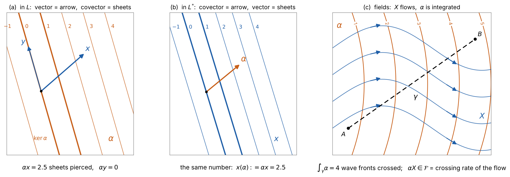

# From Grassmann to Clifford: Oziewicz 1986, its sequel, and two later readings

> A summary, in this repository's words, of Z. Oziewicz, "From Grassmann to Clifford" (1986), with every formula restated and keyed to the paper's equation numbers. The paper's thesis is that the pair of Grassmann algebras of multivectors and multiforms is primary, that exterior multiplication and its transpose are fermion creation and annihilation operators with no metric, and that a Clifford algebra is the same space with the product fixed by `γ_v = e_v + i_{φv}` for a linear map `φ` from vectors to covectors, not necessarily symmetric. All the paper's formulas that could be tested pass exact checks for generic `φ`. Three later texts are then compared with it. Oziewicz's own sequel (1997) constructs the product that 1986 postulates and concedes that the antisymmetric part `ω` of `φ` labels isomorphic algebras; its Conjecture 8.2 on the minimum polynomial of `γ^μ ⊗ γ_μ` is true in every dimension, by a short argument given here. Jadczyk (2021) proves the construction in full and shows that `ω` is a gauge, implemented by `exp(i_ω)`; one sign in his eq. (68) is wrong under his own conventions. Sobczyk's globally dual null vectors are the 1986 dual pair, and his locally dual ones are the 1986 construction for one particular `φ`. The conclusion (§13): what is given without any choice is the evaluation of covectors on vectors; the Grassmann algebra is its Fock space; a metric is the choice of a subspace, the graph of `φ`, of the doubled space. 90 exact checks pass.

**Status.** Supplement (a reading of published papers, not a ladder step). Companion
script: [`src/verify_grassmann_clifford.py`](../src/verify_grassmann_clifford.py).
Requested by Bill Page, 15 November 2026; the comparisons and the conclusion were added on
15 and 16 November. **Every statement of what a paper says is a reading.** The 1986 paper
was read from page images of a 120 dpi scan with no text layer; the readings that are
uncertain are listed in §15. The 1997 paper was read in full from the author's later
re-typeset version, supplied by Bill Page. Jadczyk's paper was read in full from the arXiv
text. Of Sobczyk's papers, §11 says which were read in full and which in part. Statements
marked **[verified]** were checked exactly with SymPy (§16); statements marked **[note]**
are analysis made for this repository and are not in the paper under discussion. None of
the papers is committed here; links are in §17 and in
[`references/bibliography.md`](../references/bibliography.md). Drafted with Claude
(Anthropic) and subject to review.
[PDF](https://github.com/billpage/oziewicz/releases/latest/download/grassmann_to_clifford.pdf)

**Source.** Z. Oziewicz, "From Grassmann to Clifford", in J. S. R. Chisholm and A. K. Common
(eds.), *Clifford Algebras and Their Applications in Mathematical Physics*, NATO ASI Series
C 183, D. Reidel, Dordrecht 1986, pp. 245–255. <https://doi.org/10.1007/978-94-009-4728-3_20>.
The author's copy of the same scan is on ResearchGate:
<https://www.researchgate.net/publication/300516562_From_Grassmann_to_Clifford>. Equation
numbers `(n)` and page numbers are the paper's unless another paper is named.

---

## 1. The thesis in brief

The paper argues that the Grassmann algebra, taken as a *dual pair* (multivectors and multiforms
together), is the primitive structure, and that a Clifford algebra is that same Grassmann algebra
plus one extra piece of data: a linear map $`\phi`$ from vectors to covectors. Three claims carry
the argument:

1. Exterior multiplication $`e`$ and its transpose $`i`$ are, with no metric at all, the creation
   and annihilation operators of fermions; the canonical anticommutation relations are the
   duality pairing (eq. 16).
2. A Clifford generator is a "quasi-particle" operator $`\gamma_v = e_v + i_{\phi v}`$, a sum of a
   creation and an annihilation operator in the sense of a Bogoliubov transformation.
3. The Clifford product on the *same* underlying space as the Grassmann algebra is fixed by
   $`\gamma_v`$ on vectors plus associativity (eq. 23). The map $`\phi`$ need not be symmetric:
   $`\phi = g + \omega`$ with $`g`$ symmetric and $`\omega`$ antisymmetric.

**Analogy.** Think of the doubled space $`\mathcal V^1 \oplus \Lambda^1`$ (vectors plus covectors) as
a phase space carrying the canonical pairing $`(x,\alpha) \mapsto \alpha x`$. The operators
$`e_x + i_\alpha`$ represent its Clifford algebra on the Grassmann algebra. Choosing $`\phi`$ selects
the subspace "graph of $`\phi`$" $`= \{(v, \phi v)\}`$ inside the doubled space, and the Clifford
algebra of $`\phi`$ is what the operators attached to that subspace generate. A metric is thus a
choice of slice through a structure that exists before any metric does. **[note]**

| Point of the doubled space $`\mathcal V^1\oplus\Lambda^1`$ | Operator on the Grassmann algebra $`\mathcal V`$ | Its square |
|---|---|---|
| any $`(x,\alpha)`$ | $`e_x + i_\alpha`$ | $`\alpha x`$ |
| on the graph of $`\phi`$: $`(v,\phi v)`$ | $`\gamma_v = e_v + i_{\phi v}`$ | $`\phi(v,v) = g(v,v)`$ |

## 2. Notation

| Paper | Here | Meaning |
|---|---|---|
| $`F`$ (script) | $`\mathcal F`$ | commutative algebra of scalars: $`\mathbb R`$, $`\mathbb C`$, or smooth functions |
| $`L, L^*`$ | same | a vector space and its dual (pp. 245–246) |
| $`V^1`$ (script) | $`\mathcal V^1`$ | $`\mathcal F`$-module of derivations of $`\mathcal F`$ (vector fields) |
| $`\Lambda^1`$ | $`\Lambda^1`$ | dual module of differential 1-forms |
| $`V`$ (script), $`\Lambda`$ | $`\mathcal V = \bigwedge \mathcal V^1`$, $`\Lambda = \bigwedge \Lambda^1`$ | Grassmann algebras of multivectors and of multiforms; $`\mathcal V^0 = \Lambda^0 = \mathcal F`$ |
| $`x, y, v, w, \dots`$ | same | multivectors; $`\deg`$ is the Grassmann degree |
| $`\alpha, \beta, \omega`$ | same | multiforms |
| $`\alpha x`$ | $`\alpha x`$ or $`\alpha(x)`$ | value of a form on a multivector of the same degree |
| $`e_x`$ | $`e_x`$ | left exterior multiplication, $`e_x y = x \wedge y`$ |
| $`i_x`$, $`i_\alpha`$ | same | transpose of $`e_x`$ (acts on $`\Lambda`$), of $`e_\alpha`$ (acts on $`\mathcal V`$) |
| $`\{A,B\}`$ | same | graded commutator (super-bracket), eq. (14) |
| $`\phi`$ | $`\phi`$; $`F`$ in Jadczyk | linear map $`\mathcal V^1 \to \Lambda^1`$; as a bilinear form $`\phi(v,w) := (\phi v)(w)`$ |
| $`\gamma_v`$ | $`\gamma_v`$; $`\bar\Lambda_F(v)`$ in Jadczyk | left Clifford multiplication by $`v`$ |
| $`\delta_a`$ | $`\delta_a`$ | right Clifford multiplication, $`\delta_a b = \gamma_b a`$ |

I write $`u \cdot w := \gamma_u w`$ for the Clifford product on $`\mathcal V`$. The paper has no symbol
for it. All degrees of operators are their shifts of Grassmann degree:
$`\deg e_x = \deg x`$, $`\deg i_x = -\deg x`$.

## 3. Introduction: the dual pair (pp. 245–246)

The opening section of the paper is conceptual. §3.1 and the first paragraph of §3.2 report it;
the figure, the examples and the limits are **[note]**.

### 3.1 Two spaces, neither first

A vector space $`L`$ always comes with its dual $`L^* = \mathrm{Hom}(L, \mathbb R)`$, eq. (1), and
in finite dimension $`L^{**} = L`$: each is the space of linear functions on the other. The paper
stresses that algebra alone does not tell the two apart, and that they are nevertheless never
canonically identified. A covector $`\alpha`$ is pictured as the hyperplane $`\ker\alpha`$ together
with one vector on which $`\alpha`$ takes the value 1; wave fronts are the example given.
Introducing a bilinear form on $`L`$ identifies $`L`$ with $`L^*`$ and so hides the distinction; the
paper insists that *not choosing* a metric is different from having none available.

The same holds for modules over a commutative algebra $`\mathcal F`$: vector fields are derivations
of $`\mathcal F`$, forms are $`\mathcal F`$-linear maps $`\mathcal V^1 \to \mathcal F`$, eq. (2), and no
manifold is needed. Analysis does tell the two apart: vector fields generate flows, forms are
what one integrates.



*Figure.* **(a)** In $`L`$ a vector $`x`$ is an arrow and a covector $`\alpha`$ is a stack of parallel
sheets, its level sets; the thick ones are $`\ker\alpha`$ and the sheet where $`\alpha = 1`$. The
value $`\alpha x`$ is the number of sheets the arrow pierces, here $`5/2`$; $`y`$ lies along the
sheets, so $`\alpha y = 0`$. No length or angle is used. **(b)** In $`L^*`$ the roles are exchanged:
$`\alpha`$ is the arrow, $`x`$ the stack of sheets, and the count is the same. This is why the two
form a *pair*: neither picture comes first. **(c)** For fields, a derivation $`X`$ is drawn by its
flow lines and a 1-form $`\alpha`$ by its wave fronts. The integral of $`\alpha`$ along the path
$`\gamma`$ is the number of fronts crossed, here $`4`$; the function $`\alpha X\in\mathcal F`$ is the
rate at which the flow crosses the fronts. Two limits of the drawing: (c) draws an exact form
$`\alpha = df`$, and a general 1-form has wave fronts only locally (and in more than two
dimensions only up to a factor); (b) uses a basis to draw $`L^*`$, though the count does not
depend on it. The numbers are computed exactly in the script before the figure is drawn.

### 3.2 Covectors as measuring instruments

**What the paper says.** Whenever $`L`$ has a physical interpretation, so has $`L^*`$: roughly,
$`L^*`$ is the set of measuring instruments, and $`\alpha v`$ is the result of measuring $`v`$ with
the instrument $`\alpha`$, a result that depends on orientation. The paper adds that this ignores
the finite accuracy of real measurements, that assigning a physical quantity to $`L`$ or to $`L^*`$
is settled by experiment and not by convention (credited to Maxwell's *Treatise*), and that
the algebra $`\mathcal F`$ models the set of exact classical measurements.

**What makes an instrument a covector.** Three properties, each visible in panel (a):

1. *Linear response.* The reading of a sum is the sum of the readings, and doubling the input
   doubles the reading.
2. *Blind directions.* The instrument does not respond to anything in $`\ker\alpha`$, a whole
   hyperplane. Shearing the input along the sheets leaves the reading unchanged.
3. *Calibration.* Beyond its blind hyperplane, the instrument is fixed by one standard input on
   which it reads 1. This is the paper's "kernel plus one vector".

Reversing the instrument, $`\alpha\to-\alpha`$, reverses every reading: this is how I read
"orientation-dependent".

**Examples.**

| Instrument (covector $`\alpha`$) | Applied to (vector $`v`$) | Reading $`\alpha v`$ |
|---|---|---|
| a ruled grating or contour map: equally spaced parallel lines | a displacement | number of lines crossed |
| a wave, by its phase $`\alpha = d\varphi`$ | a displacement | number of crests crossed, $`\Delta\varphi/2\pi`$ |
| the same wave in space-time | an observer's 4-velocity | the frequency that observer counts |
| a force (spring balance) | a small displacement | work done |
| a voltmeter with a short probe: the field $`E`$ | the probe's displacement | potential drop; swapping the leads changes the sign |
| absolute time $`\tau`$ (a clock) | a displacement in space-time | elapsed time |
| a price list | a basket of goods | cost |

Remarks on the examples:

- **Doppler effect.** The third row is the second with a different kind of vector. One wave
  covector, read by two observers $`u`$ and $`u'`$, gives two frequencies $`\alpha u`$ and
  $`\alpha u'`$. No metric enters.
- **Observer.** In the sixth row an observer is a vector $`T`$ on which the clock reads 1,
  $`\tau T = 1`$: an instrument together with its calibrating vector. This is the observer
  $`T\otimes\tau`$ of Oziewicz's later papers (§11.2, item 4).
- **Maxwell.** The *Treatise* divides directed physical quantities into those referred to a line
  ("forces", such as $`E`$ and $`H`$) and those referred to an area ("fluxes", such as $`D`$ and
  $`B`$). In present terms these are 1-forms and 2-forms. The paper dates the *Treatise* to 1864;
  it appeared in 1873, and 1864 is the year of Maxwell's paper on the dynamical theory of the
  field.
- **Higher degree.** An instrument for a $`k`$-vector is a $`k`$-form; a flux meter reads a 2-form
  on an area element $`x\wedge y`$. The determinant in eq. (3) is the reading of the compound
  instrument $`\alpha^1\wedge\dots\wedge\alpha^k`$ on $`x_1\wedge\dots\wedge x_k`$ (§4, §13.2).

**What a metric hides.** With a metric one speaks of "the wave vector" and "the force vector",
replacing each instrument by the arrow perpendicular to its sheets. That the two are different
things shows wherever the identification is not available or not unique. In a birefringent
crystal the wave normal and the direction in which the energy travels differ: the first belongs
to the covector $`d\varphi`$, the second is a vector.

**Limits of the interpretation.**

- *Not every instrument is a covector.* A rod that is free to turn measures the length $`|v|`$,
  which is not linear in $`v`$: $`|v+w|\ne|v|+|w|`$. It reads a quadratic quantity and needs a
  metric. In the terms of this supplement that is exactly where $`\phi`$ enters (§7): the
  metric-free instruments are the covectors, and a metric is one more instrument of a different
  kind.
- *Linearity is local.* Real instruments respond linearly only to small inputs, which is why the
  fields of eq. (2), not the vector spaces of eq. (1), are the realistic setting.
- *Exactness.* The paper's own caveat: finite accuracy is ignored, and $`\mathcal F`$ stands for
  exact measurements.
- *"Roughly speaking".* The paper does not claim that every element of $`L^*`$ is realised by a
  device. The identification is a reading of the mathematics, not a theory of measurement.

## 4. Grassmann multiplications (pp. 247–249)

**Pairing by determinants, eq. (3).** For $`\alpha^i \in \Lambda^1`$ and $`x_j \in \mathcal V^1`$,

```math
(\alpha^1 \wedge \dots \wedge \alpha^k)(x_1 \wedge \dots \wedge x_k) := \det\big[\alpha^i x_j\big].
```

This *defines* both wedge products at once (decomposable elements span $`\mathcal V`$ and
$`\Lambda`$), with no factorial and no metric. Associativity of $`\wedge`$ is then a theorem about
determinants (the paper cites Arnold [1]). The paper stresses that the determinant is the *value*
of a form on a multivector, not a scalar product, and contrasts this with Hestenes [5, eq. 3.17]
and Hestenes–Sobczyk [6, Ch. 1–4].

**Exterior multiplication as an operator, eqs. (4)–(7).**

```math
e : \mathcal V \to \mathrm{End}\,\mathcal V, \qquad e_x y := x \wedge y, \qquad \deg(x\wedge y) = \deg x + \deg y,
```

```math
e_x \circ e_y = (-1)^{\deg x\,\deg y}\, e_y \circ e_x \quad(6), \qquad\qquad e_x \circ e_y = e_{e_x y} \quad(7).
```

Eq. (7) *is* the associativity of $`\wedge`$: it says $`e`$ is an algebra homomorphism (the left
regular representation). It is a different statement from the trivial associativity of
composition in $`\mathrm{End}\,\mathcal V`$. Likewise for $`e_\alpha`$ on $`\Lambda`$. **[verified]**

**Interior multiplication as the transpose, eqs. (8)–(12).** Diagram (8) of the paper relates
four maps:

| Map | Type | Definition |
|---|---|---|
| $`e`$ | $`\mathcal V \to \mathrm{End}\,\mathcal V`$ | $`e_x y = x\wedge y`$ |
| $`e`$ | $`\Lambda \to \mathrm{End}\,\Lambda`$ | $`e_\alpha\beta = \alpha\wedge\beta`$ |
| $`i`$ | $`\mathcal V \to \mathrm{End}\,\Lambda`$ | $`(i_x\omega)\,y := \omega(e_x y)`$, for $`\deg\omega = \deg x + \deg y`$ |
| $`i`$ | $`\Lambda \to \mathrm{End}\,\mathcal V`$ | $`\beta(i_\alpha x) := (e_\alpha\beta)\,x`$, for $`\deg x = \deg\alpha+\deg\beta`$ |

The two definitions in the right column are eq. (9). Then

```math
\deg(i_x\omega) = \deg\omega - \deg x, \qquad i_x\omega = 0 \ \text{ if } \deg\omega < \deg x \quad(10),
```

```math
i_x \circ i_y = (-1)^{\deg x\,\deg y}\, i_y\circ i_x \quad(11), \qquad\qquad i_x\circ i_y = i_{e_y x} \quad(12).
```

Note the reversed order in (12): $`i`$ is an *anti*-homomorphism, because transposition reverses
products. Consequently $`i_{x\wedge y} = i_y\circ i_x`$. **[verified]**

*Example.* For $`x \in \mathcal V^1`$ and $`\alpha,\beta\in\Lambda^1`$:
$`(i_x(\alpha\wedge\beta))(y) = (\alpha\wedge\beta)(x\wedge y) = \alpha x\,\beta y - \alpha y\,\beta x`$, so
$`i_x(\alpha\wedge\beta) = (\alpha x)\beta - (\beta x)\alpha`$: the usual left contraction.

The paper remarks that "interior product" is a poor name, since $`i`$ is an action of one algebra
on the other and has no associativity of its own to speak of.

**Antiderivation property, eq. (13).** For $`\deg x = 1`$ and $`\alpha`$ of any degree,

```math
i_x \circ e_\alpha = e_{i_x\alpha} + (-1)^{\deg\alpha}\, e_\alpha\circ i_x .
```

In most textbooks (the paper cites Greub [4, Ch. V §4]) this is the *definition* of $`i_x`$. Here it
is a consequence of (3) and (9), i.e. of the Laplace expansion of a determinant. **[verified]**

## 5. Fermion creation and annihilation operators (pp. 249–250)

**Super-bracket, eq. (14).** For homogeneous $`A, B`$ in $`\mathrm{End}\,\Lambda`$ or
$`\mathrm{End}\,\mathcal V`$,

```math
\{A,B\} := A\circ B - (-1)^{\deg A\,\deg B}\, B\circ A ,
```

an anticommutator when both degrees are odd and a commutator otherwise.

**Relations, eqs. (15)–(16).** On $`\Lambda`$:

```math
\{e_\alpha, e_\beta\} = 0, \qquad \{i_x, i_y\} = 0, \qquad \{i_x, e_\alpha\} = e_{i_x\alpha} + (\dots).
```

For $`\deg x = \deg\alpha = 1`$ the dots vanish, $`e_{i_x\alpha}`$ is multiplication by the scalar
$`\alpha x`$, and

```math
\{i_x, e_\alpha\} = \alpha x \in \mathcal F \qquad(16).
```

These are the canonical anticommutation relations (CAR), obtained with no Hilbert space and no
metric: the right-hand side is the duality pairing. **[verified]** The paper's reading:
$`\mathcal V`$ and $`\Lambda`$ are the Fock spaces of fermions and antifermions; if $`e`$ creates
fermions then $`i = e^*`$ annihilates antifermions, and conversely.

**Composite pairs are not ideal bosons, eq. (17).** The dots in (15) are non-zero when
$`\deg x > 1`$. For $`\deg x = \deg y = 1`$ and $`\deg\alpha = 2`$,

```math
[\,i_{x\wedge y},\, e_\alpha\,] = \alpha(x\wedge y) + e_{i_y\alpha}\circ i_x - e_{i_x\alpha}\circ i_y .
```

The first term is the bosonic commutator one would want for a pair; the other two are the
corrections. The paper adds, without proof, that exact boson–fermion duality needs infinite
dimension. **[verified]** (17).

## 6. Quasi-particles and the generalized Kähler–Atiyah product (pp. 250–251)

**Quasi-particle operators, eq. (18).** Since $`e_\alpha`$ and $`i_x`$ both act on $`\Lambda`$, so does
their sum, and its transpose acts on $`\mathcal V`$:

```math
e_\alpha + i_x \in \mathrm{End}\,\Lambda, \qquad (e_\alpha + i_x)^* = e_x + i_\alpha \in \mathrm{End}\,\mathcal V .
```

**A product on $`\mathcal V \oplus \Lambda`$, eqs. (19)–(20).** Define
$`\gamma : \mathcal V\oplus\Lambda \to \mathrm{End}(\mathcal V\oplus\Lambda)`$ by

```math
\gamma_{x,\alpha}\{y,\beta\} := \{\,(e_x + i_\alpha)\,y,\ (e_\alpha + i_x)\,\beta\,\} .
```

No relation between $`\mathcal V`$ and $`\Lambda`$ beyond duality is used. The paper calls this the
generalization of the Kähler–Atiyah algebra ([7], [2], [3]), which reappears after a metric is
chosen.

**Dirac-type relations, eqs. (21)–(22).** For odd degrees, restricted to $`\mathcal V`$,

```math
\{\gamma_{x,\alpha}, \gamma_{y,\beta}\} = \{i_\alpha, e_y\} + \{i_\beta, e_x\} \quad(21), \qquad
(\gamma_{x,\alpha})^2 = \{i_\alpha, e_x\} \quad(22),
```

and for $`\deg x = \deg\alpha = 1`$, by (16), $`(\gamma_{x,\alpha})^2 = \alpha x`$. **[verified]** The
paper compares (21) with the supercharge algebra of supersymmetric quantum mechanics (Witten [8])
and reads $`\gamma_{x,\alpha}`$ as a metric-free "space-time splitting" into a vector and an
independent covector.

**[note]** In degree 1, (21)–(22) say that $`(x,\alpha)\mapsto e_x + i_\alpha`$ is a Clifford map for
the neutral quadratic form $`Q(x,\alpha) = \alpha x`$ on $`\mathcal V^1\oplus\Lambda^1`$. This is the
standard isomorphism $`C\ell(L\oplus L^*) \cong \mathrm{End}(\bigwedge L)`$.

**Non-associativity.** The product (20), extended to all degrees, is not associative. The paper
gives the defect

```math
\gamma_{x,\alpha}\circ\gamma_{y,\beta} - \gamma_{\gamma_{x,\alpha}\{y,\beta\}}
 = \big(i_\alpha\circ i_\beta - i_{e_\alpha\beta}\big) + \big(i_\alpha\circ e_y - e_{i_\alpha y}\big) + \big(e_x\circ i_\beta - i_{i_x\beta}\big),
```

valid for all degrees. **[note]** On the $`\mathcal V`$ component this follows at once from (20)
and (7), since the only cancelling pair is $`e_x\circ e_y - e_{x\wedge y} = 0`$. The first bracket
does not vanish because of the order reversal in (12): $`i_\alpha\circ i_\beta = i_{\beta\wedge\alpha}`$.

## 7. Clifford multiplication (pp. 251–253)

**The extra structure.** Let $`\phi : \mathcal V^1 \to \Lambda^1`$ be any $`\mathcal F`$-linear (or
semi-linear, for the Hermitian case) map, not necessarily invertible. Examples named: a
(pseudo-)Riemannian metric, a (pre-)symplectic form, a Hermitian form, or a sum
$`\phi = g + \omega`$.

**Definition, eq. (23).** $`\gamma : \mathcal V \to \mathrm{End}\,\mathcal V`$ is fixed by three
conditions:

```math
\begin{aligned}
&1.\quad \gamma_v = e_v && \deg v = 0,\\
&2.\quad \gamma_v = e_v + i_{\phi v} && \deg v = 1,\\
&3.\quad \gamma_{\gamma_v w} = \gamma_v\circ\gamma_w && \text{(associativity).}
\end{aligned}
```

So for $`\deg v = 1`$: $`\gamma_v w = v\wedge w + i_{\phi v}w`$. The paper asserts that these conditions
determine $`\gamma`$ uniquely and that $`\mathcal V`$ with the product $`u\cdot w = \gamma_u w`$ is the
Clifford algebra, of the same dimension as $`\mathcal V`$ for every $`\phi`$.

**[note] Existence.** Uniqueness is clear from the recursion (24) below. Existence (that a
$`\gamma`$ obeying condition 3 for *all* $`v, w`$ exists) is not proved in the paper. It is
Chevalley's theorem; see §10.3. **[verified]** for a generic non-symmetric $`\phi`$ in dimensions 3
and 4: condition 3 holds for all pairs of basis blades.

**Recursion, eqs. (24)–(25).** For $`\deg v = 1`$,

```math
\gamma_{v\wedge w} = \gamma_v\circ\gamma_w - \gamma_{i_{\phi v}w} \qquad(24),
```

and for $`\deg w = 1`$ as well, where $`i_{\phi v}w = \phi(v,w)`$ is a scalar,

```math
\gamma_{v\wedge w} = \gamma_v\circ\gamma_w - \phi(v,w) \qquad(25).
```

In creation and annihilation operators,

```math
\gamma_{v\wedge w} = e_{v\wedge w} - i_{\phi v\wedge\phi w} + e_v\circ i_{\phi w} - e_w\circ i_{\phi v},
```

where $`-\,i_{\phi v\wedge\phi w} = i_{\phi v}\circ i_{\phi w}`$ by (12). Here $`\phi`$ has been extended
to $`\mathcal V \to \Lambda`$ as a degree-preserving algebra homomorphism. **[verified]**

**Symmetric and antisymmetric parts, eq. (26).** Write

```math
\phi = g + \omega, \qquad g(v,w) = g(w,v), \qquad \omega(v,w) = -\omega(w,v), \quad \omega\in\Lambda^2 .
```

Then

```math
\{\gamma_v, \gamma_w\} = 2\,g(v,w), \qquad \gamma_{v\wedge w} = \tfrac12[\gamma_v,\gamma_w] - \omega(v\wedge w) \qquad (\deg v = \deg w = 1).
```

The anticommutator sees only $`g`$. The antisymmetric part $`\omega`$ changes *which* element of the
algebra is called the bivector $`v\wedge w`$. **[verified]**

**Explicit formulas, eq. (27).** For vectors $`k,l,m,p,q,r,s \in \mathcal V^1`$:

```math
\gamma_{k\wedge l\wedge m} = \gamma_k\gamma_l\gamma_m + \phi(k,m)\,\gamma_l - \phi(l,m)\,\gamma_k - \phi(k,l)\,\gamma_m ,
```

```math
\begin{aligned}
\gamma_{p\wedge q\wedge r\wedge s} ={}& \gamma_p\gamma_q\gamma_r\gamma_s
 + \phi(q,s)\,\gamma_p\gamma_r - \phi(r,s)\,\gamma_p\gamma_q - \phi(q,r)\,\gamma_p\gamma_s\\
&- \phi(p,q)\,\gamma_r\gamma_s + \phi(p,r)\,\gamma_q\gamma_s - \phi(p,s)\,\gamma_q\gamma_r\\
&+ \phi(p,q)\phi(r,s) - \phi(p,r)\phi(q,s) + \phi(p,s)\phi(q,r).
\end{aligned}
```

**[verified]** for all index choices, including repeated vectors. **[note]** The general pattern
is a signed sum over partial pairings $`i<j`$ with $`\phi`$ evaluated in that order; it is
Jadczyk's formula (51) for $`\bar\lambda_{-F}`$, and the last line is a Pfaffian-like expression
(a true Pfaffian only when $`\phi = \omega`$).

The paper's conclusions from this section: the Clifford product should be *defined from* the
Grassmann products and $`\phi`$, not the other way round (against [5], [6]); setting $`\phi = 0`$ is a
choice of structure and differs from choosing none; and (26) invites a reading in terms of
Einstein's non-symmetric unified field theory, $`g`$ gravitational and $`\omega`$ electromagnetic.

## 8. Idempotents and spinors (pp. 253–255)

**Why associativity.** The paper asks why condition 3 of (23) should be imposed at all and
answers: spinors, as elements of a minimal left ideal, need it.

**Idempotents, eqs. (28)–(29).** With $`\delta_a b := \gamma_b a`$ (right multiplication),

```math
\gamma_p\circ\gamma_p = \gamma_p \iff \gamma_p\,p = p \quad(28), \qquad
\delta_p\circ\delta_p = \delta_p \iff \delta_p\,p = p \quad(29),
```

and $`\gamma_a\circ\gamma_b = \gamma_{\gamma_a b} \iff \delta_a\circ\delta_b = \delta_{\delta_a b}`$.
If $`p`$ is a primitive idempotent, $`I_p = \delta_p\mathcal V = \mathcal V\cdot p`$ is a minimal left
ideal, the spinor space, and the "Dirac operator" is the restriction

```math
\Gamma_p : \mathcal V\ni v \longmapsto \gamma_v\circ\delta_p = \delta_p\circ\gamma_v \in \mathrm{End}\,I_p .
```

The emphasis is on the dependence on $`p`$: the matrix representation is incidental, the choice of
$`p`$ is not, and $`p`$ is a multivector *field* that need not exist globally. This is offered as
the reason spinors do not exist on arbitrary manifolds.

**A family of idempotents, eqs. (30)–(31).** Try

```math
2p = \lambda + v + a\wedge b, \qquad \lambda\in\mathcal F, \quad v, a, b\in\mathcal V^1 \qquad(30).
```

Then $`p\cdot p = p`$ (with $`p\neq 1`$) is stated to be equivalent to

```math
\begin{aligned}
& v\wedge a\wedge b = 0,\\
& \lambda = 1 + \omega(a\wedge b),\\
& v\,\omega(a\wedge b) + b\,\omega(v\wedge a) - a\,\omega(v\wedge b) = 0,\\
& g(v,v) + [g(a,b)]^2 - g(a,a)\,g(b,b) = 1 \qquad(31).
\end{aligned}
```

**[verified]** The exact grade decomposition, for generic $`\lambda, v, a, b, \phi`$, is

```math
\begin{aligned}
4(p\cdot p - p) ={}& \big[\lambda^2 - 2\lambda + g(v,v) + g(a,b)^2 - \omega(a,b)^2 - g(a,a)g(b,b)\big]\\
&+ 2\big[(\lambda-1)\,v + \omega(v,a)\,b - \omega(v,b)\,a\big]
 + 2\big[\lambda - 1 - \omega(a,b)\big]\,a\wedge b + 2\,v\wedge a\wedge b ,
\end{aligned}
```

which reproduces (31) when $`a\wedge b\neq0`$.

**[note] Two refinements.**
- The third line of (31) is redundant: its left side equals $`i_\omega(v\wedge a\wedge b)`$, so it
  follows from the first line. **[verified]**
- If $`a\wedge b = 0`$ the bivector equation is empty and $`\lambda = 1`$ comes from the vector
  equation instead (for $`v\ne0`$). The paper's two examples cover both cases:

```math
A = \tfrac12(1+v),\ \ g(v,v) = 1; \qquad
B = \tfrac12\big(1 + \omega(a\wedge b) + a\wedge b\big),\ \ [g(a,b)]^2 - g(a,a)g(b,b) = 1 .
```

For $`g = 0`$ the last line of (31) reads $`0 = 1`$: no idempotents of this form. (Consistent with
§14, note 1: for $`g=0`$ the algebra is a Grassmann algebra, whose only idempotents are 0 and 1.)
The condition on $`B`$ says the plane of $`a, b`$ has Gram determinant $`-1`$, i.e. signature $`(1,1)`$.

**Commuting idempotents, eq. (32).** If $`\delta_A\circ\delta_B = \delta_B\circ\delta_A`$ then
$`\delta_A B = \delta_B A`$ is again idempotent. For $`\omega = 0`$ the paper states that commutation
forces $`g(v,a) = g(v,b) = 0`$, and that in four-dimensional space-time $`\delta_A B`$ is primitive
and is fixed by a complete moving frame (vierbein), now with $`v\wedge a\wedge b \neq 0`$. A side
remark suggests reading $`\omega`$ in (31) as a distortion of the spinor space by the
electromagnetic field.

**[note]** For $`\omega=0`$: $`v\cdot(a\wedge b) - (a\wedge b)\cdot v = 2g(v,a)\,b - 2g(v,b)\,a`$, which
confirms the orthogonality claim. The primitivity claim depends on signature; see §14, note 4.

## 9. Clifford algebra of forms and the exterior derivative (p. 255)

With a map the other way, $`\phi:\Lambda^1\to\mathcal V^1`$, the same construction gives a Clifford
product on $`\Lambda`$, with $`\gamma_\alpha = e_\alpha + i_{\phi\alpha}`$ for $`\deg\alpha=1`$. Let $`d`$
be the exterior derivative and $`L_x`$ the Lie derivative. From the super-brackets

```math
\{d, e_\alpha\} = e_{d\alpha}, \qquad \{d, i_x\} = L_x, \qquad \{L_x, i_y\} = i_{L_x y}
```

(the second is Cartan's formula) the paper obtains

```math
\{d, \gamma_\alpha\} = e_{d\alpha} + L_{\phi\alpha} \qquad (\deg\alpha = 1),
```

and concludes that for an idempotent $`\beta\in\Lambda`$ the exterior derivative does not commute
with the spinor projection: $`d\circ\delta_\beta \neq \delta_\beta\circ d`$.

**[note]** The displayed bracket is immediate by linearity. The conclusion is about *right*
multiplication $`\delta_\beta`$, while the bracket concerns *left* multiplication $`\gamma_\alpha`$, so
the "therefore" is a plausibility argument, not a derivation. The conclusion is nevertheless
true, already in flat space. Example on $`\mathbb R^2`$ with the Euclidean metric: take
$`\beta = \tfrac12(1 + dx)`$, idempotent since $`dx\cdot dx = 1`$, and a function $`f`$. Then

```math
d(\delta_\beta f) = \tfrac12\big(df + df\wedge dx\big), \qquad
\delta_\beta(df) = \tfrac12\big(df + df\cdot dx\big) = \tfrac12\big(df + df\wedge dx + \partial_x f\big),
```

so $`(\delta_\beta\circ d - d\circ\delta_\beta) f = \tfrac12\,\partial_x f \neq 0`$. What does commute
with right multiplication by a parallel idempotent is the Kähler–Dirac operator $`d - d^\dagger`$
(Kähler [7]; Graf 1978), which is left Clifford multiplication by $`dx^\mu`$ composed with
$`\nabla_\mu`$. The paper's point is that $`d`$ alone does not preserve a spinor ideal.

## 10. Comparison with Jadczyk (2021)

A. Jadczyk, "On the bundle of Clifford algebras over the space of quadratic forms",
arXiv:2103.09767, is dedicated to Oziewicz's memory and names Oziewicz's 1997 paper "Clifford
algebra of multivectors" among its starting points. The 1986 paper is in its bibliography (as
[28]); as far as I could find it is not cited in the body. The two papers treat the same
construction thirty-five years apart, from opposite ends.

### 10.1 Scope

| | Oziewicz 1986 | Jadczyk 2021 |
|---|---|---|
| Starting object | dual pair of Grassmann algebras, pairing by determinants (3) | tensor algebra $`T(V)`$; Clifford algebras as quotients $`T(V)/J(Q)`$ |
| Scalars | commutative algebra $`\mathcal F`$ (fields, or functions); modules | a field $`K`$, any characteristic; vector spaces, any dimension |
| Extra structure | one map $`\phi:\mathcal V^1\to\Lambda^1`$ | all bilinear forms $`F\in\mathrm{Bil}(V)`$ at once, acting on all $`Q`$ |
| Clifford product | defined on $`\mathcal V`$ by (23) | transported from $`C\ell(V,Q+Q_F)`$ by the linear bijection $`\bar\lambda_F`$ |
| Proofs | few; (23) asserted | complete, following Bourbaki (*Algèbre* Ch. 9) and Chevalley |
| Aim | the Grassmann pair is primary, physically and conceptually | $`\omega`$-twisted products are gauge-equivalent realizations, not new algebras |

### 10.2 Dictionary

| Oziewicz 1986 | Jadczyk 2021 |
|---|---|
| $`\mathcal V^1`$, $`\mathcal V`$ | $`V`$, $`\bigwedge(V) = C\ell(V, 0)`$ |
| $`\phi(v,w)`$ | $`F(v,w)`$; $`Q_F(x) = F(x,x)`$ |
| $`i_\alpha`$ on $`\mathcal V`$, $`\deg\alpha = 1`$ | $`\bar i_f`$ (Prop. 1.1, Prop. 3.4) |
| $`i_{\phi v}`$ | $`\bar i^F_v`$ (Def. 1.2) |
| $`\gamma_v = e_v + i_{\phi v}`$, (23.2) | $`\bar\Lambda^F_v = \bar e_v + \bar i^F_v`$ (§3.1.1) |
| $`\gamma : \mathcal V \to \mathrm{End}\,\mathcal V`$, (23) | $`\bar\Lambda_F\circ\bar\lambda_F^{-1}`$, where $`\bar\lambda_F(u) = \bar\Lambda_F(u)(1)`$, eq. (56) |
| $`u\cdot w = \gamma_u w`$ | $`x\cdot_F u = x\wedge u + \bar i^F_x(u)`$, eqs. (2), (59) |
| (25), (27): wedge in terms of $`\gamma`$-products | eq. (51) for $`\bar\lambda_{-F} = \bar\lambda_F^{-1}`$ |
| $`\phi = g + \omega`$, (26) | $`F = g + A`$, $`A\in\mathrm{Alt}(V)`$ |
| $`i_\omega`$, with $`i_{\alpha\wedge\beta} = i_\beta\circ i_\alpha`$ by (12) | $`\bar i_{A^*}`$, with $`\bar i_{f\wedge g} = \bar i_f\circ\bar i_g`$, eq. (63) |
| $`\{\gamma_v,\gamma_w\} = 2g(v,w)`$ | $`(\bar\Lambda^F_x)^2 = Q(x) + F(x,x)`$ |

Jadczyk's $`\bar\lambda_F`$ runs *from* the Clifford algebra *to* the exterior algebra (for $`Q=0`$):
it sends a Clifford product of vectors to wedge products plus contractions, e.g.
$`\bar\lambda_F(x_1x_2) = x_1\wedge x_2 + F(x_1,x_2)`$. Oziewicz's (25) and (27) are the inverse
direction, which is why they match Jadczyk's (51) with $`F\to -F`$. **[verified]**

### 10.3 Existence of $`\gamma`$

$`\bar\Lambda_F : C\ell(V, Q_F)\to\mathrm{End}(\bigwedge V)`$ is an injective algebra homomorphism
and $`\bar\lambda_F : C\ell(V,Q_F)\to\bigwedge V`$ is a linear bijection (Props. 3.5, 3.7, and the
diagram after eq. 56). Transporting the product along $`\bar\lambda_F`$ gives exactly condition 3
of (23). So

```math
(\mathcal V,\ \cdot\ ) \;\cong\; C\ell(\mathcal V^1, Q_\phi), \qquad Q_\phi(v) = \phi(v,v) = g(v,v):
```

**the algebra depends only on $`g`$.** This supplies the proof missing from §7, and it is the
construction of Chevalley (1954), who already used a non-symmetric bilinear form because in
characteristic 2 a quadratic form need not come from a symmetric one. A non-symmetric $`\phi`$ is
therefore not an exotic addition of 1986; it is forced in general and merely optional over
$`\mathbb R`$.

### 10.4 The antisymmetric part is a gauge transformation

For alternating $`A`$, Jadczyk shows (Prop. 3.10, Cor. 3.11, eqs. 64–72) that $`\bar\lambda_A`$ is the
exponential of a contraction by the 2-form representing $`A`$. In the 1986 notation:

```math
[\,i_\omega,\ e_x\,] = i_{i_x\omega}, \qquad e^{\,i_\omega}\, e_x\, e^{-i_\omega} = e_x + i_{\omega x}, \qquad
e^{\,i_\omega}\, i_\alpha\, e^{-i_\omega} = i_\alpha ,
```

```math
\gamma^{\,g+\omega}_u = e^{\,i_\omega}\circ\gamma^{\,g}_{\,e^{-i_\omega}u}\circ e^{-i_\omega}, \qquad
i_\omega = \sum_{j < k}\omega_{jk}\, i_{e^k}\circ i_{e^j},
```

where $`\omega x := i_x\omega = \omega(x,\cdot)`$. Equivalently
$`e^{i_\omega}(u\cdot_g w) = (e^{i_\omega}u)\cdot_{g+\omega}(e^{i_\omega}w)`$: the linear bijection
$`e^{i_\omega}`$ of $`\mathcal V`$ is an algebra isomorphism between the two products. It fixes
scalars and vectors and moves higher grades, $`e^{i_\omega}(v\wedge w) = v\wedge w + \omega(v,w)`$.
**[verified]** for generic $`g,\omega`$ in dimensions 3 and 4.

The first formula is the degree-(2,1) case of the unwritten terms "$`(\dots)`$" in Oziewicz's
(15), and the mirror image of his (17). In his vocabulary, $`i_\omega`$ annihilates a pair, and
$`e^{i_\omega}`$ is a Bogoliubov transformation that preserves the vacuum,
$`e^{i_\omega}1 = 1`$. **[note]**

**A sign in Jadczyk's eq. (68).** With Jadczyk's own conventions, namely
$`\langle f\wedge g, x\wedge y\rangle = f(x)g(y) - f(y)g(x)`$ (60), $`A(x,y) = \langle A^*,x\wedge y\rangle`$
(61) and $`\bar i_{f\wedge g} = \bar i_f\circ\bar i_g`$ (63), one finds

```math
[\,\bar i_{A^*},\ \bar e_x\,] = -\,\bar i^A_x ,
```

the opposite of the sign printed in (64), (65), (67), (68). The slip is in the last line of the
proof of Prop. 3.10, where $`g(x)f(y) - f(x)g(y)`$ is set equal to $`+A(x,y)`$; by (62) it is
$`-A(x,y)`$. It is also visible inside the paper: Cor. 1 gives $`\lambda_F = \exp(a_F)`$ with
$`a_A(x\wedge y) = A(x,y)`$, whereas $`\bar i_f\bar i_g(x\wedge y) = -A(x,y)`$. So under (60)–(63),
eq. (69) should read $`\bar\lambda_A = \exp(-\bar i_{A^*})`$ and (72) correspondingly.
**[verified]** Nothing structural changes. Oziewicz's transpose convention (12),
$`i_{\alpha\wedge\beta} = i_\beta\circ i_\alpha`$, is exactly the one for which Jadczyk's formulas hold
as printed: $`\bar i_{A^*}`$ (Jadczyk) $`= -\,i_\omega`$ (Oziewicz). **[verified]**

Two smaller misprints in v1, for the record: Lemma 3.1 states $`\bar i_f(1) = 1`$ where its proof
and Prop. 3.4 have $`0`$; and eq. (46) omits the factor $`f(x_i)`$ present in eq. (8).

### 10.5 Why $`\omega`$ is a gauge and $`g`$ is not: the doubled space

**[note]** Combine §6 with §10.4. The operators $`e_x + i_\alpha`$ represent the Clifford algebra
of the doubled space $`\mathcal V^1\oplus\Lambda^1`$ with the neutral form $`Q(x,\alpha) = \alpha x`$,
and $`\gamma_v`$ is the operator attached to the point $`(v,\phi v)`$ of the graph of $`\phi`$.
Conjugation by $`e^{i_\omega}`$ induces on the doubled space the linear map

```math
(x,\ \alpha)\ \longmapsto\ (x,\ \alpha + \omega x), \qquad Q(x, \alpha+\omega x) = \alpha x + \omega(x,x) = Q(x,\alpha).
```

It is an isometry of the doubled space, so it is implemented by an invertible element of its
Clifford algebra, namely $`e^{i_\omega}`$, and it carries the graph of $`g`$ to the graph of $`g+\omega`$. The
analogous shear by a symmetric form, $`(x,\alpha)\mapsto(x,\alpha+gx)`$, changes $`Q`$ by $`g(x,x)`$
and is not an isometry: no operator on $`\mathcal V`$ can implement it as an algebra
automorphism, and the algebra really changes.

```text
     Lambda^1 (covectors)
        ^
        |        graph(g + omega)
        |       /
        |      /   graph(g)
        |     /  /
        |    / /
        |   //
        +--//--------------> V^1 (vectors) = graph(0)
```

Reading the picture: the horizontal axis, the graph of $`0`$, is the Grassmann algebra. The
shear by $`\omega`$ from the graph of $`g`$ to the graph of $`g+\omega`$ is an isometry of
$`Q(x,\alpha) = \alpha x`$, implemented by $`e^{i_\omega}`$: a gauge. The shear by a symmetric $`g`$
from the axis to the graph of $`g`$ is not an isometry, and it changes the algebra to
$`C\ell(g)`$.

This is the same mechanism as the B-field transformation of generalized geometry (Hitchin 2003,
Gualtieri 2004), where a 2-form shears $`T\oplus T^*`$ and acts on spinors, with forms in place of
multivectors. Jadczyk's closing remark, that a position-dependent $`A`$ brings in a 3-form
shifting by $`dA`$, is the corresponding statement about $`H = dB`$.

### 10.6 Consequences for claims of the 1986 paper

1. **Idempotents (31).** $`e^{i_\omega}`$ maps $`\lambda_0 + v + a\wedge b`$ to
   $`\lambda_0 + \omega(a,b) + v + a\wedge b`$. **[verified]** So the family (31) for $`g+\omega`$ is
   the image of the family for $`g`$: the condition $`\lambda = 1+\omega(a\wedge b)`$ is the gauge
   image of $`\lambda_0 = 1`$, and $`B = \tfrac12(1 + \omega(a\wedge b) + a\wedge b)`$ is the image of
   $`\tfrac12(1 + a\wedge b)`$. All the $`\omega`$-dependence in (31) is a relabelling.
2. **"Distortion of spinor space" by $`\omega`$ (p. 254).** By Jadczyk's Prop. 3.9 the
   representations of $`C\ell(g)`$ on $`\bigwedge V`$ for $`g`$ and for $`g+\omega`$ are equivalent, the
   intertwiner being $`e^{i_\omega}`$. Left ideals, primitivity and spinor spaces correspond one to
   one. At a point there is no distortion.
3. **Wedge versus antisymmetrized product.** Jadczyk's Prop. 3.12 says that for $`F = g`$ the
   element $`y_1\wedge\dots\wedge y_n`$ corresponds to the antisymmetrized Clifford product. This
   is the Hestenes–Sobczyk *definition* of the wedge, which Oziewicz argues against. In the 1986
   notation it reads $`\gamma_{v\wedge w} = \tfrac12[\gamma_v,\gamma_w]`$ and holds exactly when
   $`\omega = 0`$; in general the defect is $`-\omega(v,w)`$. **[verified]** So the disagreement
   between Oziewicz and [5], [6] is, mathematically, the freedom to choose $`\omega`$: Hestenes
   fixes the gauge $`\omega=0`$, Oziewicz declines to.
4. **Einstein's non-symmetric theory (p. 253).** Removable at a point (item 2); it can only have
   content through derivatives of $`\omega`$, as in §9 and §10.5.

### 10.7 The bundle picture

All $`C\ell(V,Q)`$ form a $`\mathbb Z_2`$-graded vector bundle over the space of quadratic forms.
$`\mathrm{Bil}(V)`$ acts on the base by $`Q\mapsto Q+Q_F`$ and on the bundle by $`\bar\lambda_{-F}`$;
symmetric $`F`$ moves between fibres, alternating $`F`$ acts within a fibre (Jadczyk §3.2).

```text
      Cl(Q)                 Cl(Q + Q_F)       fibres
        |    --- lambda_F --->   |
        |                        |
  ------o------------------------o------      base: Quad(V)
        Q                     Q + Q_F
```

A symmetric $`F`$ moves the base point, and $`\bar\lambda_F`$ carries one fibre to the other. An
alternating $`F = \omega`$ leaves the base point fixed and acts inside one fibre by
$`e^{i_\omega}`$: a vertical automorphism, the gauge.

In this picture the 1986 paper sits over the single base point $`Q = 0`$ (the Grassmann algebra)
and uses $`\phi`$ to pull the product of the fibre over $`Q_\phi`$ back to it.

Jadczyk concludes that "Clifford algebra of a bilinear form" names no new algebra. Fauser and
Abłamowicz (arXiv:math/9911180) keep the term for the *pair* (algebra, grading), which does
depend on $`\omega`$. The two positions agree on the mathematics: the algebra is $`C\ell(g)`$; what
$`\omega`$ changes is the embedding of $`\bigwedge V`$, i.e. which elements count as $`k`$-vectors.
Oziewicz's own formulation, "a pair: Grassmann algebra and $`\phi`$", is the Fauser–Abłamowicz
reading.

### 10.8 What each paper has that the other lacks

**In 1986, not in Jadczyk:** the second algebra $`\Lambda`$ on an equal footing and the pairing by
determinants; $`e`$ and $`i`$ for arguments of every degree, with (11), (12), (17); the doubled
product (19)–(20) and its non-associativity; idempotents and spinor ideals; the exterior
derivative; modules over function algebras, hence fields of everything.

**In Jadczyk, not in 1986:** proofs; the tensor-algebra level, where
$`\Lambda_F(\Lambda_G(u)(v))(w) = \Lambda_{F+G}(u)(\Lambda_F(v)(w))`$ and
$`\lambda_F\circ\lambda_G = \lambda_{F+G}`$ (Lemma 1.6, Prop. 1.8); the closed formula (21)/(51) for
all degrees and its Pfaffian (Cor. 1.16); $`\lambda_F = \exp(a_F)`$; characteristic 2; the bundle
and gauge interpretation; equivalence of the twisted representations (Prop. 3.9); the symbol and
quantization maps (§3.3).

**A question.** Jadczyk's framework is pointwise. Oziewicz's is over $`\mathcal F`$, so $`\phi`$,
$`\omega`$ and the idempotent $`p`$ are fields. Does the bundle of §10.7, taken over a manifold
with a connection, give a precise form to the 1986 remarks about $`d`$ and spinor ideals (§9),
with $`d\omega`$ as the obstruction?

## 11. Comparison with Sobczyk's null-vector papers

Sobczyk is thanked in the 1986 acknowledgments, and his book with Hestenes [6] is one of the
paper's targets. His recent programme builds geometric algebras from null vectors. Papers read
for this section: "Global and Local Duality in Grassmann Algebras" (2023, in full); Sobczyk,
Cruz Guzman, Page, "Grassmann-Clifford Geometric Algebras from a Universal Null Substrate"
(2026, §1–5 and the start of §7); and the definitions and relevant passages of "Global and Local
Nilpotent Bases of Matrices" (2023), "Null Vector Number Systems" (2025) and the keynote draft
"The Universal Null Substrate" (2026). None of the passages read cites the 1986 paper.

### 11.1 Dictionary

| Sobczyk | Oziewicz 1986 | Relation |
|---|---|---|
| globally dual Grassmann algebras, $`a_ib_j + b_ja_i = \delta_{ij}`$ | dual pair $`\{\mathcal V,\Lambda\}`$ with $`a_i = e_{x_i}`$, $`b_j = i_{\alpha^j}`$; eq. (16) | same structure |
| coordinate matrices $`[b_i] = [a_i]^{T}`$ | $`i`$ is the transpose of $`e`$; eq. (9) | same |
| $`e_i = a_i + b_i`$, $`f_i = a_i - b_i`$ generating $`G_{n,n}`$ | quasi-particle operators $`e_x \pm i_\alpha`$; eqs. (18), (22) | same |
| $`G_{n,n}\cong M_{2^n}(\mathbb R)`$, spectral basis | $`\mathrm{End}\,\mathcal V`$, generated by all $`e_x`$, $`i_\alpha`$ | same algebra |
| locally dual null vectors, $`c_i\cdot c_j = \tfrac12(1-\delta_{ij})`$, one Grassmann algebra | one Grassmann algebra plus $`\phi = g`$, $`\gamma_c = e_c + i_{gc}`$; eq. (23) | special case of $`\phi`$ |
| "hybrid Grassmann–Clifford algebra" (Def. 4 of the 2026 paper) | "a pair: Grassmann algebra and some $`\phi`$" | same idea |
| idempotents $`c_ic_j`$ | idempotent $`B`$ of (30)–(31) with null $`a = 2c_i`$, $`b = c_j`$ | same elements |
| observer idempotent $`\kappa = \tfrac12 c_1w_1`$ (keynote draft) | $`e_T\circ i_\tau`$ with $`\tau(T) = 1`$ | same operator |

### 11.2 The connections

1. **Global duality is the 1986 dual pair.** Sobczyk imposes $`a_ib_j+b_ja_i = \delta_{ij}`$ on two
   Grassmann algebras of null vectors. Oziewicz *derives* this, with the pairing $`\alpha x`$ on
   the right, for exterior multiplication by a vector and contraction by a covector. The $`4^n`$
   products $`a_Sb_T`$ span all operators on the $`2^n`$-dimensional Grassmann algebra.
   **[verified]** In both, the null generators are fermion creation and annihilation operators,
   and $`e_i, f_i`$ are the Majorana combinations.
2. **Local duality is (23) with one particular $`\phi`$.** With
   $`g(c_i,c_j) = \tfrac12(1-\delta_{ij})`$ on $`n+1`$ vectors, $`\gamma_c`$ satisfies $`c_i^2 = 0`$,
   $`c_ic_j + c_jc_i = 1`$. The Gram matrix has eigenvalues $`n/2`$ (once) and $`-\tfrac12`$
   ($`n`$ times): signature $`(1,n)`$. The recursive orthogonalization of Theorem 1 of the 2026
   paper gives an orthonormal basis of $`G_{1,3}`$. **[verified]**
3. **Idempotents.** $`c_ic_j = \tfrac12(1 + 2c_i\wedge c_j)`$, and (31) holds because both vectors
   are null with $`g(2c_i,c_j) = 1`$. **[verified]**
4. **The observer.** Oziewicz's later observer, a (1,1)-tensor $`T\otimes\tau`$ with $`\tau(T)=1`$,
   is in the 1986 notation the operator $`e_T\circ i_\tau`$: idempotent, and equal to
   $`y\mapsto\tau(y)\,T`$ on $`\mathcal V^1`$. **[verified]** It is a fermion number operator. (The
   keynote draft calls the 1-form "contravariant" and the vector "covariant"; these are
   interchanged.)
5. **The gauge of §10.4 in null-vector language.** Since $`b_j = i_{e^j}`$,
   $`e^{i_\omega} = \exp\big(\sum_{j < k}\omega_{jk}\,b_kb_j\big)`$: a unipotent element of $`G_{n,n}`$
   built from the $`b`$'s alone. **[note]**

### 11.3 Differences

- **A hidden choice of $`\omega`$.** Definition 4 of the 2026 paper takes the wedge to be the
  antisymmetrized product: $`\phi = g`$. The "index arithmetic" on ordered products
  $`c_{i_1}c_{i_2}\cdots`$ corresponds instead to a triangular $`\phi`$, with $`\phi(c_i,c_j) = 0`$ for
  $`i<j`$ (so $`\omega(c_i,c_j) = -\tfrac12`$): then the ordered products *are* the wedge blades
  (Jadczyk's Cor. 3.8), whereas for $`\phi=g`$ one has $`c_1c_2 = c_1\wedge c_2 + \tfrac12`$.
  **[verified]** Same algebra, different grading. Grade-dependent statements (bivectors, Lie
  algebras of bivectors) should say which is meant.
- **Which algebra contains vectors and covectors together.** Oziewicz's product (20) on
  $`\mathcal V\oplus\Lambda`$ has dimension $`2\cdot2^n`$ and is not associative. Sobczyk's $`G_{n,n}`$
  is the associative operator algebra, dimension $`4^n`$. They agree on degree-1 generators only.
- **Identification of a space with its dual.** Global duality respects Oziewicz's insistence
  that the two are never identified. Local duality does not: it is a metric on one space.

### 11.4 Questions

1. Is a locally dual basis more than a convenient null basis for one metric? In 1986 terms it is
   one point in the space of all $`\phi`$, singled out by simplex symmetry.
2. The Zero Residue Factorization depends only on the signature, hence only on $`g`$. Does
   anything in the null-substrate programme depend on $`\omega`$?
3. Both papers point to nuclear physics: Oziewicz through quasi-particles and the shell model,
   the 2026 paper through the valley of stability. The first rests on the identity in item 1 of
   §11.2. I have found no mathematical link for the second.

## 12. Oziewicz's own sequel: "Clifford algebra of multivectors" (1997)

Z. Oziewicz, "Clifford algebra of multivectors. The minimum polynomials of the tensor product of
the Dirac matrices and the opposite Clifford algebra", *Adv. Appl. Clifford Alg.* **7** (S),
467–486 (1997). Read here in full, in a later re-typeset version by the author (26 pages; page
numbers 467–492 in its running heads). Equation numbers below are those of that version. The
paper does not cite the 1986 paper, but it is the same programme with the proofs moved to the
tensor algebra, and it is the paper Jadczyk names as his starting point. Chronologically it
belongs between §9 and §10.

### 12.1 What changes between 1986 and 1997

| | 1986 | 1997 |
|---|---|---|
| Setting | modules over $`\mathcal F`$; dual pair $`\mathcal V,\Lambda`$ | vector space $`M`$ over a field $`k\ni\tfrac12`$; $`M^*`$ only in degree 1 |
| Clifford product on multivectors | postulated by (23) | constructed: Theorems 4.2, 4.3 from a "deforming map" $`j`$ on the tensor algebra |
| Source named | none | Graßmann (1877), Chevalley (1954, pp. 38–42), Bourbaki (1959) |
| $`\phi`$ | any map $`\mathcal V^1\to\Lambda^1`$; $`\phi = g+\omega`$ | $`\phi = \eta + \omega`$ (9.5); $`\eta`$ symmetric |
| Role of $`\omega`$ | new physics suggested (Einstein's theory, spinor distortion) | $`\omega`$ labels isomorphic Clifford algebras; it changes the grading |
| Generality added | — | a pre-braid $`\sigma`$ in place of the sign rule; grade $`-1`$ maps giving enveloping algebras |
| Dropped | — | $`\Lambda`$, the doubled product (19)–(20), idempotents, spinors, $`d`$ |
| New result | — | minimum polynomial of $`\gamma^\mu\otimes\gamma_\mu`$ (Conjecture 8.2); opposite algebra (Prop. 10.1) |

### 12.2 Quantization versus deformation

The paper's organizing distinction (Defs. 1.2, 1.3, 3.1):

- **Quantization**: a family of ideals in the tensor algebra $`TM`$, hence a family of quotient
  algebras $`C\ell(M,\eta) = TM/\ker\pi(\eta)`$ whose underlying spaces *and* products both vary
  with $`\eta`$. A "bivector" has no meaning in such a quotient.
- **Deformation**: a family of products on one fixed space. $`C\ell(M,\eta,\sigma)`$ is the
  $`\mathbb Z`$-graded space of multivectors $`M^\wedge`$ with an $`\eta`$-dependent product
  $`\wedge^\eta`$: the "Clifford algebra of multivectors".

The device connecting them is a pair of mutually inverse linear bijections $`\lambda,\mu`$ of the
space of tensors. $`\lambda`$ transports concatenation to a new associative product
$`\otimes^\lambda = \lambda\circ\otimes\circ(\mu\otimes\mu)`$. If a subspace $`I`$ is a two-sided ideal
for both products, then (Cor. 3.2, presented as a form of the Poincaré–Birkhoff–Witt theorem)

```math
TM/\mu I \;\cong\; \lambda TM/I : \qquad \text{quantization by } \mu \ \equiv\ \text{deformation by } \lambda .
```

**In the 1986 notation.** For the sign braid $`\sigma = -\text{switch}`$, the deformed creator
(5.2) is $`\ell_v = e_v + j\circ e_v`$ with $`j\circ e_v = i_{\phi v}`$, so its quotient, the "Dirac
matrix" of Def. 4.1, is $`\gamma_v = e_v + i_{\phi v}`$: eq. (23.2). Theorem 4.3,
$`\wedge^\lambda\circ\pi = \gamma^{\mathrm{End}}\circ\mu`$, says that the product of multivectors is
"apply $`\mu`$, then multiply the $`\gamma`$'s": this is $`\gamma_u`$ of (23), with existence now
proved. The recursion (5.3)–(5.4) for $`\mu`$ and $`\lambda`$ is Bourbaki's, and it is Jadczyk's
(17): **Oziewicz's $`\lambda`$ is Jadczyk's $`\lambda_F`$ and $`\mu`$ is $`\lambda_{-F}`$.** The explicit
polynomials (6.5)–(6.7) for $`\mu`$ on two, three and four letters reduce, for
$`\sigma=-\text{switch}`$, to eqs. (25) and (27) of 1986. **[verified]** Jadczyk's closed formula
(21) is the all-degree version. So §1 of Jadczyk (2021) re-derives §5–6 of the 1997 paper for the
sign braid, with full proofs; the 1997 paper has the braid and fewer proofs (its Lemma 8.1 is stated without one).

**Existence.** Critical note 5 on (23) is thus answered by Oziewicz himself in 1997, conditional
on the boxed hypothesis (4.1) that $`I`$ is an ideal for the deformed product, which for the
Clifford case is Lemma 8.1.

### 12.3 Bare and clouded gradings

§9.1 and §10 of the 1997 paper settle the status of $`\omega`$ in the way §10.4–§10.7 above
describe, eleven years after 1986 and twenty-four before Jadczyk:

- The $`\omega`$-deformed exterior algebra $`\{M^\wedge,\wedge^\omega\}`$ ($`\eta = 0`$) is associative
  and $`\mathbb Z_2`$-graded commutative, and is isomorphic to the exterior algebra. **[verified]**
- The product $`\wedge^\omega`$ does not respect the original ("bare") $`\mathbb Z`$-grading, but it
  respects a second ("clouded") one, with
  $`M^{\wedge\omega}_k \subset M^{\wedge k}\oplus M^{\wedge(k-2)}\oplus\cdots`$.
  **[note]** In the notation of §10.4 the clouded grade-$`k`$ space is $`e^{i_\omega}(M^{\wedge k})`$,
  and $`e^{i_\omega}`$ is the isomorphism. **[verified]**
- $`\eta`$ determines the algebra; $`\omega`$ only chooses among isomorphic realizations. What is
  kept is the pair (algebra, bare grading), which is the Fauser–Abłamowicz reading of §10.7.
- The closing remarks give $`\omega`$ its physical reading, credited to Fauser: in fermionic
  quantum field theory $`\eta`$ is the anticommutator and $`\omega`$ the propagator, and Theorem 4.3
  is related to the Wick and Dyson expansions. The triangular $`\phi`$ of §11.3 (ordered products
  are wedge blades) is the normal-ordering case of this.
- For the *symmetric* algebra the roles of $`\eta`$ and $`\omega`$ are exchanged, and grade $`-2`$
  deforming maps are said to cover both Clifford and Weyl algebras. This is the correct form of the
  1986 "symplectic Clifford algebra" (critical note 1): the Weyl algebra deforms the symmetric
  algebra by $`\omega`$, and there $`\eta`$ is the gauge.

**[note] One claim that cannot stand as written.** §10 of the 1997 paper says that for general
$`\phi`$ there is a unique clouded $`\mathbb Z`$-grading preserved by $`\wedge^\phi`$. With vectors in
degree 1 this fails as soon as $`\eta\neq0`$: $`v\wedge^\phi v = \eta(v,v)`$ is a non-zero scalar,
of degree 0, where a graded product would put it in degree 2. **[verified]** A Clifford algebra
with $`\eta\ne0`$ is $`\mathbb Z_2`$-graded and filtered, not $`\mathbb Z`$-graded; the statement holds
for $`\eta=0`$ (§9.1) and is presumably a slip of generality.

### 12.4 The opposite Clifford algebra (Prop. 10.1)

With $`\Psi\circ s`$ the graded switch, $`u\otimes w\mapsto(-1)^{|u||w|}w\otimes u`$ (parities taken in
the bare grading), the proposition reads

```math
u\wedge^{\phi}w \;=\; (-1)^{|u|\,|w|}\; w\wedge^{-\phi^{T}}u , \qquad \phi^T(v,w) := \phi(w,v).
```

**[verified]** for generic $`\phi`$ and all pairs of blades, $`n=4`$. Consequences: for
$`\phi=\omega`$ one has $`-\phi^T=\omega`$, so $`\wedge^\omega`$ is graded commutative; for
$`\phi=\eta`$ it is Chevalley's statement that the graded opposite of $`C\ell(\eta)`$ is
$`C\ell(-\eta)`$. In the 1986 notation it relates left and right multiplication,
$`\delta^{\phi}_a = \pm\gamma^{-\phi^T}_a`$ on homogeneous elements, which is the tool §8 and §9 of
the 1986 paper lacked when passing from $`\gamma`$ to $`\delta`$ (critical note 6).

### 12.5 The minimum polynomial of $`\gamma^\mu\otimes\gamma_\mu`$ (Conjecture 8.2)

Let $`\eta`$ be invertible with inverse $`\xi`$, and
$`\Gamma := \sum_{\mu\nu}\xi^{\mu\nu}\,\gamma_{e_\mu}\otimes\gamma_{e_\nu}`$ acting on
$`M^\wedge\otimes M^\wedge`$. The paper conjectures that its minimum polynomial is independent of
$`\xi`$ and equals

```math
p_n(x) = \begin{cases}(x^2-1)(x^2-3^2)\cdots(x^2-n^2) & n=\dim M \text{ odd},\\ x\,(x^2-2^2)\cdots(x^2-n^2) & n \text{ even},\end{cases}
\qquad\text{i.e.}\qquad p_n(x) = \prod_{k=0}^{n}\big(x-(n-2k)\big),
```

and reports it proved for $`n\le3`$ by hand and for $`n=4`$ with Maple by A. R. Rodríguez
Domínguez.

**[verified]** exactly for $`n = 1,\dots,5`$ (Euclidean), and for $`n=4`$ in signatures $`(1,3)`$,
$`(2,2)`$, for a non-diagonal $`\eta`$, and for a non-symmetric $`\phi=\eta+\omega`$.

**[note] The conjecture is true for all $`n`$.** Proof. $`\Gamma`$ does not depend on the basis, so
take an $`\eta`$-orthogonal one (possible since $`\tfrac12\in k`$), with $`\eta(e_\mu,e_\mu) = \epsilon_\mu\neq0`$.
Put $`A_\mu = \gamma_{e_\mu}\otimes 1`$ and $`B_\mu = 1\otimes\gamma_{e_\mu}`$. Every $`A`$ commutes with
every $`B`$, and $`A_\mu^2 = B_\mu^2 = \epsilon_\mu`$. Define

```math
T_\mu := \epsilon_\mu^{-1}A_\mu B_\mu, \qquad \Gamma = \sum_{\mu=1}^{n}T_\mu .
```

Then $`T_\mu^2 = \epsilon_\mu^{-2}A_\mu^2B_\mu^2 = 1`$, and for $`\mu\ne\nu`$,
$`T_\mu T_\nu = (\epsilon_\mu\epsilon_\nu)^{-1}A_\mu A_\nu B_\mu B_\nu = (\epsilon_\mu\epsilon_\nu)^{-1}(-A_\nu A_\mu)(-B_\nu B_\mu) = T_\nu T_\mu`$.
So $`\Gamma`$ is a sum of $`n`$ commuting involutions: it is diagonalizable, with eigenvalues among
$`n-2k`$, where $`k`$ counts the $`T_\mu`$ equal to $`-1`$. Every sign pattern occurs, because the
$`2^n`$ products $`T_S = \prod_{\mu\in S}T_\mu`$ are non-zero multiples of
$`\gamma_{e_S}\otimes\gamma_{e_S}`$, which are linearly independent (the representation of
$`C\ell\otimes C\ell`$ on $`M^\wedge\otimes M^\wedge`$ is faithful); hence the joint projectors
$`\prod_\mu\tfrac12(1\pm T_\mu)`$ are all non-zero. Therefore the eigenvalues are exactly
$`n, n-2,\dots,-n`$ and $`p_n`$ is the minimum polynomial, of degree $`n+1`$. $`\blacksquare`$

For non-symmetric $`\phi`$ conjugate by $`e^{i_\omega}\otimes e^{i_\omega}`$ (§10.4). The eigenvalue
$`n-2k`$ has multiplicity $`\binom nk\,2^{n}`$. This is the algebra behind Fierz rearrangement, and
the result is very likely in that literature; I have not searched for it.

**Analogy.** $`\Gamma`$ is the total "spin" of $`n`$ independent two-state systems,
$`\sum_\mu\sigma_z^{(\mu)}`$: each $`T_\mu`$ asks whether the two factors agree or disagree in the
$`\mu`$-th direction.

### 12.6 Braids, and what was not carried over

The 1997 construction takes any pre-braid $`\sigma`$ on $`M\otimes M`$ in place of the sign rule
$`v\otimes w\mapsto -w\otimes v`$; the formulas (6.5)–(6.8) and (7.2)–(7.7) are polynomials in
$`\eta`$ and $`\sigma`$, and with $`\sigma = +\text{switch}`$ and grade $`-1`$ maps the same scheme gives
universal enveloping algebras, the Dirac condition (6.12) forcing the Jacobi identity. None of
this is in 1986 or in Jadczyk.

Conversely, the 1997 paper drops what is most distinctive in 1986: the second algebra $`\Lambda`$
and the determinant pairing, the doubled space (§6, §10.5), idempotents, and the exterior
derivative. The "Kähler–Atiyah algebra" also changes meaning: in 1986 it is the product on
$`\mathcal V\oplus\Lambda`$; in 1997 it is the space of multivectors with the two products
$`\wedge`$ and $`\wedge^\eta`$.

**Questions.** (1) Is there a braided version of the doubled-space argument of §10.5, i.e. of
"$`\omega`$ is an isometry of the doubled space"? (2) The proof in §12.5 uses only that the
$`\gamma`$'s of different directions anticommute. For a non-trivial braid, does $`\Gamma`$ remain a
sum of commuting operators with a two-point spectrum each?

## 13. Conclusion: the status of the thesis, and evaluation

This section is analysis (**[note]** throughout), drawing on §4–§12.

### 13.1 Status of the thesis

The thesis of §1, "the Grassmann pair is primary and a Clifford algebra is that pair plus a map
$`\phi`$ from vectors to covectors", has three parts with three different verdicts.

1. **Proved.** For every linear $`\phi`$ the Grassmann algebra with $`\gamma_v = e_v + i_{\phi v}`$
   carries an associative product (§7). Postulated in 1986, constructed by Oziewicz in 1997
   (§12.2), proved in full by Chevalley, Bourbaki and Jadczyk (§10.3), and checked here for
   generic $`\phi`$.
2. **Reduced.** Only the symmetric part $`g`$ of $`\phi`$ determines the algebra. The antisymmetric
   part $`\omega`$ is a gauge (§10.4): it changes which elements are called $`k`$-vectors and
   nothing else. Oziewicz says so himself in 1997 (§12.3). So $`\phi`$ is over-parametrised: $`g`$
   gives the algebra, $`\omega`$ the grading.
3. **Not a theorem.** "Primary" is a claim of priority. One may equally start from the Clifford
   algebra and recover the Grassmann algebra as the case $`g=0`$. What can be defended is that the
   abstract Clifford algebra does not know what a bivector is, and the pair (algebra, grading)
   does (§10.7, §12.3). The Grassmann structure is exactly that extra datum.

The sharper form the thesis takes after §10.5 is: **what is given without any choice is the
evaluation pairing between covectors and vectors; the Grassmann algebra is its Fock space; a
metric is the choice of a subspace, the graph of $`\phi`$, to which evaluation is restricted.**

### 13.2 Evaluation

"Evaluation" occurs in two senses, and both are at work.

**Evaluation of a covector on a vector,** $`\mathrm{ev}(\alpha, x) = \alpha x`$. Everything
metric-free in the 1986 paper is this map together with antisymmetry:

| 1986 | In terms of evaluation |
|---|---|
| pairing by determinants, eq. (3) | $`\mathrm{ev}`$ extended to all degrees |
| $`i`$ is the transpose of $`e`$, eq. (9) | adjoint with respect to $`\mathrm{ev}`$ |
| $`\{i_x, e_\alpha\} = \alpha x`$, eq. (16) | $`\mathrm{ev}`$ is the right-hand side of the anticommutation relations |
| $`(e_x+i_\alpha)^2 = \alpha x`$, eq. (22) | $`\mathrm{ev}`$ is the quadratic form of the doubled space |
| $`\gamma_v^2 = g(v,v)`$ | $`\mathrm{ev}`$ pulled back along $`v\mapsto(v,\phi v)`$: $`(\phi v)(v)`$ |

The last row shows again why $`\omega`$ is a gauge: $`(\omega v)(v) = 0`$, so evaluation on the
graph of $`\phi`$ cannot see it.

The element dual to evaluation (coevaluation), $`\sum_\mu e_\mu\otimes e^\mu`$, is independent of
the basis and appears twice. Pushed through $`e\otimes i`$ it is the degree operator
$`\sum_\mu e_{e_\mu}\circ i_{e^\mu}`$, whose eigenvalue on a $`k`$-vector is $`k`$: this operator *is*
the bare grading of §12.3. Pushed through $`\gamma\otimes\gamma`$ after identifying $`e^\mu`$ with a
vector by $`\xi = \eta^{-1}`$, it is the operator $`\Gamma = \gamma^\mu\otimes\gamma_\mu`$ of §12.5,
which is why its minimum polynomial cannot depend on the basis.

**Evaluation at 1.** The operators $`\gamma_u`$ live in $`\mathrm{End}\,\mathcal V`$. The product on
multivectors is $`u\cdot w = \gamma_u(w)`$, and $`\gamma_u(1) = u`$: the map $`T\mapsto T(1)`$ turns the
operator algebra back into a product on the Grassmann space. This is the map written
$`\mathrm{ev}(\cdot,1)`$ in Jadczyk's diagram after his eq. (56), and
$`\bar\lambda_F = \mathrm{ev}(\cdot,1)\circ\bar\Lambda_F`$. Here $`1`$ is the vacuum: the element
annihilated by every $`i_\alpha`$.

### 13.3 Evaluation in Sobczyk's null-vector algebra

Global duality (§11.2, item 1) is this structure exactly: the $`a_i`$ are vectors, the $`b_j`$ are
covectors, and the defining relation $`a_ib_j+b_ja_i = \delta_{ij}`$ is evaluation. The neutral
metric of $`G_{n,n}`$ is therefore the one metric that requires no choice.

For a $`k`$-vector $`A = x_1x_2\cdots x_k`$ in the $`a`$'s and a $`k`$-form
$`B = \alpha^1\alpha^2\cdots\alpha^k`$ in the $`b`$'s, with $`\tilde B = \alpha^k\cdots\alpha^1`$ the
reverse, evaluation has two equivalent expressions:

```math
\langle\tilde B A\rangle_0 = 2^{-k}\det\big[\alpha^i x_j\big], \qquad\qquad
\tilde B A\,u = \det\big[\alpha^i x_j\big]\,u, \quad u := b_1a_1\,b_2a_2\cdots b_na_n .
```

In the first, the scalar part gives the Gram determinant of the inner products
$`\alpha^i\cdot x_j = \tfrac12\,\alpha^i x_j`$; the factor $`2^{-k}`$ is Sobczyk's normalisation
$`a_i\cdot b_j = \tfrac12\delta_{ij}`$. In the second, $`u`$ is a primitive idempotent annihilated
by every $`b_j`$, i.e. the projector onto the vacuum, and there is no factor. The second formula is
the two senses of evaluation meeting: the value of a form on a multivector is what remains when
the operator $`\tilde BA`$ is evaluated on the vacuum. **[verified]** for generic $`x_j`$,
$`\alpha^i`$, $`k=1,2,3`$, $`n=3`$.

The map $`\phi`$ appears as a choice of $`n`$-dimensional subspace of the $`2n`$-dimensional space
spanned by the null vectors: $`v\mapsto v+\phi(v)`$, a vector plus a covector, with
$`(v+\phi v)^2 = g(v,v)`$. **[verified]** Sobczyk's $`e_i = a_i+b_i`$ is $`\phi = \mathrm{id}`$ and
$`f_i = a_i-b_i`$ is $`\phi=-\mathrm{id}`$. The degree operator is $`\sum_i a_ib_i`$.
**[verified]**

Local duality is a different kind of object: one space with a chosen metric, in which evaluation
has already been replaced by $`g`$. Inside the doubled space it is the graph
$`c_i = a_i + \tfrac12\sum_{j\neq i}b_j`$. **[verified]**

### 13.4 Questions

1. In global duality evaluation is canonical and a metric is a choice of subspace. The
   null-substrate programme starts from local duality, i.e. from the chosen metric. Is the
   simplex metric singled out by anything in the evaluation structure, or only by its symmetry?
2. The 1986 paper works over an algebra of functions, so $`\phi`$ is a field while evaluation is
   not: it is the same at every point. Is the natural setting for §9 therefore the doubled bundle
   $`T\oplus T^*`$ with its canonical pairing, with $`g`$ and $`\omega`$ as a section of graphs?
3. Does the symmetric-algebra analogue (permanents in (3), commutators in (16)) give the Weyl
   algebra with the roles of $`g`$ and $`\omega`$ exchanged, as the 1997 paper indicates (§12.3)?

## 14. Critical notes

1. **"Symplectic Clifford algebra" (abstract item 6, p. 252).** With $`g = 0`$ and $`\phi=\omega`$ the
   generators anticommute, $`\{\gamma_v,\gamma_w\} = 0`$, so the algebra is isomorphic to the
   Grassmann algebra itself, by §10.4. It is not the Weyl algebra
   ($`vw - wv = \omega(v,w)`$), which is infinite-dimensional and deforms the *symmetric* algebra;
   that is what "symplectic Clifford algebra" usually means (Crumeyrolle). The paper's remark
   that Riemannian and symplectic cases have the same dimension is correct for its definition,
   but the object is then trivial as an algebra. A question worth asking: is there a version of
   the dual-pair construction on $`S(\mathcal V^1)`$ and $`S(\Lambda^1)`$, with permanents in place of
   determinants in (3), that yields the Weyl algebra in the same way?
2. **Einstein's non-symmetric theory (p. 253).** At a point, $`\omega`$ is removable by
   $`e^{i_\omega}`$. It can only matter through its dependence on position, where $`d`$ fails to
   commute with $`e^{i_\omega}`$ (compare §9, §10.5, and Jadczyk's remark on a 3-form shifting by
   $`dA`$). The paper's suggestion is therefore not wrong but needs the differential structure to
   have content.
3. **(31), third line** is redundant (§8).
4. **Primitivity of $`\delta_A B`$ depends on signature.** One needs $`g(v,v) = 1`$, a plane
   $`\{a,b\}`$ of signature $`(1,1)`$, and $`v\perp a,b`$.
   - Signature $`(-,+,+,+)`$: possible, e.g. $`v = e_1`$, $`a = e_0`$, $`b = e_2`$. Then
     $`C\ell_{3,1}\cong M_4(\mathbb R)`$ and $`\delta_{A\cdot B}`$ has rank $`4`$, the dimension of a
     minimal left ideal. **[verified]** The claim holds.
   - Signature $`(+,-,-,-)`$: impossible. $`v`$ is timelike, $`v^\perp`$ is negative definite, and
     contains no plane of signature $`(1,1)`$. Here $`C\ell_{1,3}\cong M_2(\mathbb H)`$ and
     $`A = \tfrac12(1+v)`$ is already primitive (ideal of dimension 8).
   The paper does not state a signature.
5. **Existence in (23)** is assumed, not proved (§7); the proof is in §10.3.
6. **§9** proves a bracket for left multiplication and concludes about right multiplication.
7. **All the $`\omega`$-dependence of the idempotents (31)** is the gauge image of the $`\omega=0`$
   solutions, and the "distortion of spinor space" by $`\omega`$ is a relabelling at a point (§10.6).
8. **The dispute with Hestenes–Sobczyk over the wedge product** is the freedom to choose
   $`\omega`$: wedge = antisymmetrized Clifford product exactly when $`\omega = 0`$ (§10.6, item 3).
9. **Jadczyk's eq. (68)** has the opposite sign under his own conventions; Oziewicz's convention
   (12) is the one for which it holds as printed (§10.4).
10. **Status in the light of the 1997 paper (§12).** Notes 1, 2, 5, 7 and 8 are positions Oziewicz
    himself reached by 1997: existence is proved there (Theorems 4.2, 4.3), $`\omega`$ is said to
    label isomorphic algebras and to change only the grading ("bare" versus "clouded"), and the
    symplectic case is placed in the symmetric algebra, where $`\eta`$ and $`\omega`$ exchange roles.
    The 1986 suggestions about Einstein's theory and spinor distortion are not repeated.
11. **A claim of the 1997 paper** that a clouded $`\mathbb Z`$-grading is preserved by
    $`\wedge^\phi`$ for general $`\phi`$ fails when $`\eta\neq0`$ (§12.3).
12. **Conjecture 8.2 of the 1997 paper** holds for all $`n`$, by a short argument (§12.5).

## 15. Uncertain readings of the scan

| Place | Reading adopted | Basis |
|---|---|---|
| p. 246, before (2) | dual modules $`\{\mathcal V^1, \Lambda^1\}`$ | partly blank in scan; fixed by (2) |
| (13) | $`i_x\circ e_\alpha = e_{i_x\alpha} + (-)^{\deg\alpha}e_\alpha\circ i_x`$ | subscripts faint; verified as an identity |
| (19) | a "$`\oplus`$" printed above $`\mathcal V\times\Lambda`$: direct sum | context of (20) |
| (20) | second slot $`(e_\alpha + i_x)\beta`$ | smudged; forced by (18) |
| p. 251, associator | third line $`e_x\circ i_\beta - i_{i_x\beta}`$ | consistent with (20) |
| (23.2) | $`\gamma_v = (e + i\circ\phi)_v`$, plus sign | smudged; fixed by the next display, $`\gamma_v w = v\wedge w + i_{\phi v}w`$ |
| p. 253, top | $`\{\gamma_v,\gamma_w\} = 2g(v,w)`$ | second argument illegible; verified |
| (31) | "for $`p\neq1`$" | faint |
| ref. [7] | Kähler, *Rendiconti di Matematica* **21** (3–4), 425 (1962) | volume/issue order unclear |
| page range | 245–255 | scan footer; Fauser–Abłamowicz cite 245–256 |

## 16. Verification

Script: [`src/verify_grassmann_clifford.py`](../src/verify_grassmann_clifford.py). SymPy,
exact polynomial arithmetic; 90 checks, all pass (about 50 s). Multivectors are coordinate
vectors over the $`2^n`$ basis blades; $`e_x`$ are explicit matrices and $`i`$ their transposes,
which is eq. (9) in dual bases. $`\phi`$ is a generic $`n\times n`$ matrix of independent
symbols with no symmetry. The only floating-point arithmetic is in the minimum-polynomial
check of §12.5, where the matrices are integer-valued and an assertion in the script bounds
the entries so that every product is exact in 64-bit floats.

| Part | What is checked | Dimension |
|---|---|---|
| A | 1986 eqs. (6), (7), (12), (13), (16), (17), (22) | $`n = 3, 4`$ |
| B | 1986 eq. (23) for all pairs of blades; (24), (25), (26), (27); the grade decomposition behind (31); the redundancy of its third line; an idempotent of rank 4 in signature $`(3,1)`$ | $`n = 3, 4`$ |
| C | the gauge formulas of §10.4, the sign of Jadczyk's (68), his Prop. 3.12 and its failure for $`\omega\neq0`$, the gauge image of the idempotents | $`n = 3, 4`$ |
| S | §11.2 items 1 to 4, the triangular $`\phi`$ of §11.3, and the evaluation formulas of §13.3 | $`n = 4`$; evaluation $`n = 3`$ |
| D | 1997 Prop. 10.1, §9.1, eqs. (6.6), (6.7), and Conjecture 8.2 for $`n = 1,\dots,5`$ and four further scalar products in dimension 4 | $`n = 4`$; conjecture $`n\le5`$ |
| F | the figure of §3.1: its numbers ($`\alpha x = 5/2`$, $`\int_\gamma\alpha = 4`$) are asserted exactly before it is drawn; not counted among the 90 | $`n = 2`$ |

Not machine-checked: eqs. (1)–(2) and §3 (conceptual); the associator formula of §6 and the
identities of §9 (short hand derivations given there); the doubled-space argument of §10.5
beyond the two conjugation formulas; the signature argument of §14 note 4 for
$`(+,-,-,-)`$ (hand argument); the general-$`n`$ statement of §12.5, which rests on the proof
given there. From the 1997 paper nothing involving a general braid $`\sigma`$ was checked
(its §5–§7, eqs. 6.8 and 7.2–7.7); only the case $`\sigma = -\text{switch}`$. The checks are
in finite dimension over a polynomial ring; the 1986 paper's module setting over a general
$`\mathcal F`$ is not covered beyond what multilinearity implies.

## 17. References

**The paper's own list** (numbers as in the paper):

1. V. I. Arnold, *Les méthodes mathématiques de la mécanique classique*, Mir, Moscow 1974, §32–33.
2. M. F. Atiyah, R. Bott, A. Shapiro, "Clifford modules", *Topology* **3** (Suppl. 1), 3–38 (1964).
3. I. M. Benn, R. W. Tucker, "The Dirac equation in exterior form", *Commun. Math. Phys.* **98**, 53–63 (1985).
4. W. H. Greub, *Multilinear Algebra*, Springer, New York 1967.
5. D. Hestenes, *Space-Time Algebra*, Gordon and Breach, New York 1966.
6. D. Hestenes, G. Sobczyk, *Clifford Algebra to Geometric Calculus*, Reidel, Dordrecht 1984.
7. E. Kähler, *Rendiconti di Matematica* **21** (3–4), 425 (1962).
8. E. Witten, "Supersymmetry and Morse theory", *J. Differential Geometry* **17**, 661–692 (1982).

The acknowledgments name J. Rzewuski's Thursday seminar in Wrocław, G. Sobczyk (who introduced
the author to Clifford algebras), J. Kocik and L. Halpern.

**Used in this supplement:**

- A. Jadczyk, "On the bundle of Clifford algebras over the space of quadratic forms" (2021).
  <https://arxiv.org/abs/2103.09767>
- B. Fauser, R. Abłamowicz, "On the decomposition of Clifford algebras of arbitrary bilinear
  form" (1999). <https://arxiv.org/abs/math/9911180>
- Z. Oziewicz, "Clifford algebra of multivectors. The minimum polynomials of the tensor product
  of the Dirac matrices and the opposite Clifford algebra", *Adv. Appl. Clifford Alg.* **7** (S),
  467–486 (1997). Read in full in the author's later re-typeset version (PDF supplied by Bill
  Page); its wording and numbering may differ from the printed text.
- C. Chevalley, *The Algebraic Theory of Spinors*, Columbia University Press 1954; N. Bourbaki,
  *Algèbre*, Ch. 9, Hermann 1959. Cited through Jadczyk; not consulted here.
- G. Sobczyk, "Global and Local Duality in Grassmann Algebras" (2023). <https://hal.science/hal-04278132>
- G. Sobczyk, "Global and Local Nilpotent Bases of Matrices" (2023). <https://arxiv.org/abs/2309.13084>
- G. Sobczyk, "Null Vector Number Systems" (2025).
  <https://www.garretstar.com/publications/17-Jan-2025-1.pdf>
- G. Sobczyk, J. Cruz Guzman, B. Page, "Grassmann-Clifford Geometric Algebras from a Universal
  Null Substrate" (2026). <https://www.garretstar.com/publications/A-JAN06-2026.pdf>
- G. Sobczyk, "The Universal Null Substrate: Emergence of Spacetime, Observer Bridges, and
  Quantum Algebras", keynote draft (2026). <https://www.garretstar.com/publications/hse_keynote_draft.pdf>
- N. Hitchin, "Generalized Calabi–Yau manifolds" (2003), <https://arxiv.org/abs/math/0209099>;
  M. Gualtieri, "Generalized complex geometry" (2004), <https://arxiv.org/abs/math/0401221>.
  Cited from memory for the B-field analogy in §10.5; not consulted here.
- J. C. Maxwell, *A Treatise on Electricity and Magnetism* (Clarendon Press, Oxford 1873).
  Cited from memory for the division into forces and fluxes in §3.2 (Art. 12); not consulted here.
- W. Graf, "Differential forms as spinors", *Ann. Inst. H. Poincaré A* **29**, 85–109 (1978).
  Cited from memory for the Kähler–Dirac statement in §9; not consulted here.
