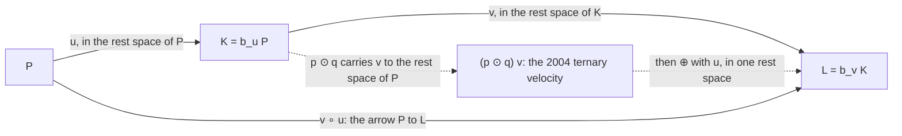

# Oziewicz's draft of November 2004: *Why Einstein's addition of velocities is non-associative?*

> A summary of an unpublished draft that is not available to the reader. It is the earliest full statement found so far of what Oziewicz later called ternary velocity, and it already holds the binary velocity, the associative addition, the many zero velocities, the algebra of observers and the condition `P ∧ A ∧ B = 0`. Its ternary velocity is not the boost-link of 2005 and 2007. The formulas hold: 67 exact checks pass, and the one failure is a side remark in (9.6). Its conclusions go further than its formulas, because the two additions it contrasts are related by a boost (its own Theorem 9.1) and everything in it is built from the metric.

**Status.** Supplement (summary of an unpublished draft, not a ladder step). Companion
script: [`src/verify_velocity_draft.py`](../src/verify_velocity_draft.py). Requested by
Bill Page, 2 November 2026, after step 2 found that the draft matters. The draft is
`velocity.pdf`, "Preliminary draft", 22 November 2004, 25 pages, which he supplied on
Drive; it was read in full, and pages 13, 15,
16 and 19 were checked as images where the extracted text was doubtful. It is not
committed here and is not known to be public. **Every statement of what the draft says
is a reading.** A reader who cannot see the draft should treat this as one reader's
account of it, not as a substitute for it. Drafted with Claude (Anthropic) and subject
to review.
[PDF](https://github.com/billpage/oziewicz/releases/latest/download/velocity_draft.pdf)

Notation follows [`analysis/ternary_mass_centre.md`](../analysis/ternary_mass_centre.md),
step 2: `v_PQ` is the binary velocity, which the draft writes with the symbol varpi and
calls the velocity-morphism; `p` is the idempotent of the body `P`; `c = 1`; signature
`(-,+,+,+)`. Section, equation and theorem numbers are the draft's.

---

## 1. The draft

It carries four titles, one under another: *Why Einstein's addition of velocities is
non-associative? How do you add velocities when time is relative? Addition of velocities
without the Lorentz group. Special relativity without the Lorentz group.* The second is
close to his "How do you add relative velocities?" of 2005 (*Group Theoretical Methods in
Physics*), which is cited in Oziewicz (2007), so this may be an early form of that paper;
the two were not compared (open item VD-SP1). Its acknowledgments thank Jerzy Kocik, Marek
Oziewicz and Bill Page for English corrections, and Jerzy Kocinski, Bill Page and Leopold
Halpern for discussion.

The public paper closest in subject that was found is Oziewicz, "The Lorentz Boost-Link is
Not Unique" (2006), [arXiv:math-ph/0608062](https://arxiv.org/abs/math-ph/0608062), of
which only the title page was read for this note.

---

## 2. The argument, section by section

**§1. Observer-independence and Lorentz invariance.** The relative velocity is the
subject. Since 1905 a change of massive observer has been taken to be a `g`-isometry, so
that observer-independence is identified with Lorentz invariance. The draft says these are
distinct. Its reason is that a boost has `(B_v)^-1 = B_{-v}`, so the inverse velocity is
reciprocal, and: "Reciprocity of frames contradicts relativity of simultaneity." It
announces that velocities parameterizing boosts are reciprocal only if they are ternary,
and that "the actual boost given in terms of the binary relative velocity can not be an
isometry".

**§2. Einstein addition.** The Einstein-Fock formula (2.1) is non-commutative, and
non-associative (Ungar). Remark 2.1: reciprocity is a tacit axiom in Einstein 1905, not a
consequence of the two postulates. Remark 2.2: an observer cannot measure the inverse
velocity, because `u` and `u^-1` are tangent to different instantaneous spaces. The
draft calls the account of non-associativity by the Thomas rotation "not satisfactory",
and says Dirac's equation removed the need for it. Tables 1 and 2 set out the contrast:
Galilean (abelian group), Einstein (loop), Lorentz-group-free (groupoid category).

**§3. Notation.** Observers and bodies are unit time-like vector fields; velocities are
space-like; `P.v = 0` is "necessary and sufficient for observing `v` by `P`". A velocity
is an arrow from observer to observed body, unique for each pair.

**§4. A Lorentz boost needs a preferred observer.** `O(3)` is not a normal subgroup of
`O(3,1)`, so a Lorentz transformation has no natural factorization into boost and
rotation. It needs a choice of `P`, whose stabiliser is the rotation group used. The word
"preferred" is defined narrowly: "To be preferred is not a property of an observer, to be
preferred is related to Lorentz boost only", and "Every observer can be chosen as
preferred". The `P`-boost is `B = id + l + l^2/(gamma + 1)`, with `l` as in (4.1). The
link equation `R = B^P_v Q`, `P.v = 0`, has a unique solution, (4.6)-(4.7), and it is
reciprocal.

**§5. Einstein addition from boosts.** `B_u B_v` is a `P`-boost up to a Thomas-Wigner
rotation (5.1), and `v ⊕ u` is defined by `B_{v⊕u} P = B_u B_v P`. This gives the
Silberstein identity (5.7) and the formula (5.8). The Lorentz `P`-boost is not a
homomorphism from `⊕` to composition.

**§6. The Lorentz-group-free boost.** `b_u P = gamma_u (u + P)` when `P.u = 0`, and
`b_u P = P` otherwise (6.4). It acts on bodies only, and it is not an isometry: for `Q`, `R`
orthogonal to `u`, (6.5) gives
`(b_u Q).(b_u R) - Q.R = -(gamma_QR - 1)(gamma_u^2 - 1)`.

**§7. Associative addition.** Take `P`, `K = b_u P`, `L = b_v K`. The velocity of `L`
relative to `P` is `v ∘ u`. Here `u` lies in the rest space of `P` and `v` in that of `K`,
so `P.v = -v.u`. Table 4 gives it in three forms, and Lemma 7.1 gives
`gamma_{v∘u} = gamma_v (gamma_u + v.u)`. Theorem 7.5 proves associativity: both bracketings
end at one body, so they are one velocity.

**§8. The inverse.** Each body has its own zero velocity. Theorem 8.1: the `∘`-inverse
of `v` is `-B^P_v v = -gamma v - (gamma - 1/gamma) P`, with properties (ii)-(iv).

**§9. How the two additions are related.** An idempotent `p ⊙ q` (9.1) carries the rest
space of `Q` isometrically to that of `P`. Theorem 9.1 then gives

```math
v\circ_P u=\bigl\{(\odot^{P}_{u})\,v\bigr\}\oplus_P u,\qquad
v\oplus_P u=\bigl\{(B^{P}_{u})\,v\bigr\}\circ_P u .
```

"The associative composition of binary velocities gives (numerically) the same result as
the Einstein ⊕-addition of ternary velocities for a preferred observer."

**§10. The algebra of observers.** Idempotents `p, q, ...` with relation (10.1) generate a
unital trace-class algebra; `gamma` is primary and the velocity secondary, with
`tr(pq) = gamma^2` (10.3). Theorem 10.3: `p ⊙ q` is the unique idempotent in the algebra of
two observers that is a partial isometry from `ker q` to `ker p`.

**§11. The velocity-morphism and the ternary velocity.** `v_PQ = Q/gamma - P` (11.4), or
as a nilpotent traceless operator `qp/tr(pq) - p` (11.6). **Definition 11.2:** the ternary
velocity of `b` relative to `q` as seen by `p` is `(p ⊙ q) v_qb`, the binary velocity
carried to the rest space of `P`. Theorem 11.3 writes it as a subtraction of velocities.
**Definition 11.4:** a *reciprocal* ternary velocity is a `p`-dependent Lorentz-boost-link.
**Theorem 11.5:** `p` is reciprocal for `a, b` if and only if `P ∧ A ∧ B = 0`, and then the
velocity is `[b, a] P / tr(ab)`, (11.10). The equivalent condition is
`tr(ab + bp + pa - 2abp) = 1`. The Galilean limit gives `[b, a] -> b - a`.

**§12. Coordinates.** (12.2) is the textbook subtraction of collinear velocities.

**§13. Addition of ternary velocities.** Definition (13.3) defines `⊕` through `∘`, for the
simple case of (11.9), and Theorem 13.1 says that this is the Einstein-Fock formula.
Definition 13.2 proposes a generalized addition for an arbitrary eagle, which need not be
Einstein's.

**§14. Conclusions.** The Lorentz transformations cannot be derived without the tacit
reciprocity axiom, which "does not agree with the relativity of time". In `v ⊕ u` the second
velocity is not genuinely measured by the body it is supposed to be measured by: it is a
ternary velocity, or the velocity of a fictional "ghost" body relative to the laboratory.
The draft closes by suggesting that many-body problems "could be formulated in terms of the
associative ∘-addition of velocities without Lorentz/Poincaré invariance/covariance".

---

## 3. The structure in one picture



The solid arrows are the groupoid, and the dashed path is Einstein's addition. Both end at
`L`. That is the content of Theorem 9.1.

*Analogy.* Two legs of a journey are drawn on two different maps. `∘` joins them as a
journey from one town to another. `⊕` first lays the second map on the first, and then adds
arrows on one sheet. The destination is the same, and the only work is in laying one map on
the other, which is the boost.

---

## 4. What was checked

`PYTHONPATH=src python3 -u src/verify_velocity_draft.py` ends with `ALL CHECKS PASSED`.
There are 67 checks, all exact (SymPy, rational vectors in 1+3 dimensions). They test the
draft on chosen cases: they are not proofs of the general statements.

| Part | Draft | Result |
|---|---|---|
| A | (2.3), (2.4), §2 (i), (4.1)-(4.5), Lemma 4.1, (5.4), Definition 5.1, (5.7), (7.4) | hold |
| B | (7.3), Lemma 7.1, Table 4 with its side conditions, (7.6)-(7.8), (7.11), (7.12), Theorem 7.5 | hold |
| C | Theorem 8.1 (i)-(iv), Exercise 8.2 | hold |
| D | (9.1)-(9.5), Theorem 9.1 | hold |
| D | (9.6) | the composition holds with `B^K_v`; the side remark does not (below) |
| E | (6.5), (10.5), (10.6), (11.5)-(11.11), Theorem 11.5, (12.2) | hold |

**One failure.** (9.6) adds "where `B^P_{⊙v} = B^K_v`", with `K = b_u P`. As operators these
are boosts at different bodies and they differ, and `B^P_{⊙v}` does not carry `K` to `L`.
What is true is `B^K_v B^P_u P = L`, which is what the text needs. The difference is the
Thomas-Wigner rotation that the section's own (5.1) records.

**Conventions worth recording.** The draft's square of a blade is the Gram determinant,
`(a∧b)^2 = det(a_i.a_j)`, not the Clifford square: §2 (i) and Theorem 8.1 (ii) need this
sign. Step 2 first read it the other way (§7 below). In (11.9) the expression
`(p - a)^2 + tr(ap) - 1` is an operator acting on `B`. In the Maple determinants of November
2004 "`pq`" stands for `gamma_pq`, whereas here `tr(pq) = gamma^2`.

Slips of notation only: (9.2) prints `R.u` with a lower-case `u` in its last term, and the
number 13.1 is used for both a definition and a theorem.

---

## 5. Where its claims stand

| Claim in the draft | Standing |
|---|---|
| Reciprocity contradicts the relativity of simultaneity (§1, §8) | Not as stated. `v_AB` and `v_BA` lie in different rest spaces, and the boost carries one to minus the other. That is MC1 part 3, and it is the draft's own Theorem 8.1 (i) |
| A boost needs a preferred observer (§4) | True of the factorization of a general Lorentz transformation, and the origin of the no-go theorem TV6. A boost from `A` to `B` in their own plane needs no third body: any `P` in the plane gives it (TV1) |
| The binary boost cannot be an isometry (§1) | True of `b_u`, which applies one `u` to all bodies orthogonal to it (6.5). Not true of `L_{A∧gamma v_AB}`, which is an isometry (MC1). The word "boost" names two maps |
| Associative addition (Theorem 7.5) | True, for the reason its proof gives: the arrow is fixed by its two end bodies. This is MC2 |
| Observer-independence and Lorentz invariance are distinct (§1, §14) | Not shown. The metric is assumed throughout, and it fixes the Lorentz group (MC2). Theorem 9.1 turns each addition into the other by a boost, so the draft proves a translation, not a second theory |
| A finite limiting velocity need not be assumed (§3, §11) | The bound follows from `P^2 = Q^2 = -1`, so it is assumed in the metric and the normalization (`bodies_first.md`, RV1) |
| Thomas rotation is not needed (§2) | Not supported: see `bodies_first.md` §6. It is the rotation in (5.1), and TV6 and TV7 show it cannot be removed |
| Many-body problems without Lorentz invariance (§14) | A programme. *Many-body mass-centre* is its continuation, and step 1 finds that the result is standard relativity |

What stands, and is his, is the coordinate-free treatment: velocity as a relation between
two bodies, the rest space of each body, the many zeros, and the explicit preferred observer
in the Einstein formula. The observation of §14 is correct and clarifying: in `v ⊕ u` all
velocities are taken in one rest space, so `v` is not what the moving body measures.

---

## 6. What later work kept and changed

| Draft (2004) | Later |
|---|---|
| Ternary velocity = binary velocity carried to `P` (Def. 11.2), same speed as binary, reciprocal only in the plane | Replaced by the boost-link, solved for every `P`, always reciprocal, slower (slides 2005, *Ternary* 2007). Step 2 keeps them apart: TV10 |
| Boost-link means reciprocal, so it exists only in the plane (Def. 11.4) | *The Lorentz Boost-Link is Not Unique* (title, 2006); link for every `P` |
| Theorem 11.5: reciprocity iff `P ∧ A ∧ B = 0` | *Ternary* Theorem 2.5: `gamma_ternary = gamma_binary` iff coplanar. Different statements with one condition |
| "Every observer can be chosen as preferred" (§4) | *Ternary* Main conclusion 2.6 says a preferred system contradicts the relativity principle. The 2004 wording is the milder, and in the reading of step 2 the more accurate |
| `b_u`, "Lorentz-group-free boost" | Returns as the boost-split of the 2012 draft *On center-of-mass* (Clarification 1.5: "Why boost-split is not isometry?") |
| Algebra of observers with unit | *Relativity groupoid* (2007); step 1, MC6 |
| Velocity addition (7.3), Table 4 | *Relativity groupoid* Theorem 7.1 |
| Ghost body | Still there in the email of 13 October 2005, for the exterior observer |

---

## 7. What this changes in the notes

- **Step 2, §8.** Read the wedge square in slide 8 with the Clifford sign, and so blamed the explicit form of `alpha`. With the draft's Gram sign the two forms agree, and the sign of `alpha` is wrong in the theorem of slide 8 and in slide 9. Corrected there.
- **Step 2, TV10.** The symbol is `p ⊙ a`. Corrected there.
- **Step 1, MC1 part 3.** "The boost carries `v_XY` to `-v_YX`" is in the draft as Theorem 8.1 (i). The credit is noted in `analysis/INDEX.md`.
- **Step 2, §6.** The remark that the claim about isometry comes from `b_u` is confirmed by §1 and §6 of the draft.

---

## 8. Open items

- **VD-SP1.** Compare the draft with the published "How do you add relative velocities?" (2005), which was not found online. Does the published text keep Definition 11.2 and Theorem 11.5?
- **VD-SP2.** Definition 13.2 proposes a generalized addition for an arbitrary eagle, and §13 says a full analysis "will be published elsewhere". Was it, and what does it become in terms of the based lift of TV7?

---

## References

- Z. Oziewicz, *Why Einstein's addition of velocities is non-associative?* and three further titles, preliminary draft, 22 November 2004 (`velocity.pdf`). Unpublished; not linked.
- Z. Oziewicz, "How do you add relative velocities?", in G. S. Pogosyan, L. E. Vicent and K. B. Wolf (eds.), *Group Theoretical Methods in Physics* (Institute of Physics, Bristol 2005), as cited in Oziewicz (2007). Not read.
- Z. Oziewicz, "The Lorentz Boost-Link is Not Unique: Relative velocity as a morphism in a connected groupoid category of null objects", [arXiv:math-ph/0608062](https://arxiv.org/abs/math-ph/0608062).
- Z. Oziewicz, "Relativity groupoid, instead of relativity group", [arXiv:math/0608770](https://arxiv.org/abs/math/0608770).
- Z. Oziewicz, "Ternary relative velocity; astonishing conflict of the Lorentz group with relativity", [arXiv:1104.0682](https://arxiv.org/abs/1104.0682).
- D. E. Fahnline, "A covariant four-dimensional expression for Lorentz transformation", *Am. J. Phys.* 50 (1982) 818-821; C. B. van Wyk, "Lorentz transformations in terms of initial and final vectors", *J. Math. Phys.* 27 (1986) 1311-1314; A. A. Ungar, *Beyond the Einstein Addition Law and its Gyroscopic Thomas Precession* (Kluwer, 2001). As cited in the draft; not re-checked.
